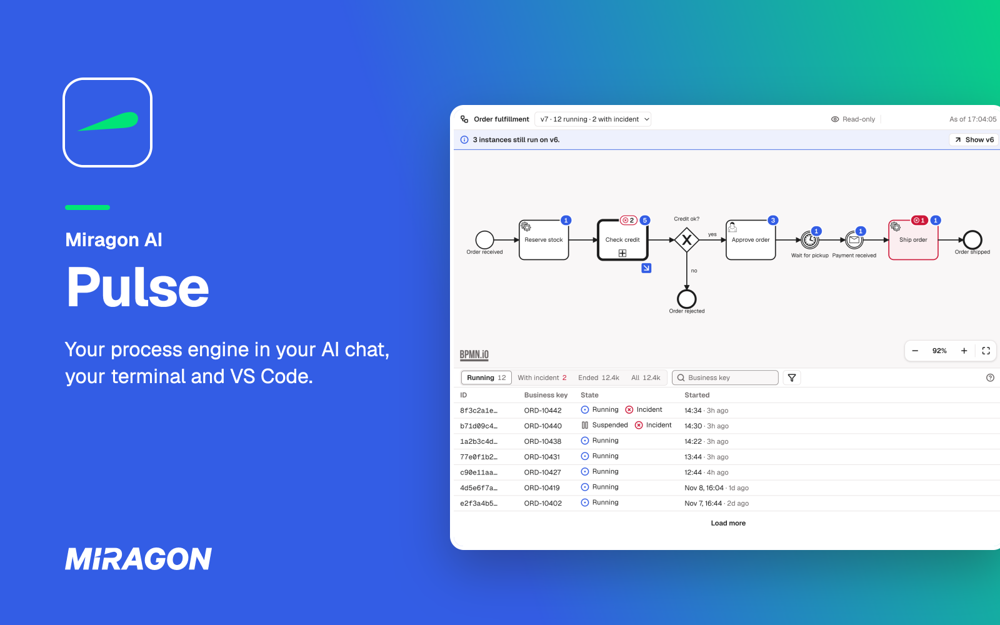

# Pulse

[](https://www.npmjs.com/package/@miragon/pulse-cli)
[](https://marketplace.visualstudio.com/items?itemName=miragon-gmbh.pulse-cockpit)
[](https://open-vsx.org/extension/miragon-gmbh/pulse-cockpit)
[](https://github.com/Miragon/pulse/pkgs/container/pulse-server)
[](https://github.com/Miragon/pulse/actions/workflows/ci.yml)
[](LICENSE)



Pulse shows you why a process instance on your Camunda 7, CIB seven or Operaton engine is stuck,
and lets you fix it from your AI chat, your terminal or VS Code. Below 1.0: pin the version
([changelog](CHANGELOG.md)).

## Why

Finding out why an order is stuck usually means a cockpit, a few REST calls and a log. Pulse
brings the engine to where you already work.

## What you get

- **One question, one answer.** Ask why an order is stuck and get the incident, the diagram and
  the root cause.
- **Your whole fleet.** Several engines side by side: profiles in the CLI and VS Code, a default
  engine and an override per question in your AI chat.
- **Safe by default.** In your AI chat Pulse only reads until you allow more, the CLI previews a
  change with `--dry-run`, and VS Code changes only a local engine until you allow more.
- **Analytics without the engine database.** Process KPIs, bottlenecks and engine comparisons come
  from Prometheus, fed by a small [metrics plugin](engine-plugins/README.md) in the engine.


## The clients

Three clients work on the same engines; pick the one that fits where you work.

| Client                                  | Where it runs                            | Install                                                                                                                                                                                   | Status  |
| --------------------------------------- | ---------------------------------------- | ----------------------------------------------------------------------------------------------------------------------------------------------------------------------------------------- | ------- |
| [MCP server](apps/mcp-server/README.md) | Claude, ChatGPT and other AI assistants  | [`ghcr.io/miragon/pulse-server`](https://github.com/Miragon/pulse/pkgs/container/pulse-server)                                                                                            | Pre-1.0 |
| [CLI](apps/cli/README.md)               | Your terminal, scripts and coding agents | [npm](https://www.npmjs.com/package/@miragon/pulse-cli) · Homebrew `miragon/tap/pulse-cli` · [executables for Linux, macOS and Windows](https://miragon.github.io/pulse/cli/installation) | Pre-1.0 |
| [VS Code](apps/vscode/README.md)        | VS Code 1.101+, and editors on Open VSX  | [Marketplace](https://marketplace.visualstudio.com/items?itemName=miragon-gmbh.pulse-cockpit) · [Open VSX](https://open-vsx.org/extension/miragon-gmbh/pulse-cockpit)                     | Early   |

## Get started

Try Pulse in your AI chat on the hosted playground, a seeded CIB seven engine that is read-only
and needs no login. In Claude Code:

```sh
claude mcp add --transport http pulse https://pulse-playground.miragon.ai/mcp
```

Then ask _"Which processes have open incidents right now?"_. Other assistants and your own engine:
[Get started](https://miragon.github.io/pulse/mcp/getting-started). In the terminal, start with
[the CLI](apps/cli/README.md#get-started); in VS Code, with [the extension](apps/vscode/README.md#get-started).

## With your AI assistant

The Claude Code plugin teaches Claude to use the CLI whenever a task touches an engine:

```text
/plugin marketplace add Miragon/pulse
/plugin install pulse-cli@pulse
```

## Help and feedback

- **Documentation:** every client, setup step and option is explained at [miragon.github.io/pulse](https://miragon.github.io/pulse/).
- **Bugs and ideas:** found a bug or missing something? [Open an issue](https://github.com/Miragon/pulse/issues).
- **Your own server:** modules for your own systems next to Pulse's start from the [Pulse starter](https://github.com/Miragon/pulse-starter).
- **Product page:** Pulse is part of [Miragon AI](https://miragon.ai/tools/pulse/).

## Contributing

Pull requests are welcome. How to build, test and release Pulse is in [CONTRIBUTING.md](CONTRIBUTING.md).

## License

[MIT](LICENSE) © Miragon GmbH
