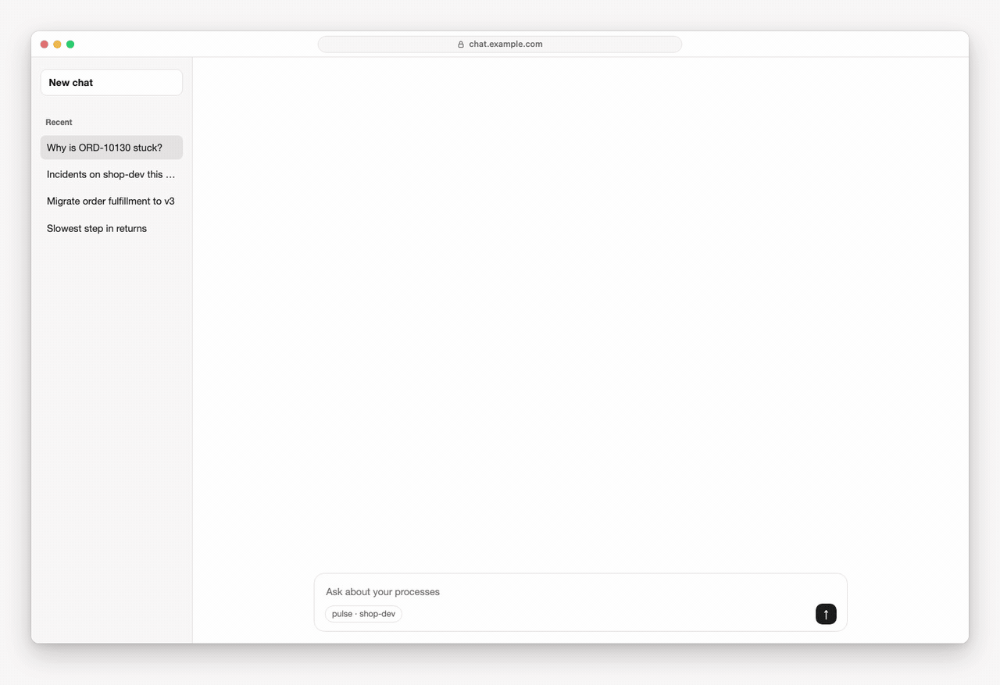

# Pulse

[](https://github.com/Miragon/pulse/releases)
[](https://github.com/Miragon/pulse/actions/workflows/ci.yml)
[](https://www.npmjs.com/package/@miragon/pulse-cli)
[](https://github.com/Miragon/pulse/pkgs/container/pulse-server)
[](https://miragon.github.io/pulse/)
[](LICENSE)

Operate and analyse your **Camunda 7, CIB seven and Operaton** engines from where you already
work: your AI chat, your terminal and VS Code. Pulse is part of [Miragon AI](https://miragon.ai/),
the family of Miragon's AI tools.



## Why

Finding out why a process instance is stuck usually means a cockpit, a few REST calls and a log.
Pulse brings the engine to you instead:

- **One question, one answer.** Ask your assistant why an order is stuck; it opens the incident,
  the diagram and the root cause in the chat. No tab hunting, no PromQL.
- **Every engine of your fleet.** CIB seven, Operaton and Camunda 7 side by side, grouped by
  environment, with a default engine per person and an override per call.
- **Safe by default.** The server starts read-only; writes need OAuth or an explicit toolset, and
  deployments a flag of their own. The CLI previews any change with `--dry-run` and asks before it
  deletes.
- **Analytics without the engine database.** Process KPIs, bottlenecks and engine comparisons come
  from Prometheus, fed by a small metrics plugin in the engine.
- **Self-hosted.** One container image, public npm packages, MIT licensed.

## Three ways in

| Where         | What it is                                                                 | Get it                                                                                   |
| ------------- | -------------------------------------------------------------------------- | ---------------------------------------------------------------------------------------- |
| Your AI chat  | An MCP server with interactive widgets for Claude, ChatGPT and other hosts | `docker run ghcr.io/miragon/pulse-server` ([README](apps/mcp-server-camunda7/README.md)) |
| Your terminal | `pulse-cli`: every engine operation as a command, for people and agents    | `npm install -g @miragon/pulse-cli` ([README](apps/cli/README.md))                       |
| VS Code       | Runtime data next to your BPMN models: incidents, variables, retries       | Early prototype: [build the `.vsix`](docs/vscode/installation.md) from source            |

## Quick start: the MCP server

Try it without installing anything: [connect your Claude to the public playground](docs/mcp/getting-started.md).
To run it on your own engine:

```bash
docker run --rm -p 127.0.0.1:8400:8400 \
  -e CAMUNDA_BASE_URL=http://host.docker.internal:8080/engine-rest \
  -e CAMUNDA_ENGINE_FLAVOR=operaton \
  -e PROMETHEUS_URL=http://host.docker.internal:9090 \
  ghcr.io/miragon/pulse-server:latest

claude mcp add --transport http pulse http://localhost:8400/mcp
```

Then ask _"Which incidents are open, and why?"_. Without `MCP_OAUTH` the server runs read-only;
the boot log names the toolset of each module. Writes, OAuth, several engines and every variable:
[Operations](docs/mcp/operations.md) and [Reference](docs/mcp/reference.md).

<picture>
  <source media="(prefers-color-scheme: dark)" srcset="docs/assets/widget-incident-dark.png">
  
</picture>

## What's in this repository

| Path                                                                                                      | Package                                   | Role                                                         |
| --------------------------------------------------------------------------------------------------------- | ----------------------------------------- | ------------------------------------------------------------ |
| [`apps/mcp-server-camunda7/`](apps/mcp-server-camunda7)                                                   | `ghcr.io/miragon/pulse-server`            | The MCP server: composes the modules, serves HTTP on `:8400` |
| [`apps/cli/`](apps/cli)                                                                                   | `@miragon/pulse-cli`                      | The command line interface                                   |
| [`apps/vscode/`](apps/vscode)                                                                             | `pulse-vscode` (a .vsix)                  | Pulse for VS Code                                            |
| [`packages/connectors/camunda/camunda7-connector/`](packages/connectors/camunda/camunda7-connector)       | `@miragon/pulse-camunda7-connector`       | Operations tools and widgets for Camunda 7 engines           |
| [`packages/connectors/analytics/analytics-connector/`](packages/connectors/analytics/analytics-connector) | `@miragon/pulse-analytics-connector`      | Prometheus-backed analytics tools and dashboards             |
| [`packages/connectors/camunda/camunda7-client/`](packages/connectors/camunda/camunda7-client)             | `@miragon/pulse-camunda7-client`          | Typed REST SDK for the engine, with Zod input schemas        |
| [`packages/connectors/analytics/analytics-client/`](packages/connectors/analytics/analytics-client)       | `@miragon/pulse-analytics-client`         | Prometheus client, PromQL queries and the metrics contract   |
| [`packages/core/widget-shell/`](packages/core/widget-shell)                                               | `@miragon/pulse-widget-shell`             | Shared widget kit and server boot for composed MCP servers   |
| [`engine-plugins/`](engine-plugins)                                                                       | `io.miragon.mcp:cibseven-history-metrics` | Micrometer metrics plugin for the engine (Java 21)           |
| [`playground/`](playground)                                                                               | —                                         | Demo engine, Compose stack and the public playground         |
| [`templates/composed-server/`](templates/composed-server)                                                 | `Miragon/pulse-starter`                   | Starter for your own server with your own connector          |

## Documentation

The docs site, [miragon.github.io/pulse](https://miragon.github.io/pulse/), is built from [`docs/`](docs/README.md):

- [Getting started](docs/mcp/getting-started.md): connect your Claude to the playground, then run it on your own engine
- [Usage](docs/mcp/usage.md): connect an assistant and what to ask
- [Reference](docs/mcp/reference.md): every tool, the toolsets and the common settings
- [Operations](docs/mcp/operations.md): the image, security, environment variables, health routes
- [Architecture](docs/mcp/architecture.md): the server, its modules and the systems they talk to
- [Developer guide](docs/mcp/developer.md): run the stack from source, build your own server
- [CLI](https://miragon.github.io/pulse/cli/): install, commands, configuration, AI agents

The product page is [miragon.ai/tools/pulse](https://miragon.ai/tools/pulse/).

## Development

```bash
pnpm install --frozen-lockfile
docker compose -f playground/docker/docker-compose.yml up -d   # CIB seven, OTEL, Prometheus, Grafana
cp .env.example .env
pnpm dev                                                        # MCP server on :8400, inspector at /mcp/inspector
pnpm build && pnpm typecheck && pnpm test && pnpm lint          # the bar for every change
```

Details: [developer guide](docs/mcp/developer.md); the rules for code changes are in [`CLAUDE.md`](CLAUDE.md).

## Renamed from miragon-ai

Up to 0.20.0 this server shipped as "Miragon AI" from `Miragon/miragon-ai`. From 0.21.0 on,
everything it ships carries the Pulse name:

- npm: `@miragon-ai/<name>` becomes `@miragon/pulse-<name>` for `widget-shell`,
  `camunda7-client`, `camunda7-connector`, `analytics-client` and `analytics-connector`; subpaths
  (`/server`, `/widgets` …) stay. Rename the dependencies and the import specifiers, one version
  across all five. The old packages are deprecated with a pointer to the new name, and update bots
  do not follow a rename, so switch by hand.
- Docker image: `miragon/miragon-ai-server` on Docker Hub becomes `ghcr.io/miragon/pulse-server`
  on the GitHub Container Registry; the old image stays on Docker Hub, frozen at 0.20.0.
- Starter: `Miragon/miragon-ai-starter` becomes
  [`Miragon/pulse-starter`](https://github.com/Miragon/pulse-starter).
- Playground: `https://pulse-playground.miragon.ai/mcp`; the old `fly.dev` URL keeps answering.
- MCP client key: the examples register the server as `pulse` (was `miragon-ai`; this repo's
  `.mcp.json` used `automation-mcp`), and it introduces itself as `pulse`; its log lines start
  with `[pulse]`. In Claude Code the key is the tool prefix: allowlists and hooks on
  `mcp__miragon-ai__*` or `mcp__automation-mcp__*` need `mcp__pulse__*`.
- Engine access logs: the client's User-Agent is `@miragon/pulse-camunda7-client/<version>` (was
  `@miragon-ai/camunda7-client/0.1.0`).
- Local Keycloak (`--profile auth`): the pre-registered client is `pulse-server` with secret
  `pulse-secret`; recreate the container to re-import the realm.
- Repo: GitHub redirects the old URL; `git remote set-url origin git@github.com:Miragon/pulse.git`
  updates a clone. The local Compose stack runs as project `pulse` now, so stop an old one first
  ([`playground/`](playground/README.md#run-locally)).

## Releases

[release-please](https://github.com/googleapis/release-please) releases everything together:
semantic commits on `main` open a release PR, and merging it publishes the server image, the npm
packages, the CLI (npm, binaries, image, Homebrew `miragon/tap/pulse-cli`) and the engine plugin
(Maven Central). The VS Code extension is packaged too, but not published yet.

## Contributing

Issues, pull requests and discussions are welcome on [GitHub](https://github.com/Miragon/pulse).
Use [semantic commit messages](https://www.conventionalcommits.org/) (they drive the release) and
keep `pnpm build && pnpm typecheck && pnpm test && pnpm lint` green.

## License

[MIT](LICENSE) © Miragon GmbH
