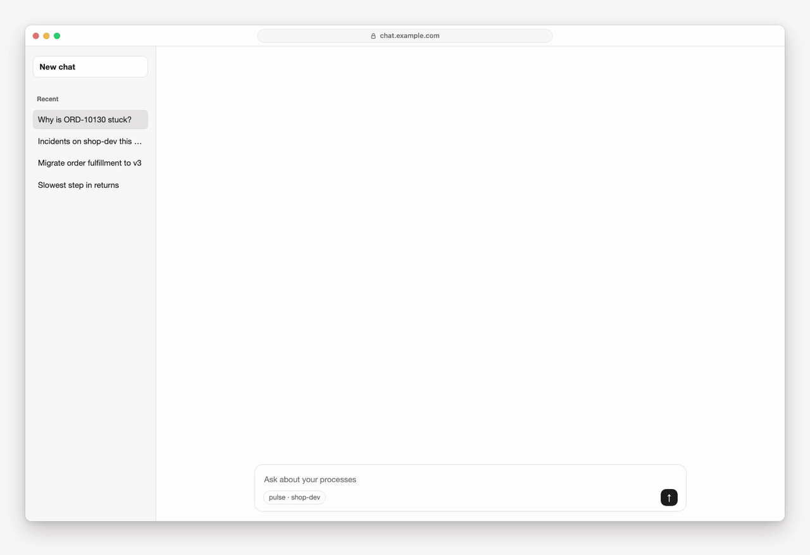

# Pulse

[](https://github.com/Miragon/pulse/releases)
[](https://github.com/Miragon/pulse/actions/workflows/ci.yml)
[](https://www.npmjs.com/package/@miragon/pulse-cli)
[](https://github.com/Miragon/pulse/pkgs/container/pulse-server)
[](https://miragon.github.io/pulse/)
[](LICENSE)

> [!IMPORTANT]
> Pulse is below 1.0.0, so its API is not stable: tools, settings, metric names, CLI commands and
> the exports of the `@miragon/pulse-*` packages can change in any release. The
> [changelog](CHANGELOG.md) lists every breaking change. Pin exact versions and update all
> `@miragon/pulse-*` packages together.

Pulse brings your **Camunda 7, CIB seven and Operaton** engines to where you already work. One
idea, three clients on the same engines:

- **Your AI chat:** an MCP server that answers with interactive views of incidents, instances and
  diagrams, in Claude, ChatGPT and other hosts.
- **Your terminal:** `pulse`, every engine operation as one short command, for people and AI
  agents alike.
- **VS Code:** runtime data next to your BPMN models: instances, incidents, variables and retries.

Pulse is part of [Miragon AI](https://miragon.ai/), the family of Miragon's AI tools.



## Why

Finding out why a process instance is stuck usually means a cockpit, a few REST calls and a log.
Pulse brings the engine to you instead:

- **One question, one answer.** Ask why an order is stuck and get the incident, the diagram and
  the root cause, in the chat, in one command or next to the model.
- **Every engine of your fleet.** CIB seven, Operaton and Camunda 7 side by side, with a default
  engine and an override per call.
- **Safe by default.** The MCP server starts read-only, the CLI previews a change with `--dry-run`
  and asks before it deletes, and VS Code writes only to a local engine unless you allow more.
- **Analytics without the engine database.** Process KPIs, bottlenecks and engine comparisons come
  from Prometheus, fed by a small metrics plugin in the engine.
- **Self-hosted and open.** One container image, public npm packages, MIT licensed.

## Get started

| Client        | Install                                                                     | Read on                                                                         |
| ------------- | --------------------------------------------------------------------------- | ------------------------------------------------------------------------------- |
| Your AI chat  | `docker run ghcr.io/miragon/pulse-server`, or try the public playground     | [Server README](apps/mcp-server/README.md), [docs](docs/mcp/getting-started.md) |
| Your terminal | `npm install -g @miragon/pulse-cli` or `brew install miragon/tap/pulse-cli` | [CLI README](apps/cli/README.md), [docs](docs/cli/getting-started.md)           |
| VS Code       | Pulse from the Marketplace or Open VSX (early prototype)                    | [Extension README](apps/vscode/README.md), [docs](docs/vscode/installation.md)  |

No engine at hand? [Connect your Claude to the public playground](docs/mcp/getting-started.md), or
start one locally with `docker run -p 8080:8080 operaton/operaton:2.1.5`.

## What's in this repository

| Path                                                                                                      | Package                                   | Role                                                         |
| --------------------------------------------------------------------------------------------------------- | ----------------------------------------- | ------------------------------------------------------------ |
| [`apps/mcp-server/`](apps/mcp-server)                                                                     | `ghcr.io/miragon/pulse-server`            | The MCP server: composes the modules, serves HTTP on `:8400` |
| [`apps/cli/`](apps/cli)                                                                                   | `@miragon/pulse-cli`                      | The command line interface                                   |
| [`apps/vscode/`](apps/vscode)                                                                             | `pulse-cockpit` (a .vsix)                 | Pulse for VS Code                                            |
| [`packages/connectors/engine/engine-connector/`](packages/connectors/engine/engine-connector)             | `@miragon/pulse-engine-connector`         | Operations tools and widgets for Camunda 7 engines           |
| [`packages/connectors/analytics/analytics-connector/`](packages/connectors/analytics/analytics-connector) | `@miragon/pulse-analytics-connector`      | Prometheus-backed analytics tools and dashboards             |
| [`packages/connectors/engine/engine-client/`](packages/connectors/engine/engine-client)                   | `@miragon/pulse-engine-client`            | Typed REST SDK and client for the engine                     |
| [`packages/connectors/engine/engine-core/`](packages/connectors/engine/engine-core)                       | `@miragon/pulse-engine-core`              | Camunda 7 workflow domain and pure engine REST rules         |
| [`packages/connectors/analytics/analytics-client/`](packages/connectors/analytics/analytics-client)       | `@miragon/pulse-analytics-client`         | Prometheus client, PromQL queries and the metrics contract   |
| [`packages/core/ui/`](packages/core/ui)                                                                   | `@miragon/pulse-ui`                       | Design kit for Pulse views and your own React UIs            |
| [`packages/core/widget-shell/`](packages/core/widget-shell)                                               | `@miragon/pulse-widget-shell`             | View runtime and server boot for composed MCP servers        |
| [`engine-plugins/`](engine-plugins)                                                                       | `io.miragon.mcp:cibseven-history-metrics` | Micrometer metrics plugin for the engine (Java 21)           |
| [`playground/`](playground)                                                                               | —                                         | Demo engine, Compose stack and the public playground         |
| [`templates/composed-server/`](templates/composed-server)                                                 | `Miragon/pulse-starter`                   | Starter for your own server with your own connector          |

## Documentation

The docs site, [miragon.github.io/pulse](https://miragon.github.io/pulse/), is built from [`docs/`](docs/README.md),
one section per client:

- [MCP server](docs/mcp/index.md): getting started, usage, every tool, operations, upgrading, architecture
- [CLI](docs/cli/index.md): install, commands, configuration, authentication, AI agents
- [VS Code](docs/vscode/index.md): installation, configuration, usage, architecture

The product page is [miragon.ai/tools/pulse](https://miragon.ai/tools/pulse/).

## Development

A fresh clone needs Node.js 22.22.2 or later, pnpm (`corepack enable`, or `npm i -g pnpm@10.32.1` on
Node.js 25 and later) and Docker; no JDK (Gradle runs in a container without one), no `.env`:

```bash
pnpm play               # installs, starts the playground, builds, MCP server on :8400, inspector at /mcp/inspector
pnpm play:cli -- ping   # the CLI against the playground engine
pnpm stack:status       # what runs; pnpm stack:up / stack:down start and stop the playground
pnpm check              # the bar for every change: build, typecheck, test, lint, format
```

Details: [developer guide](docs/mcp/developer.md); the rules for code changes are in [`CLAUDE.md`](CLAUDE.md).

## Releases

[release-please](https://github.com/googleapis/release-please) releases everything together:
semantic commits on `main` open a release PR, and merging it publishes the server image, the npm
packages, the CLI (npm, binaries, image, Homebrew `miragon/tap/pulse-cli`), the VS Code extension
(Marketplace and Open VSX) and the engine plugin (Maven Central).

## Contributing

Issues, pull requests and discussions are welcome on [GitHub](https://github.com/Miragon/pulse).
Use [semantic commit messages](https://www.conventionalcommits.org/) (they drive the release) and
keep `pnpm build && pnpm typecheck && pnpm test && pnpm lint` green.

## License

[MIT](LICENSE) © Miragon GmbH
