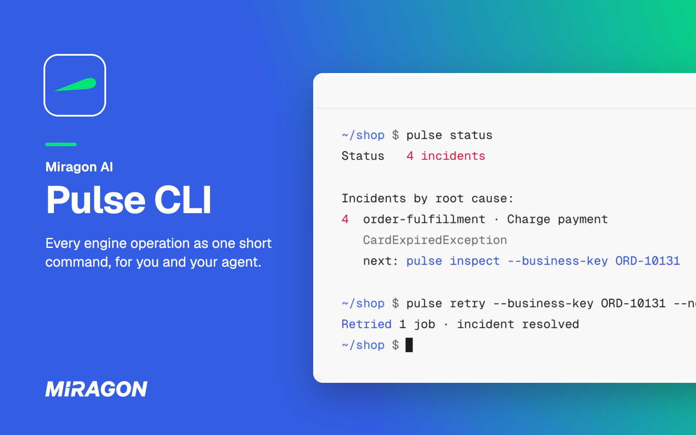
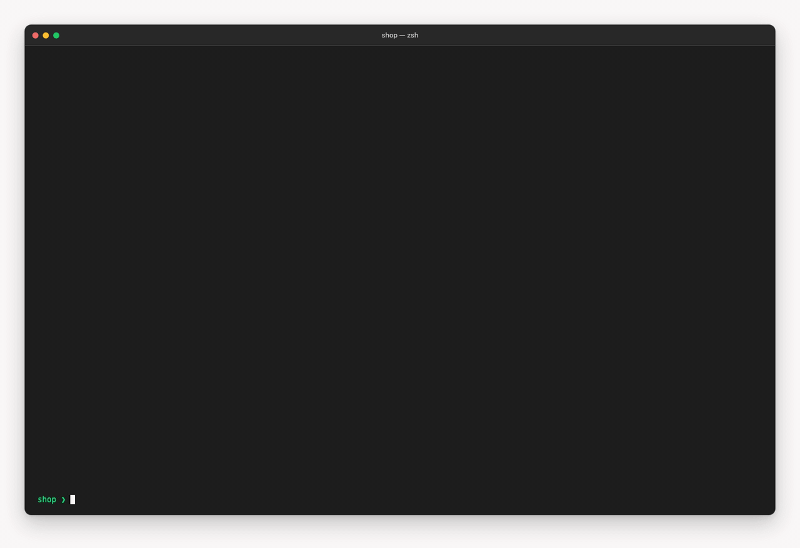

# Pulse CLI

[](https://www.npmjs.com/package/@miragon/pulse-cli)
[](https://github.com/Miragon/homebrew-tap)
[](https://github.com/Miragon/pulse/blob/main/apps/cli/LICENSE)



Run your Camunda 7, CIB seven or Operaton engine from the shell: find out why an instance is stuck,
retry it, deploy a process and move it forward, each in one short command. Built for you and for
your coding agent alike. Below 1.0: pin the version, since a release can rename a command.

Free and open source (MIT). No account and no server of its own: the CLI talks to your engine's
REST API.

## Install

The command is `pulse` (`pulse-cli` is a second name of the same program).

- **npm** (Node.js 22.12 or later): `npm install -g @miragon/pulse-cli`
- **Homebrew** (macOS, Linux): `brew install miragon/tap/pulse-cli`
- **Standalone executable** (Linux, macOS, Windows, no Node.js) or **container image**
  `ghcr.io/miragon/pulse-cli`: see [Installation](https://miragon.github.io/pulse/cli/installation),
  which also covers proxies and certificates.

## Get started

Start a local engine, then deploy a process, start an instance and complete its first task.
`order.bpmn` is any process with a user task; the [walk-through](https://miragon.github.io/pulse/cli/getting-started#your-first-process) has one.

```sh
docker run -d --name engine -p 8080:8080 operaton/operaton:2.1.5
pulse ping
pulse deploy order.bpmn --start --business-key ORD-1001 --var amount=250
pulse advance --business-key ORD-1001 --var approved=true
```

`pulse` talks to `http://localhost:8080/engine-rest` until you set up a profile for your own
engine: [Configuration](https://miragon.github.io/pulse/cli/configuration) and
[Authentication](https://miragon.github.io/pulse/cli/authentication).

## Find out why an instance is stuck



`status` triages the whole engine in one read-only call and groups its incidents by root cause.
`inspect` shows where one instance waits and why, and `retry` runs its failed job again:

```sh
pulse status
pulse inspect --business-key B-1
pulse retry --business-key B-1 --now
```

## Move a process forward

`deploy` and `advance` each combine the requests a step needs: deploy and start in one go, then
complete the task an instance waits at. `--wait` polls until the instance moves on, instead of a
`sleep` loop.

```sh
pulse deploy bpmn --start --business-key B-1 --var amount=250
pulse advance --business-key B-1 --var approved=true --wait
```

[Workflow commands](https://miragon.github.io/pulse/cli/workflow-commands) explains all six.

## Safe on real engines

Every change can be previewed with `--dry-run`, deleting needs `--yes`, and a profile marked
read-only refuses every write:

```sh
pulse config set prod --url https://camunda.example.com/engine-rest --read-only
pulse process-instance list --profile prod --with-incident
```

[Safety](https://miragon.github.io/pulse/cli/safety) covers previews, confirmations and read-only
mode.

## Every REST operation as a command

Beyond the six workflow commands, every operation of the engine's REST API is a command of its own,
and `api` sends a raw request:

| Task                           | Commands                                                                 |
| ------------------------------ | ------------------------------------------------------------------------ |
| Deploy processes and decisions | `deploy`, `deployment`, `process-definition`, `decision-definition`      |
| Start and follow instances     | `inspect`, `wait`, `process-instance`, `message`, `signal`               |
| Work on tasks                  | `advance`, `task`, `external-task`                                       |
| Find and fix what failed       | `status`, `retry`, `incident`, `job`                                     |
| Change running instances       | `migration`, `modification`, `batch`                                     |
| Look into the history          | `historic-process-instance`, `historic-task-instance` and more           |
| Administer the engine          | `user`, `group`, `tenant`, `authorization`, `metrics`, `history-cleanup` |
| Ask the CLI itself             | `guide`, `commands`, `describe`, `--help`                                |
| Set up engines and logins      | `config`, `auth`, `ping`                                                 |

On a terminal the answer is a table; for an agent or a script it is JSON, and an error is one JSON
line with a documented exit code. Everyday command lines: [Recipes](https://miragon.github.io/pulse/cli/recipes).

## Built for your AI agent

The CLI never asks a question, and it explains itself: `pulse guide` prints the usage guide, so one
line in `AGENTS.md` or `CLAUDE.md` ("Run `pulse guide` before using `pulse`") is enough. In Claude
Code, the plugin makes Claude use the CLI whenever a task touches an engine:

```text
/plugin marketplace add Miragon/pulse
/plugin install pulse-cli@pulse
```

[Using the CLI from AI agents](https://miragon.github.io/pulse/cli/agents) has the details.

## Good to know

- Works with Operaton, CIB seven and Camunda 7, not with Camunda 8: [Engines](https://miragon.github.io/pulse/cli/engines) names the tested versions.
- Logins per profile: Basic auth, OAuth and bearer tokens.
- Pulse also answers in your AI chat and in VS Code: [Pulse](https://github.com/Miragon/pulse#readme).

## Links

[Documentation](https://miragon.github.io/pulse/cli/)
·
[Changelog](https://github.com/Miragon/pulse/blob/main/CHANGELOG.md)
·
[Report an issue](https://github.com/Miragon/pulse/issues)
·
[Source and contributing](https://github.com/Miragon/pulse/blob/main/docs/cli/development.md)

Made by [Miragon](https://www.miragon.io). MIT licence; the licences of the works of others it bundles are in [THIRD_PARTY_LICENSES.txt](https://github.com/Miragon/pulse/blob/main/apps/cli/THIRD_PARTY_LICENSES.txt).
