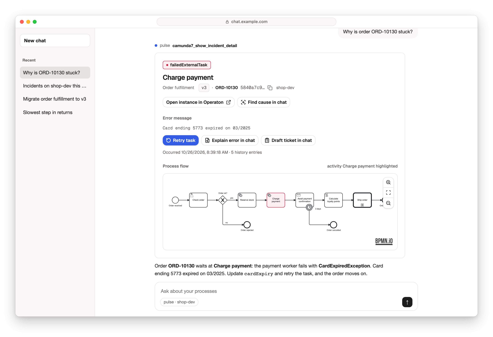
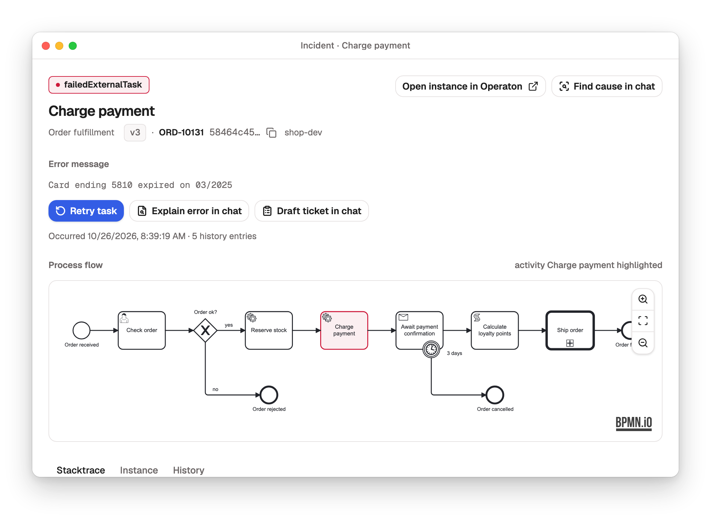

# @miragon/pulse-mcp-server-camunda7

[](https://github.com/Miragon/pulse/pkgs/container/pulse-server)
[](https://miragon.github.io/pulse/)

Ask your AI assistant about your Camunda 7, CIB seven and Operaton engines, and get the answer as
an interactive view in the chat.



## Connect

```bash
docker run --rm -p 127.0.0.1:8400:8400 \
  -e CAMUNDA_BASE_URL=http://host.docker.internal:8080/engine-rest \
  ghcr.io/miragon/pulse-server:latest
claude mcp add --transport http pulse http://localhost:8400/mcp
```

Claude Desktop, claude.ai, ChatGPT and other hosts: [Usage](../../docs/mcp/usage.md#connect-your-assistant).

Then ask _"Which incidents are open, and why?"_. Without `MCP_OAUTH` the server runs read-only;
the boot log names the toolset of each module. Writes, OAuth and several engines:
[Operations](../../docs/mcp/operations.md).

<picture>
  <source media="(prefers-color-scheme: dark)" srcset="../../docs/assets/widget-incident-dark.png">
  
</picture>

## Overview

The MCP host for [Pulse](../../README.md). It composes the `camunda7` and `analytics` modules
into a single [mcp-use](https://github.com/mcp-use/mcp-use) server, bundles every React widget into
one Vite bundle served as per-tool view resources, and serves the streamable-HTTP MCP transport on
port `8400`.

This is the deployable artifact: it ships as the Docker image
[`ghcr.io/miragon/pulse-server`](https://github.com/Miragon/pulse/pkgs/container/pulse-server).
The package itself is `private` and not published to npm.

## What it does

- **Composes modules:** loads the modules named in `MCP_ACTIVE_MODULES` (default: all) and merges
  their tools, widgets and pipeline steps. Each module runs one fail-closed toolset per boot: the
  suffix if given (`camunda7:operations`, …), otherwise read-only without `MCP_OAUTH` and its
  standard toolset (camunda7 `operations`, analytics `standard`) with it; `admin` is never implied,
  an empty or unknown suffix falls back to read-only, and the boot log states the result. The
  toolkit's dashboard builder is registered only under OAuth while no module runs read-only.
  Modules self-describe via their `src/module.ts` (`configFromEnv`, `knownEnvVars`, `bootWarnings`,
  `instructions`, plugin factory) against the app-owned port in
  [`src/module-contract.ts`](src/module-contract.ts); the app only selects modules and wires shared
  resources.
- **Bundles the widget UI:** Vite builds the two-file bundle `dist/mcp-app.js` + `dist/mcp-app.css`,
  a self-contained bundle (React, Tailwind, all widgets). mcp-use serves it behind one
  `ui://views/<tool>.html` view resource per widget tool (derived from each tool's `view` binding).
  The `dedupe` array in [`vite.config.ts`](vite.config.ts) is load-bearing: it keeps a single React /
  toolkit instance so in-widget `useCallTool()` works.
- **Serves HTTP:** streamable-HTTP MCP on `:8400/mcp`; the `mcp-use` inspector (`:8400/mcp/inspector`) ships with `mcp-use dev` only, never with the production entrypoint
  in dev.

The server is self-contained (tools + widget UI in one endpoint). Aggregating it with other MCP
servers is the job of an external MCP gateway (e.g. agentgateway) in front; there is no built-in
upstream/proxy federation.

## Run

```bash
# Published image (production) — boots read-only without MCP_OAUTH or a toolset suffix
docker run --rm -p 127.0.0.1:8400:8400 \
  -e CAMUNDA_BASE_URL=http://host.docker.internal:8410/engine-rest \
  -e PROMETHEUS_URL=http://host.docker.internal:9090 \
  ghcr.io/miragon/pulse-server:latest

# From source (local dev — needs the Docker infra; see the root README)
pnpm dev          # build:ui + mcp-use dev on :8400, inspector at /mcp/inspector
pnpm build        # build:ui (Vite widget bundle) + build:server (tsc)
pnpm start        # run the compiled server from dist/
```

Pulse assumes a Camunda 7 engine. For CIB seven or Operaton add `-e CAMUNDA_ENGINE_FLAVOR=cibseven`
(or `operaton`): it picks the engine's cockpit links and the product name the views show.

Configuration is entirely environment-driven. See
[Configuration](../../docs/mcp/reference.md#configuration), [Toolsets](../../docs/mcp/reference.md#toolsets) and
[`docs/mcp/operations.md`](../../docs/mcp/operations.md). To exercise write paths locally, set
`MCP_ACTIVE_MODULES=camunda7:admin,analytics:standard` in `.env` (plus
`CAMUNDA_ALLOW_DEPLOYMENTS=true` for deployments).

## Layout

| Path                     | Contents                                                                                                 |
| ------------------------ | -------------------------------------------------------------------------------------------------------- |
| `src/index.ts`           | Server entry: `createApp()`, then `listen()` (body cap, drain) unless `mcp-use dev` serves it            |
| `src/app.ts`             | `createApp(env, deps?)`: OAuth, persistence, plugins into the shared boot; the e2e suites boot it too    |
| `src/module-contract.ts` | App-owned port: `ModuleDefinition` + `SharedResources { profileStore, fetchBpmnXml? }`                   |
| `src/setup.ts`           | Module selection (`MCP_ACTIVE_MODULES`), env-typo warner + boot warnings from the modules, shared wiring |
| `src/ui/`                | Widget host bundle: `widget-registry.ts` (the host map) + `McpAppView` dispatcher                        |
| `vite.config.ts`         | Single-file widget bundle config (keep the `dedupe` array)                                               |
| `Dockerfile`             | Lives at the repo root; multi-stage build that produces the published image                              |

## Renamed from miragon-ai

Up to 0.20.0 this server shipped as "Miragon AI" from `Miragon/miragon-ai`. From 0.21.0 on,
everything it ships carries the Pulse name:

- npm: `@miragon-ai/<name>` becomes `@miragon/pulse-<name>` for `widget-shell`,
  `camunda7-client`, `camunda7-connector`, `analytics-client` and `analytics-connector`; subpaths
  (`/server`, `/widgets` …) stay. Rename the dependencies and the import specifiers, one version
  across all five. The old packages are deprecated with a pointer to the new name, and update bots
  do not follow a rename, so switch by hand.
- Docker image: `miragon/miragon-ai-server` on Docker Hub becomes `ghcr.io/miragon/pulse-server`
  on the GitHub Container Registry; the old image stays on Docker Hub, frozen at 0.20.0.
- Starter: `Miragon/miragon-ai-starter` becomes
  [`Miragon/pulse-starter`](https://github.com/Miragon/pulse-starter).
- Playground: `https://pulse-playground.miragon.ai/mcp`; the old `fly.dev` URL keeps answering.
- MCP client key: the examples register the server as `pulse` (was `miragon-ai`; this repo's
  `.mcp.json` used `automation-mcp`), and it introduces itself as `pulse`; its log lines start
  with `[pulse]`. In Claude Code the key is the tool prefix: allowlists and hooks on
  `mcp__miragon-ai__*` or `mcp__automation-mcp__*` need `mcp__pulse__*`.
- Engine access logs: the client's User-Agent is `@miragon/pulse-camunda7-client/<version>` (was
  `@miragon-ai/camunda7-client/0.1.0`).
- Local Keycloak (`--profile auth`): the pre-registered client is `pulse-server` with secret
  `pulse-secret`; recreate the container to re-import the realm.
- Repo: GitHub redirects the old URL; `git remote set-url origin git@github.com:Miragon/pulse.git`
  updates a clone. The local Compose stack runs as project `pulse` now, so stop an old one first
  ([`playground/`](../../playground/README.md#run-locally)).
