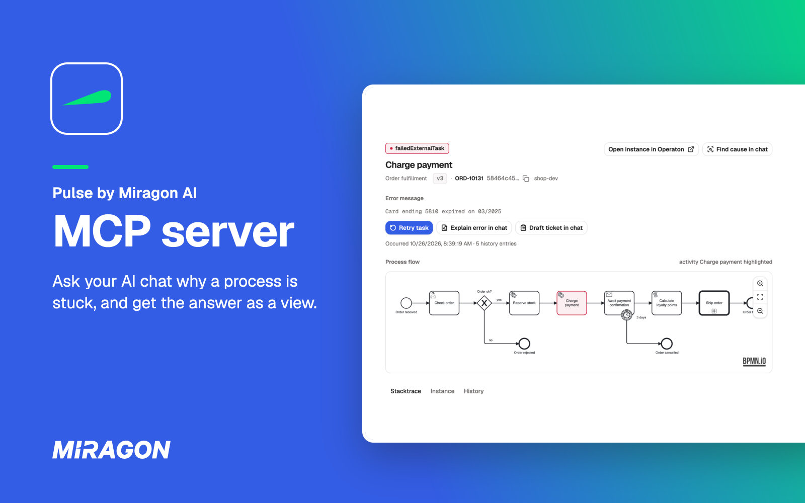
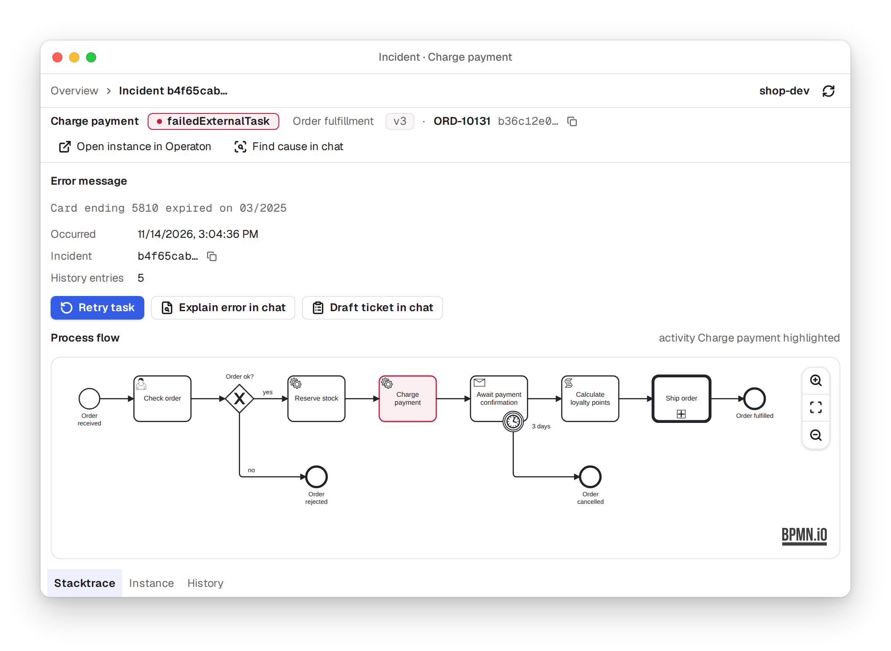

# Pulse MCP server

[](https://github.com/Miragon/pulse/pkgs/container/pulse-server)
[](../../LICENSE)



Ask Claude, ChatGPT or any other AI assistant about your Camunda 7, CIB seven or Operaton engines,
and get the answer as an interactive view in the chat: the incident, the diagram and the root cause.
Pulse is an MCP server, the standard way AI assistants call tools. Below 1.0: pin a version tag for
anything beyond a first try.

Free and open source (MIT). One container image you run next to your engines; no account, and your
engine data stays in your network.

## Get started

Try it on the hosted playground, a seeded CIB seven engine that is read-only and needs no login,
at `https://pulse-playground.miragon.ai/mcp`. In Claude Code:

```sh
claude mcp add --transport http pulse https://pulse-playground.miragon.ai/mcp
```

claude.ai, Claude Desktop, ChatGPT and other hosts add the same URL as
[Usage](https://miragon.github.io/pulse/mcp/usage#connect-your-assistant) shows. Then ask _"Which
processes have open incidents right now?"_.

## Ask why an order is stuck

<picture>
  <source media="(prefers-color-scheme: dark)" srcset="../../docs/assets/widget-incident-dark.png">
  
</picture>

Incidents, instances, process diagrams and the engine's health come back as views in the chat, in
your host's language and theme. Click through them like a cockpit, or hand a finding back to the
chat to explain an error or draft a ticket. What else you can ask:
[Usage](https://miragon.github.io/pulse/mcp/usage#what-you-can-ask).

## Read-only until you allow more

The server only reads until you name a toolset: `engine:operations` adds retries, task completion
and other day-to-day changes, `engine:admin` deletions and migrations. Your assistant
asks before a change as its tool-approval settings say, and a button in a view names what it acts
on. [Toolsets](https://miragon.github.io/pulse/mcp/reference#toolsets) lists what each one allows.

## Your whole fleet

One server reaches [several engines](https://miragon.github.io/pulse/mcp/reference#multi-engine),
described in one profile file in the format the CLI and VS Code read too, with a default engine and
an override per question. With passthrough auth behind OAuth, each caller's own login reaches the
engine.

## Figures straight from the engine

A process's flow shows its open incidents per element, how many instances are at each element right
now (**Running**) and how often the instances started in the last 30 days passed each one
(**Throughput · 30 days**). With two engines or more, an overview shows each engine's health and
job backlog and which processes run where. Every figure comes from the engine's REST API: no plugin
and no metrics store in the engine. [Usage](https://miragon.github.io/pulse/mcp/usage#tips) says
how each one is read.

## Run it on your own engine

You need Docker and the REST API of your engine (usually `…/engine-rest`). The server boots
read-only:

```sh
docker run --rm -p 127.0.0.1:8400:8400 \
  --add-host=host.docker.internal:host-gateway \
  -e ENGINE_BASE_URL=http://host.docker.internal:8080/engine-rest \
  ghcr.io/miragon/pulse-server:latest
claude mcp add --transport http pulse http://localhost:8400/mcp
```

A REST API with a login takes `ENGINE_AUTH_TYPE=basic` with `ENGINE_USERNAME` and
`ENGINE_PASSWORD`. More on CIB seven and Operaton links and Docker networks:
[Get started](https://miragon.github.io/pulse/mcp/getting-started#run-it-on-your-own-engine).
OAuth, write toolsets and deployment: [Operations](https://miragon.github.io/pulse/mcp/operations).

## Good to know

- claude.ai and ChatGPT reach only a public HTTPS URL, not `localhost`; Claude Desktop needs a
  bridge, as [Usage](https://miragon.github.io/pulse/mcp/usage#connect-your-assistant) shows.
- Works with Operaton, CIB seven and Camunda 7, not with Camunda 8.
- Modules for your own systems next to Pulse's: [Build your own server](https://miragon.github.io/pulse/mcp/build-your-own).
- Pulse also runs in your terminal and in VS Code: [Pulse](../../README.md).

## Links

[Documentation](https://miragon.github.io/pulse/mcp/)
·
[Changelog](../../CHANGELOG.md)
·
[Report an issue](https://github.com/Miragon/pulse/issues)
·
[Source and contributing](CONTRIBUTING.md)

Made by [Miragon](https://www.miragon.io). MIT licence.
