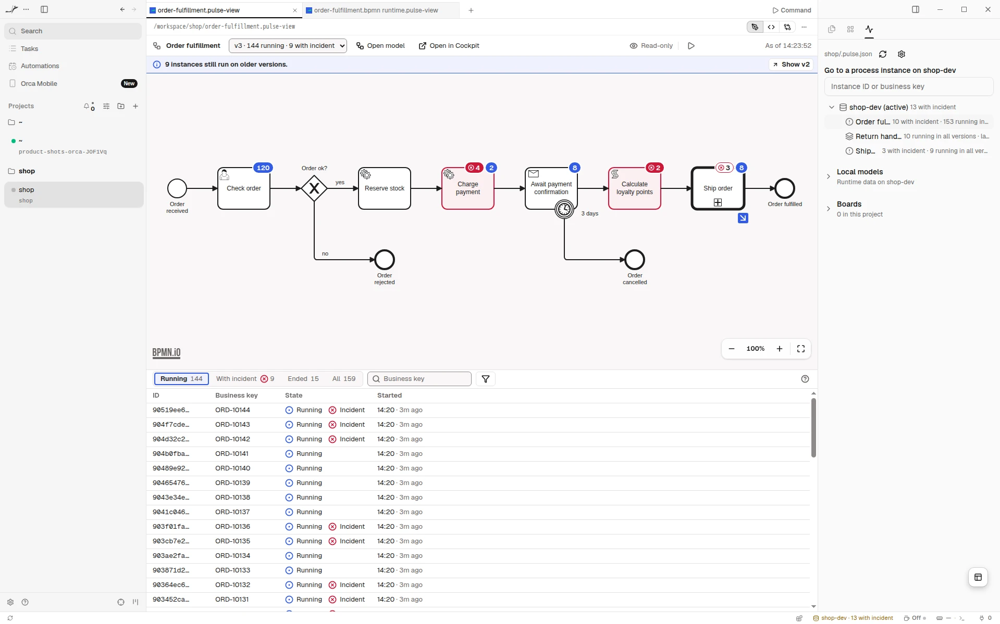
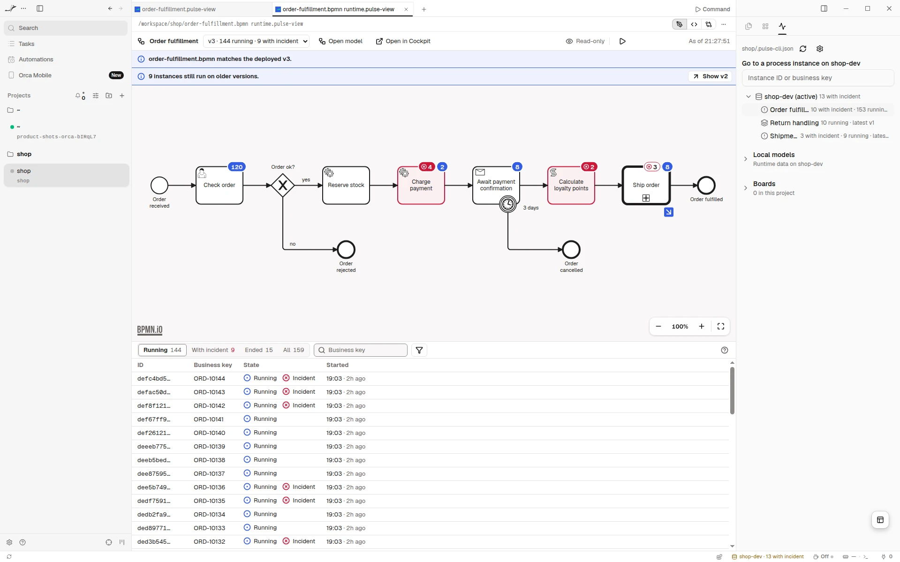

# Pulse for Orca

[](../../LICENSE)


See what your process engine is running, right next to your BPMN models. In
[Orca](https://www.onorca.dev), Pulse shows the definitions, instances, incidents and variables
of your Operaton, CIB seven or Camunda 7 engine, with badges on the deployed diagram, and fixes
what is stuck once you confirm it.

Free and open source (MIT). No account and no cloud: Pulse talks only to the engines your project
names, and writes nothing unless you allow it.

**[Open in Orca](https://www.onorca.dev/plugins/miragon/orca-modelers/pulse-cockpit)**

## Get started

1. Turn on plugins in Orca once: Settings → Plugins → **Turn on plugins**.
2. Open the plugin's page with the link above, or search for **Pulse** in Settings → Plugins, and
   install it. Orca shows the access Pulse asks for: your engines over the network, its own
   secrets for logins, and files in your workspace for its tabs. New releases reach you through
   Orca.
3. Name your engines in a `.pulse-cli.json` at the root of your project, the same file the
   [Pulse CLI](https://miragon.github.io/pulse/cli/) reads:

   ```json
   {
     "profiles": {
       "local": { "url": "http://localhost:8080/engine-rest", "flavor": "operaton" }
     }
   }
   ```

4. Open the Pulse panel in Orca's right sidebar. Without a project file, Pulse tries an engine on
   `localhost:8080`.

## Incidents on the diagram

<picture>
  <source media="(prefers-color-scheme: dark)" srcset="images/screenshot-orca-dark.webp">
  
</picture>

Open a process from the panel, and its deployed diagram shows how many instances wait at each
step and where incidents are. Below it, the instances with their state; open one to see its
variables, its history and the root cause of an incident. Tabs refresh on their own while you see
them.

## Your model against the engine

<picture>
  <source media="(prefers-color-scheme: dark)" srcset="images/screenshot-orca-2-dark.webp">
  
</picture>

**Local models** in the panel lists every `.bpmn` of your project. Open one, and you see the
runtime data of the version it deploys, and whether your file still matches it.

## Fix what is stuck

Retry incidents, change variables, move tokens, cancel and migrate instances. Each write waits
for your confirmation in the Pulse panel, with the engine, the instances and what changes. By
default, Pulse writes only to engines on your machine; the setting **Writes** allows more. Every
write lands in the plugin's log.

## Boards

A `.board.json` opens as a board: counters, incident summaries and instance lists across your
engines, refreshed while you look at them. **Boards** in the panel creates one.

## Good to know

- Needs the Orca desktop app, version 1.4.252 or later.
- Each tab is a small file in `.pulse/views/` next to your project file, which Git ignores.
- Logins live in Orca's secret storage, in your operating system's key store.
- Also available for [VS Code](https://miragon.github.io/pulse/vscode/), as a
  [command line tool](https://miragon.github.io/pulse/cli/) and as an
  [MCP server](https://miragon.github.io/pulse/mcp/) for your AI chat.

## Links

[Docs](https://miragon.github.io/pulse/orca/) · [Changelog](../../CHANGELOG.md) ·
[Report an issue](https://github.com/Miragon/pulse/issues) ·
[Source and contributing](CLAUDE.md) ·
[All Miragon plugins for Orca](https://github.com/Miragon/orca-modelers)

Made by [Miragon](https://www.miragon.io). MIT licence.
