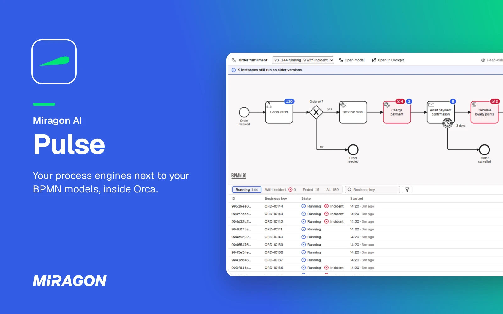

# Pulse for Orca

[](https://github.com/Miragon/pulse/actions/workflows/ci.yml)
[](../../LICENSE)



An [Orca](https://www.onorca.dev) plugin that shows what your Camunda 7, CIB seven or Operaton
engine is running, right next to your BPMN models: definitions, instances, incidents and
variables. It is an early version, and its features can still change. It is not in Orca's plugin
directory yet: until then you [load it from the source](#install). Pulse also runs in
[VS Code, your AI chat and your terminal](https://github.com/Miragon/pulse#readme).

## Why

When an instance gets stuck, you leave the editor for the engine's web UI, search the instance and
read the stack trace. Pulse brings that view into Orca.

## What you get

- **The runtime on the model.** Running instances and incidents as badges on the deployed
  diagram, per version, in Orca's editor tabs.
- **Model and engine side by side.** **Local models** in the Pulse panel lists every `.bpmn` of
  your project and tells you whether it still matches the deployed version.
- **The root cause, not the noise.** Open an instance to see its variables, its history and the
  root cause of an incident.
- **Safe on real engines.** Retries, variable changes, token moves and migrations run on local
  engines only until you allow more in the setting **Writes**, always after a confirmation in the
  Pulse panel that names the engine.
- **Boards in your repository.** A `.board.json` opens as a board: counts, incident summaries and
  instance lists across your engines.

<picture>
  <source media="(prefers-color-scheme: dark)" srcset="images/screenshot-orca-dark.webp">
  
</picture>

## Install

You need the Orca desktop app, version 1.4.252 or later, and turn on plugins once: Settings →
Plugins → **Turn on plugins**. Until the plugin is listed in
[Miragon's Orca catalog](https://github.com/Miragon/orca-modelers), build it from a clone of this
repository and load it as a development plugin:

```sh
pnpm install && pnpm build
orca plugin dev load apps/orca/dist                    # prints the approval command
orca plugin dev load apps/orca/dist --approve <fingerprint>
```

Orca shows the access Pulse asks for before it runs: your engines over the network, its own
secrets for logins, and files in your workspace for its tabs.

## Get started

1. Name your engines in a `.pulse-cli.json` at the root of your project, the project file Pulse
   shares with the [Pulse CLI](https://miragon.github.io/pulse/cli/); you don't need to install
   the CLI:

   ```json
   {
     "profiles": {
       "local": { "url": "http://localhost:8080/engine-rest", "flavor": "operaton" }
     }
   }
   ```

2. Open the Pulse panel in Orca's right sidebar: it lists your engines and their processes.
   Without a project file, Pulse tries an engine on `localhost:8080`.
3. Open a process from the panel to see its deployed diagram with its badges, or a `.bpmn` under
   **Local models** to compare it with the engine.

Profiles, credentials, production engines and writes: [Configuration](https://miragon.github.io/pulse/orca/configuration).

## Help and feedback

- **Documentation:** installation, configuration and usage are explained at [miragon.github.io/pulse/orca](https://miragon.github.io/pulse/orca/).
- **Bugs and ideas:** found a bug or missing something? [Open an issue](https://github.com/Miragon/pulse/issues).

## Contributing

How the plugin is built, tested and released is in [CONTRIBUTING.md](CONTRIBUTING.md).

## License

[MIT](../../LICENSE) © Miragon GmbH
