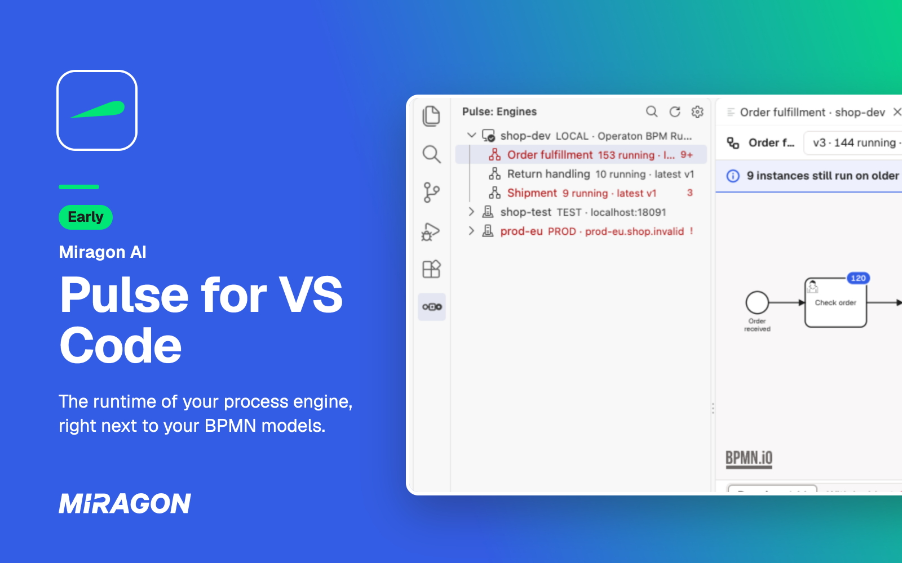
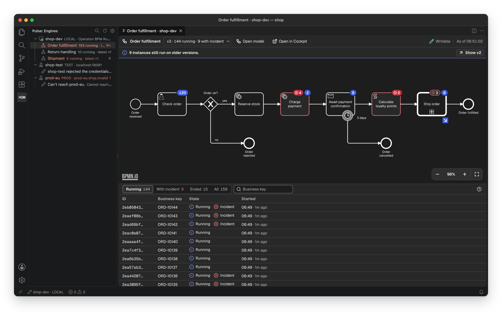
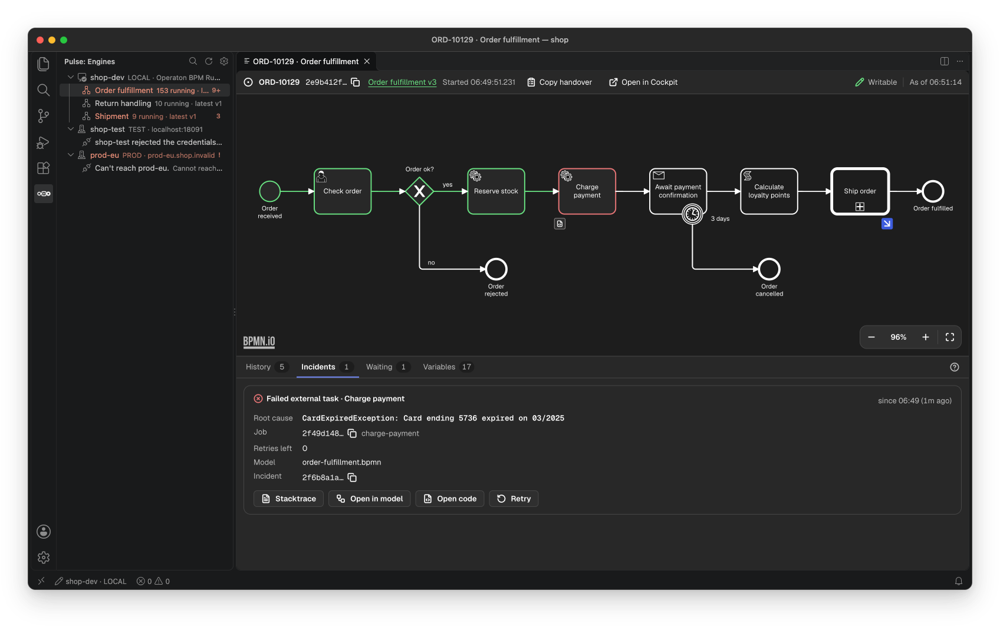
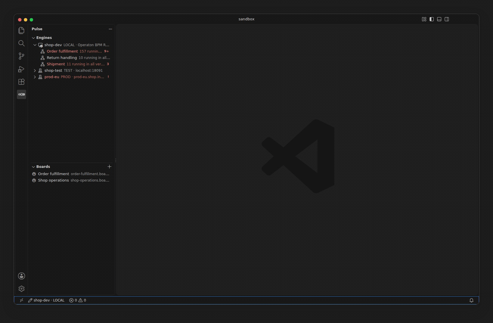
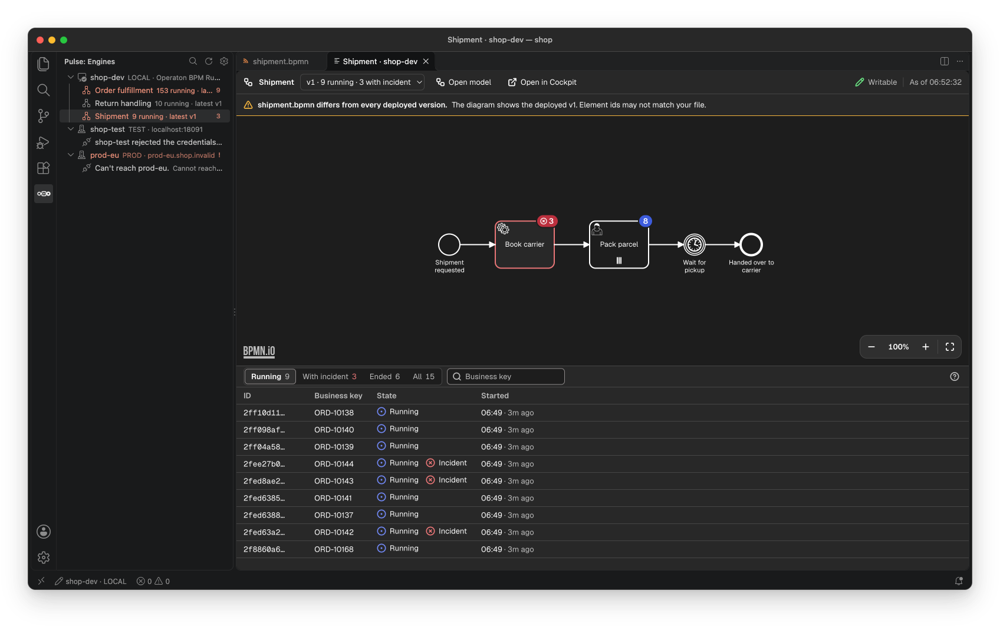
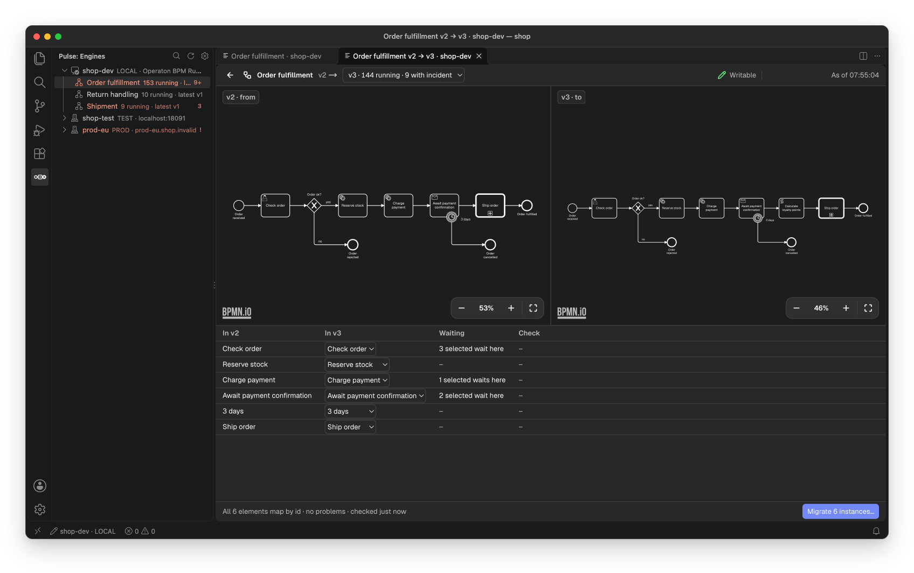
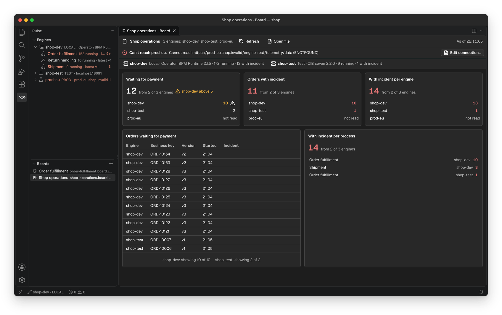

# Pulse for VS Code

[](https://marketplace.visualstudio.com/items?itemName=miragon-gmbh.pulse-cockpit)
[](https://open-vsx.org/extension/miragon-gmbh/pulse-cockpit)
[](https://github.com/Miragon/pulse/blob/main/apps/vscode/LICENSE)



See what your Camunda 7, CIB seven or Operaton engine is running, right next to your BPMN models:
the deployed diagram with its instances and incidents, the root cause of a failure next to your
code, and a retry once you fixed it. Pulse is an early version, so its features can still change.

Free and open source (MIT). No account, and your engines stay yours: Pulse talks to their REST API
from your editor.

## Get started

1. List your engines as profiles in `.pulse-cli.json` in your workspace, the project file Pulse
   shares with the [Pulse CLI](https://miragon.github.io/pulse/cli/) (you don't need to install the
   CLI):

   ```json
   {
     "profiles": {
       "dev": { "url": "http://localhost:8080/engine-rest", "flavor": "operaton" }
     }
   }
   ```

2. Click **Pulse** in the activity bar. The **Engines** view lists your engines and their
   processes; an engine with a login gets its credentials from **Pulse: Set Credentials…**.
3. Pick a process, or run **Pulse: Show Runtime Data for This Model** on an open `.bpmn` file.

Every profile setting, production engines and Open in Cockpit links:
[Configuration](https://miragon.github.io/pulse/vscode/configuration).

## The runtime on your model



A process opens on its deployed diagram, with the running instances and incidents of each element
as badges. Pick a version, filter the instances by element, business key or process variables, and
see the ones in trouble first.

## The root cause of an incident



An instance shows where it waits, its incidents with the root cause taken from the full stack
trace, incidents inside called instances, and its variables. The stack trace opens as a document
whose frames link to your sources, and **Open code** jumps to the worker or delegate that implements the element.

## Fix it and retry



Change a variable, retry the incident or move a token, right where you found the problem. On a
local engine that works right away; on any other engine only once you set `pulse.writes` in your
user settings. Every write asks first, names its engine and target, and leaves an audit line in
the **Pulse** output channel.

## Your model and the deployed one



An open `.bpmn` file tells you whether it matches a deployed version. From an incident,
**Open in model** jumps to the element in your local file.

## Move instances to a new version



Tick instances to cancel them or migrate them as one batch. A migration shows both versions with
the mapping the engine proposes and flags elements where instances would get stuck, before anything
runs.

## Boards across engines



A board is a JSON file in your repository that shows counts, instances, open incidents and the
deployed diagram across engines, so your team shares one view of its processes.
[Boards](https://miragon.github.io/pulse/vscode/boards) explains the file.

## Good to know

- Needs VS Code 1.101 or later, or an editor built on it such as Cursor or VSCodium (from
  [Open VSX](https://open-vsx.org/extension/miragon-gmbh/pulse-cockpit)).
- Works with Operaton, CIB seven and Camunda 7, not with Camunda 8. Engines without a login or
  with Basic auth.
- Calls go through your editor's proxy and certificate settings.
- Pulse also answers in your AI chat and your terminal: [Pulse](https://github.com/Miragon/pulse#readme).

## Links

[Documentation](https://miragon.github.io/pulse/vscode/)
·
[Changelog](https://github.com/Miragon/pulse/blob/main/CHANGELOG.md)
·
[Report an issue](https://github.com/Miragon/pulse/issues)
·
[Source and contributing](https://github.com/Miragon/pulse/blob/main/apps/vscode/CONTRIBUTING.md)

Made by [Miragon](https://www.miragon.io). MIT licence.
