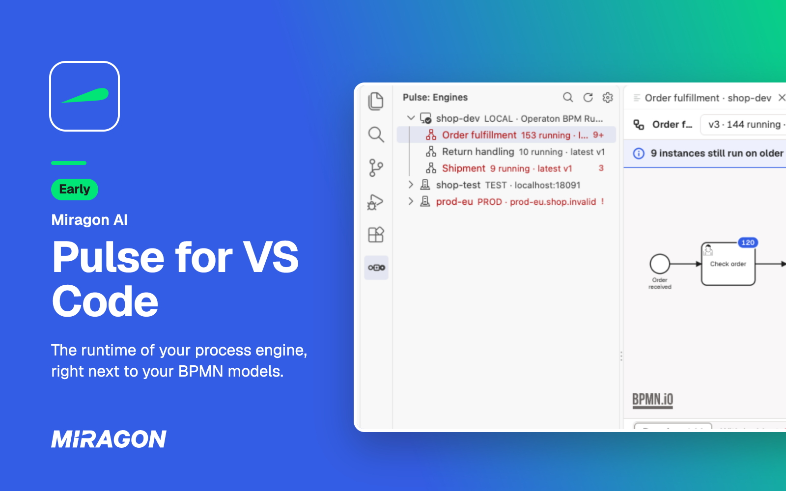
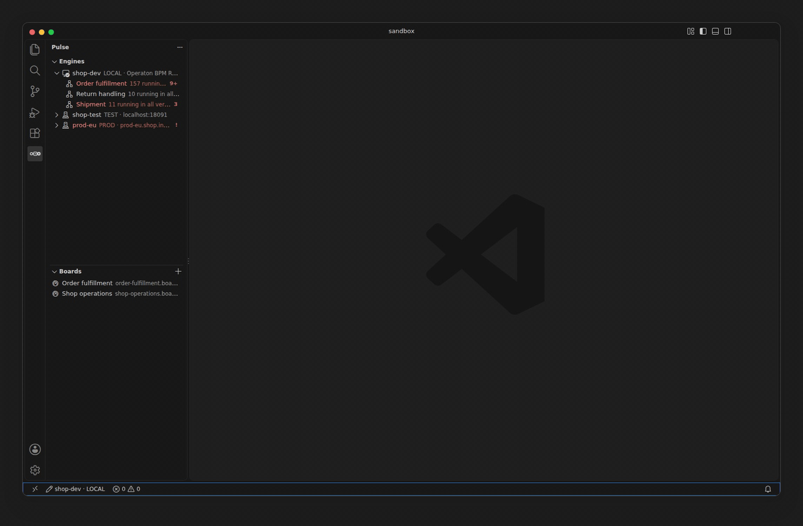

# Pulse for VS Code

A VS Code extension that shows what your Camunda 7, CIB seven or Operaton engine is running, right
next to your BPMN models: definitions, instances, incidents and variables. It is an early version,
and its features can still change. Pulse also runs in your [AI chat and your terminal](https://github.com/Miragon/pulse#readme).

## Why

When an instance gets stuck, you leave the editor for the engine's web UI, search the instance and
read the stack trace. Pulse brings that view into the editor.

## What you get

- **The runtime on the model.** Running instances and incidents as badges on the deployed
  diagram, per version.
- **The root cause, not the noise.** The incident's root cause from the full stack trace, with
  links from its frames to your sources.
- **Model and engine side by side.** An open `.bpmn` file tells you whether it matches a deployed
  version.
- **Safe on real engines.** Retries and variable changes run on local engines only until you turn
  on `pulse.writes` in your user settings, always after a confirmation that names the engine.
- **Boards in your repository.** [Shared views](https://miragon.github.io/pulse/vscode/boards) as
  JSON files: counts, instances, open incidents and the deployed diagram, across engines.

## Install

| Editor                                      | Listing                                                                                                     |
| ------------------------------------------- | ----------------------------------------------------------------------------------------------------------- |
| VS Code                                     | [Visual Studio Marketplace](https://marketplace.visualstudio.com/items?itemName=miragon-gmbh.pulse-cockpit) |
| VSCodium, Cursor and other Open VSX editors | [Open VSX](https://open-vsx.org/extension/miragon-gmbh/pulse-cockpit)                                       |

Or from a shell: `code --install-extension miragon-gmbh.pulse-cockpit` (`codium` or `cursor` in
those editors). You need VS Code 1.101 or later, or an editor built on it.

## Get started

1. List your engines as profiles in `.pulse-cli.json`, the project file Pulse shares with the
   [Pulse CLI](https://miragon.github.io/pulse/cli/); you don't need to install the CLI. For an
   engine with a login, run **Pulse: Set Credentials…**.
2. Click **Pulse** in the activity bar: the Engines view lists your engines and their processes.
3. On a `.bpmn` file, run **Show Runtime Data for This Model** to see its deployed versions.

Profiles, credentials, production engines and writes: [Configuration](https://miragon.github.io/pulse/vscode/configuration).
No engine at hand? A clone of the repository starts [a seeded engine](https://miragon.github.io/pulse/vscode/installation#try-it-on-a-seeded-engine).

## Help and feedback

- **Documentation:** installation, configuration and usage are explained at [miragon.github.io/pulse/vscode](https://miragon.github.io/pulse/vscode/).
- **Bugs and ideas:** found a bug or missing something? [Open an issue](https://github.com/Miragon/pulse/issues).

## Contributing

How the extension is built, tested and released is in [CONTRIBUTING.md](CONTRIBUTING.md).

## License

[MIT](LICENSE) © Miragon GmbH
