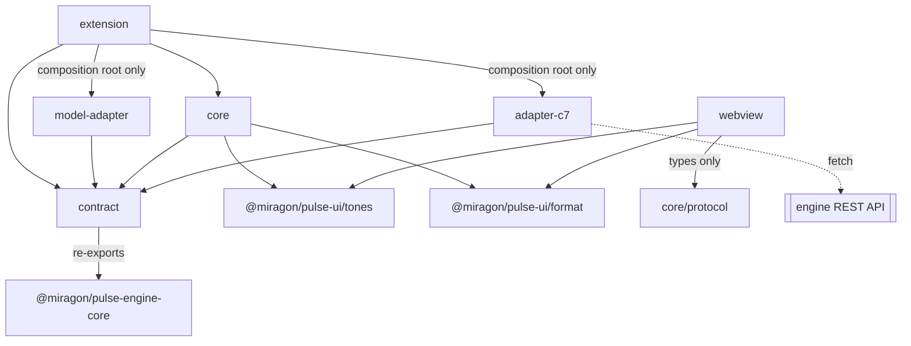
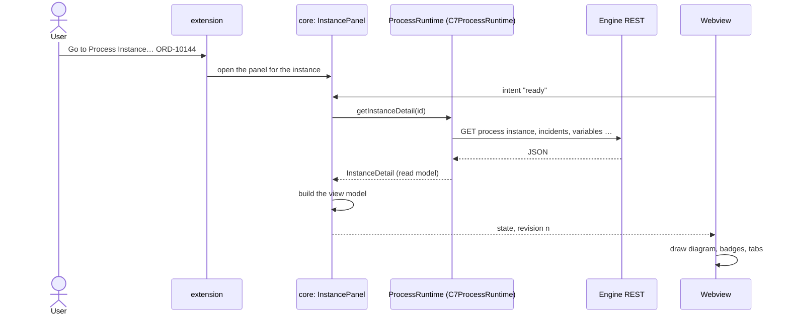

# Architecture

- Status: accepted
- Last reviewed: 2026-11-09 (the engine contract leaves the app for `@miragon/pulse-engine-core`, the engine family's neutral core; before that 2026-11-08, Pulse's UI foundation in core and webview)

## Context

Pulse shows what a process engine is running, next to the BPMN models in VS Code.
It must be engine-neutral like the Miragon BPMN modeler: Camunda 7 family engines
(Operaton, CIB seven, Camunda 7) now, Camunda 8 later, without reworking the core.
The product owner asked for extremely good encapsulation: a core with logic and UI,
and adapter modules that only provide data and fulfil contracts.

## Decision

### Layers

One package, `apps/vscode` of the Pulse monorepo, with six layers as folders under
`apps/vscode/src`. There is no per-layer build. Only the extension bundles (esbuild): the
host as CommonJS for Node 22, the webview as an IIFE.

| Layer         | Responsibility                                                                                                                                                                                                                                                                                                                                                                | Runtime                               |
| ------------- | ----------------------------------------------------------------------------------------------------------------------------------------------------------------------------------------------------------------------------------------------------------------------------------------------------------------------------------------------------------------------------- | ------------------------------------- |
| `contract`    | The barrel of the engine contract `@miragon/pulse-engine-core` (`packages/connectors/engine/engine-core`: the `ProcessRuntime` and `ProcessCommands` ports, read models and `RuntimeError`; its `./testing` the kit and an in-memory `FakeEngine`) plus the ports of the IDE: `EngineAdapter`, the local `ModelSource` and `CodeLocator` ports with the `WorkspaceFiles` seam | none (no DOM, no Node)                |
| `core`        | Engine-neutral logic: use cases turn read models into view models, panel sessions handle webview intents; `apps/vscode/src/core/protocol` holds the JSON-only messages and view models                                                                                                                                                                                        | none                                  |
| `webview`     | Preact UI and bpmn-js diagram. Renders protocol view models, sends intents                                                                                                                                                                                                                                                                                                    | browser                               |
| `adapters/c7` | `EngineAdapter`, `ProcessRuntime`, `ProcessCommands` and the Cockpit web UI for the Camunda 7 family ([c7-adapter.md](c7-adapter.md)); `apps/vscode/src/adapters/c7/engine-rest` reads and writes the engine's REST API                                                                                                                                                       | Node                                  |
| `model`       | `ModelSource` and `CodeLocator` for the local workspace: reads `.bpmn` files with bpmn-moddle and its vendor descriptors, finds the implementing code ([local-sources.md](local-sources.md)); the only layer with those libraries                                                                                                                                             | none (files through `WorkspaceFiles`) |
| `host`        | VS Code host: composition root, connections, tree, panels, commands, status bar                                                                                                                                                                                                                                                                                               | Node + `vscode`                       |

The core in the product owner's sense is everything that is engine-neutral
(`core`, `webview`, `host`); adapters only provide data.

### Allowed dependencies

The list is closed: every import edge not listed is an error
(`apps/vscode/.dependency-cruiser.cjs`, `allowedSeverity: error`, run by
`pnpm lint:architecture:vscode`).



```text
contract    → @miragon/pulse-engine-core (main entry only)
core        → contract (entry only), @miragon/pulse-ui/tones,
              @miragon/pulse-ui/format (only from views/labels.ts)
protocol    → (nothing outside protocol)
webview     → protocol (type-only), @miragon/pulse-ui/tones,
              @miragon/pulse-ui/format (only from format/), preact,
              bpmn-js, diagram-js, modeler-shell, fonts
              (nothing else of @miragon/pulse-ui ships: no React kit, no stylesheet, no ./testing)
adapters/*  → contract (entry only)
model       → contract (entry only), bpmn-moddle, camunda-bpmn-moddle, zeebe-bpmn-moddle
              (nothing else may import these)
host        → core, protocol, contract, vscode, modeler-shell, Node built-ins
              adapters and the model adapter only from host/composition-root.ts
tests, scripts, dev tooling → anything (the kit and FakeEngine: @miragon/pulse-engine-core/testing)
```

The engine contract is the core of the engine family, the neutral layer above the dialects:
`@miragon/pulse-engine-core` in `packages/connectors/engine/engine-core`, which esbuild bundles
like c7-core. It holds what every dialect answers (the read and write ports, ids,
read models, queries, `RuntimeError`, `FailingRuntime`, `ValueKinds`, `MoveReasons`,
`RootCauses`) and, in `./testing`, the conformance kit, its world and the fake. What only the IDE needs stays here:
`EngineAdapter` with the connection, the credentials and `EngineWebUi` (the links into an engine's
web UI differ between the MCP server and the extension), the local ports and their read models.
The package keeps the extension's house rules (the repository's ESLint config names its paths next
to the extension's) and imports nothing (the repository's `family-core-is-a-leaf`); in the
repository only this layer, the extension's tests and its dev host import it, besides the `src` of
a dialect's core (c7-core takes `RootCauses` from its main entry) and tests anywhere; the engine
connector and the CLI do not until they serve a second dialect (`engine-core-consumers`). They
import its entries, never a file of the package by path
(`engine-core-only-by-its-entries`): a module reached by path would be a second copy of the
contract, whose `RuntimeError` the first copy's `RuntimeError.is` no longer recognises.

`@miragon/pulse-ui/tones` and `@miragon/pulse-ui/format` are the part of Pulse's UI foundation
the extension ships: the tone vocabulary and `SITUATION_TONES`, the one tone per situation (an
open incident, a running or suspended instance), and the formatters (times to the millisecond,
relative times, the one duration form, exact and compact counts with their lower bound, short
ids), both of which the MCP widgets read too. They import nothing (the repository's
`ui-foundation-entries-import-nothing`), so esbuild bundles about a kilobyte and no React.
The extension shares which tone a situation takes and how a date, a duration, a count or an id
reads, not a component: the webview draws the tone with its own CSS
([user-interface.md](user-interface.md)), `TimeLabels` and `CountLabels` (webview) and `Labels`
(core) delegate to the formatters and set their locale (English, a 24-hour clock:
`en-u-hc-h23`, once per layer: `Labels` in the core, `LabelLocale` in the webview), the
repository's date and number gates keep `Intl` and `toFixed` out of core and webview, and
`pulse-ui-only-its-foundation` keeps pulse-ui's React kit, its stylesheets and `./testing` out of
shipped code. Only those label helpers import the formatters (`core/views/labels.ts` and the
webview's `format/` folder, the closed world's one entry for `@miragon/pulse-ui/format`): the
formatters keep their locale in the module, so a module that called them directly would format
in the machine's locale until a helper had loaded.

One edge crosses into another app, and only as a file read: the CLI owns the format of
`.pulse-cli.json` (its JSON Schema `apps/cli/schema/project-file.schema.json`) and the shared
fixtures in `apps/cli/test/fixtures/project-file/`, each the file and the CLI's verdict. The
extension owns what it makes of each fixture, in
`apps/vscode/test/host/project-file-fixtures.expected.json`, so rewording a problem changes no
file of the CLI. The test `apps/vscode/test/host/project-file-fixtures.test.ts` reads the
fixtures with `node:fs`, never through an import (apps never import each other; a file read is
no import edge), and holds `TargetsParser` to them: every profile the CLI accepts is a target with
the CLI's URL, auth type and read-only flag, or a named problem, and every fixture has exactly one
expectation. A change to the CLI's rules changes the fixtures, and this test fails until the
parser follows; `apps/vscode/turbo.json` names the fixtures as inputs of `test`, so a cached run
never hides that. Pulse reads profile by profile and ignores keys it does not use, so a file the
CLI refuses as a whole (a committed password, a secret header, an unknown key) can still list
engines; the fixtures pin that.

Each layer has its own `tsconfig.<layer>.json` with `lib`/`types` matching its runtime,
so code that uses `document` in the core or `process` in the webview does not compile.

### Composition root

`apps/vscode/src/host/composition-root.ts` is the only place that knows engines. Its
class `CompositionRoot` holds one `EngineAdapter` per engine kind (`c7` → `C7Adapter`
in a `Record<EngineKind, EngineAdapter>`, so a new kind does not compile without its
adapter) and implements `EngineFactories`: for a configured target it
returns the `ProcessRuntime` and, where the adapter has them, the `ProcessCommands` and
the `EngineWebUi` (for a target with a `cockpitUrl`) of the adapter for `target.engine`. A target the target policy refuses (OAuth2,
credentials saved for another endpoint, basic credentials over plain HTTP) gets a
`FailingRuntime` with the refusal text and no commands; the connection builder keeps
the commands only when the write policy allows them ([writes.md](writes.md)). The
static `CompositionRoot.create` builds the adapters; nothing else constructs one.

The rest of the extension is VS Code wiring. `activate` in `extension.ts` hands the
`ExtensionContext` to `PulseExtension`, which builds the connection registry, the
trees, the status bar, the panel manager and the commands (each a class implementing
`Command`, registered by `CommandRegistrar`) and puts them into the context's
subscriptions. No DI container, no plugin registry: adding an engine means one adapter
folder and one entry in the composition root's adapter map.

### Host ⇄ webview protocol

Hand-rolled discriminated unions in `apps/vscode/src/core/protocol` with runtime guards
(`MessageGuards.isWebviewIntent` in the host; the webview, which may import only types,
checks state messages in its `HostBridge`). Rule: **intents in,
state out**. The webview sends intents (`ready`, `refresh`, `selectVersion`,
`filterInstances`, `filterProcesses`, `openInstance`, `openProcess`, `openCall`,
`retryIncident`, `setVariable`, `moveToken`, `setCredentials`, …); the
host answers by pushing the complete `PanelState` with a monotonically increasing
revision; the webview drops stale revisions. Write intents carry no authority: the core
resolves them against the shown snapshot, and the write state travels back in the view
like everything else. The bulk intents neither: `toggleInstances` names ids, but the
core keeps only its loaded rows that an offered action may touch; `selectMatching` and
`startBulk` (which names only the action) carry no ids, and the core collects them
itself ([writes.md](writes.md)). The same holds for jumps: `openCall` names only an element id, the
core finds the called process or instances in its snapshot and opens them through
`PanelEffects` (`openDefinition`, `openLatestDefinition`, `openInstance`, `openMigration`, `pickInstance`);
`openProcess` names only a BPMN process id, and the engine overview opens it only when its
snapshot lists it. A board ([boards.md](boards.md)) is the one panel over several engines: its
intents (`openBoardInstance`, `openBoardProcess`, `openBoardEngine`, `setBoardCredentials`)
name an engine and an id, and the core opens them only when the shown board lists them on that
engine. `filterProcesses` costs no engine call: the overview filters its
snapshot again. `filterInstances` carries up to five variable conditions as text with an
optional type; `VariableConditionRules` decides the type, and the guard drops a filter
whose condition does not fit it. `suggestVariableNames` names nothing either: the core
reads the names of the shown version once and puts them into the view. `openWebUi` carries no URL either: the core picks the shown version or
instance, or the engine's start page in the overview, the extension builds the URL with
the connection's `EngineWebUi` and hands it to `vscode.env.openExternal`. Nothing
awaits a reply, so no correlation is needed. View models carry ISO
timestamps; the webview formats them.



Panel sessions (`EnginePanel`, `DefinitionPanel`, `InstancePanel`, `MigrationPanel`, all implementing
`Panel`) live in the core and are free of VS Code: host actions go through the
`PanelEffects` port, which the extension implements. The browser dev host
(`apps/vscode/dev/host`) runs the same sessions (`?panel=engine`, `definition`, `instance`, `migration`).

The sessions build immutable snapshots and hand them to one `ViewSession`, which owns
the loaded view, the latest-wins ticket and the three published states (loading,
ready/refreshing, failed with the stale view), each carrying the panel's live updates
status. Only the newest load may publish or change state; "load more" is ignored while
a reload is in flight, and a quiet background read (`refreshQuietly`, driven by the
panel's `RefreshLoop`, [live-updates.md](live-updates.md)) skips while either runs and
never publishes `refreshing`. `rebuild` derives a new
view from the loaded snapshot without the engine (the overview's filter), and a session
whose last load failed republishes the failure with the stale view, never a fresh-looking
ready state. The extension keeps
one webview, one revision counter and one theme bridge per panel and rebinds the panel
to a fresh session whenever the connections reload (credentials, endpoint, refresh,
settings), disposing the old session's loop; it tells the session whether its panel is
watched, hidden, in a background window or idle.
Panels opened from a `.bpmn` file are keyed by the file URI and compare again with the
file's current content when _Show Runtime Data for This Model_ runs again.

## Consequences

- An undeclared or forbidden import fails `pnpm lint:architecture:vscode` (negative test
  in `apps/vscode/test/architecture`); a wrong global fails
  `pnpm --filter pulse-cockpit run typecheck` through the `@ts-expect-error` probe of each
  layer (`apps/vscode/test/<layer>/runtime.boundary.ts`).
- A new engine takes `apps/vscode/src/adapters/<engine>` with a class implementing
  `EngineAdapter`, an engine test that runs the `ConformanceKit` of
  `@miragon/pulse-engine-core/testing` and one entry in the composition root; core,
  protocol and webview stay untouched. A new engine question is a change to that package: a
  port, a read model, a law and a saboteur there, the use in the core here. ESLint keeps engine words
  out of them, and dependency-cruiser fails while a new adapter has no engine test. The
  spike built a Camunda 8 adapter this way against a mock of the REST API v2 and removed
  it again to keep the prototype small to check.
- Source-only layers keep the build to one esbuild run; the extension ships as one .vsix.

## Decision log

Consensus round 2026-10-21 (five reviewers). Repo shape was split 2:2 between one
package with folder rules and workspaces; workspaces won on the tie-break "hard,
machine-checked boundaries beat convention" because per-package tsconfigs close the
globals gap dependency-cruiser cannot see. Superseded on 2026-10-24 by the move into the
Pulse monorepo: its gates know one package per app, so the workspaces folded into one
package, and one tsconfig per layer keeps the globals boundary. `vscode-messenger` was
rejected in favour of plain unions (its host side is bound to the `vscode` API, which
blocks the browser dev host).

Revised on 2026-11-09: one package per app no longer holds for the contract. The product owner
decided on 2026-11-08 that the contract sits above the engine dialects, with Camunda 8 the second
dialect to speak it, so its ports, read models, kit and fake moved to the public workspace package
`@miragon/pulse-engine-core` (`packages/connectors/engine/engine-core`), the core of the engine
family, which the owner made the neutral layer above the dialects on 2026-11-09, with their
floors, their tests and their house rules. The extension stays one package with six layers; its contract layer became
the barrel of that package plus the ports of the IDE, so no import of the core, the adapters or the
host changed. No `EngineDialect` seam and no C7 runtime moved with it: the C7 adapter stays in
`apps/vscode/src/adapters/c7`.
