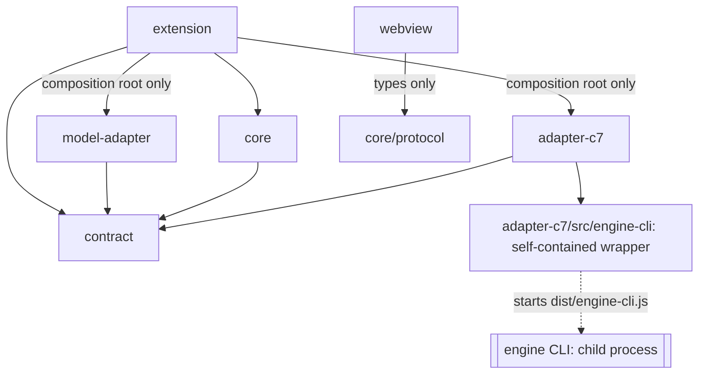
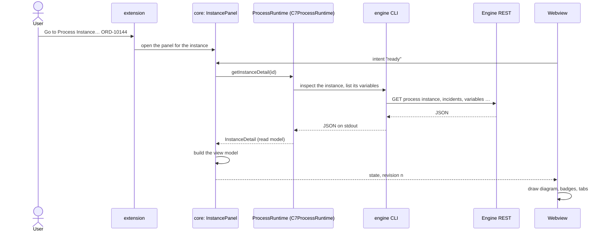

# Architecture

- Status: accepted
- Last reviewed: 2026-10-26 (boards)

## Context

Pulse shows what a process engine is running, next to the BPMN models in VS Code.
It must be engine-neutral like the Miragon BPMN modeler: Camunda 7 family engines
(Operaton, CIB seven, Camunda 7) now, Camunda 8 later, without reworking the core.
The product owner asked for extremely good encapsulation: a core with logic and UI,
and adapter modules that only provide data and fulfil contracts.

## Decision

### Layers

One package, `apps/vscode` of the Pulse monorepo, with six layers as folders under
`apps/vscode/src`. There is no per-layer build. Only the extension bundles (esbuild): the
host as CommonJS for Node 22, the webview as an IIFE.

| Layer         | Responsibility                                                                                                                                                                                                                                                                                               | Runtime                               |
| ------------- | ------------------------------------------------------------------------------------------------------------------------------------------------------------------------------------------------------------------------------------------------------------------------------------------------------------ | ------------------------------------- |
| `contract`    | The `ProcessRuntime`, `ProcessCommands` and `EngineAdapter` ports, the local `ModelSource` and `CodeLocator` ports with the `WorkspaceFiles` seam, read models and `RuntimeError`; folders `apps/vscode/src/contract/conformance` (the kit) and `apps/vscode/src/contract/fake` (in-memory reference engine) | none (no DOM, no Node)                |
| `core`        | Engine-neutral logic: use cases turn read models into view models, panel sessions handle webview intents; `apps/vscode/src/core/protocol` holds the JSON-only messages and view models                                                                                                                       | none                                  |
| `webview`     | Preact UI and bpmn-js diagram. Renders protocol view models, sends intents                                                                                                                                                                                                                                   | browser                               |
| `adapters/c7` | `EngineAdapter`, `ProcessRuntime`, `ProcessCommands` and the Cockpit web UI for the Camunda 7 family ([c7-adapter.md](c7-adapter.md)); `apps/vscode/src/adapters/c7/engine-cli` is a self-contained wrapper around the engine CLI                                                                            | Node                                  |
| `model`       | `ModelSource` and `CodeLocator` for the local workspace: reads `.bpmn` files with bpmn-moddle and its vendor descriptors, finds the implementing code ([local-sources.md](local-sources.md)); the only layer with those libraries                                                                            | none (files through `WorkspaceFiles`) |
| `host`        | VS Code host: composition root, connections, tree, panels, commands, status bar                                                                                                                                                                                                                              | Node + `vscode`                       |

The core in the product owner's sense is everything that is engine-neutral
(`core`, `webview`, `host`); adapters only provide data.

### Allowed dependencies

The list is closed: every import edge not listed is an error
(`apps/vscode/.dependency-cruiser.cjs`, `allowedSeverity: error`, run by
`pnpm lint:architecture:vscode`).



```text
contract    → (nothing)
core        → contract (entry only)
protocol    → (nothing outside protocol)
webview     → protocol (type-only), preact, bpmn-js, diagram-js, modeler-shell, fonts
adapters/*  → contract (entry only); only adapters/c7/engine-cli may use Node built-ins
engine-cli  → (nothing of ours; an in-process engine client replaces it as a whole)
model       → contract (entry only), bpmn-moddle, camunda-bpmn-moddle, zeebe-bpmn-moddle
              (nothing else may import these)
host        → core, protocol, contract, vscode, modeler-shell, Node built-ins
              adapters and the model adapter only from host/composition-root.ts
tests, scripts, dev tooling → anything
```

Each layer has its own `tsconfig.<layer>.json` with `lib`/`types` matching its runtime,
so code that uses `document` in the core or `process` in the webview does not compile.

### Composition root

`apps/vscode/src/host/composition-root.ts` is the only place that knows engines. Its
class `CompositionRoot` holds one `EngineAdapter` per engine kind (`c7` → `C7Adapter`
in a `Record<EngineKind, EngineAdapter>`, so a new kind does not compile without its
adapter) and implements `EngineFactories`: for a configured target it
returns the `ProcessRuntime` and, where the adapter has them, the `ProcessCommands` and
the `EngineWebUi` (for a target with a `cockpitUrl`) of the adapter for `target.engine`. A target the target policy refuses (OAuth2,
credentials saved for another endpoint, basic credentials over plain HTTP) gets a
`FailingRuntime` with the refusal text and no commands; the connection builder keeps
the commands only when the write policy allows them ([writes.md](writes.md)). The
static `CompositionRoot.create` builds the adapters; nothing else constructs one.

The rest of the extension is VS Code wiring. `activate` in `extension.ts` hands the
`ExtensionContext` to `PulseExtension`, which builds the connection registry, the
trees, the status bar, the panel manager and the commands (each a class implementing
`Command`, registered by `CommandRegistrar`) and puts them into the context's
subscriptions. No DI container, no plugin registry: adding an engine means one adapter
folder and one entry in the composition root's adapter map.

### Host ⇄ webview protocol

Hand-rolled discriminated unions in `apps/vscode/src/core/protocol` with runtime guards
(`MessageGuards.isWebviewIntent` in the host; the webview, which may import only types,
checks state messages in its `HostBridge`). Rule: **intents in,
state out**. The webview sends intents (`ready`, `refresh`, `selectVersion`,
`filterInstances`, `filterProcesses`, `openInstance`, `openProcess`, `openCall`,
`retryIncident`, `setVariable`, `moveToken`, `setCredentials`, …); the
host answers by pushing the complete `PanelState` with a monotonically increasing
revision; the webview drops stale revisions. Write intents carry no authority: the core
resolves them against the shown snapshot, and the write state travels back in the view
like everything else. The bulk intents neither: `toggleInstances` names ids, but the
core keeps only its loaded rows that an offered action may touch; `selectMatching` and
`startBulk` (which names only the action) carry no ids, and the core collects them
itself ([writes.md](writes.md)). The same holds for jumps: `openCall` names only an element id, the
core finds the called process or instances in its snapshot and opens them through
`PanelEffects` (`openDefinition`, `openLatestDefinition`, `openInstance`, `openMigration`, `pickInstance`);
`openProcess` names only a BPMN process id, and the engine overview opens it only when its
snapshot lists it. A board ([boards.md](boards.md)) is the one panel over several engines: its
intents (`openBoardInstance`, `openBoardProcess`, `openBoardEngine`, `setBoardCredentials`)
name an engine and an id, and the core opens them only when the shown board lists them on that
engine. `filterProcesses` costs no engine call: the overview filters its
snapshot again. `filterInstances` carries up to five variable conditions as text with an
optional type; `VariableConditionRules` decides the type, and the guard drops a filter
whose condition does not fit it. `suggestVariableNames` names nothing either: the core
reads the names of the shown version once and puts them into the view. `openWebUi` carries no URL either: the core picks the shown version or
instance, or the engine's start page in the overview, the extension builds the URL with
the connection's `EngineWebUi` and hands it to `vscode.env.openExternal`. Nothing
awaits a reply, so no correlation is needed. View models carry ISO
timestamps; the webview formats them.



Panel sessions (`EnginePanel`, `DefinitionPanel`, `InstancePanel`, `MigrationPanel`, all implementing
`Panel`) live in the core and are free of VS Code: host actions go through the
`PanelEffects` port, which the extension implements. The browser dev host
(`apps/vscode/dev/host`) runs the same sessions (`?panel=engine`, `definition`, `instance`, `migration`).

The sessions build immutable snapshots and hand them to one `ViewSession`, which owns
the loaded view, the latest-wins ticket and the three published states (loading,
ready/refreshing, failed with the stale view), each carrying the panel's live updates
status. Only the newest load may publish or change state; "load more" is ignored while
a reload is in flight, and a quiet background read (`refreshQuietly`, driven by the
panel's `RefreshLoop`, [live-updates.md](live-updates.md)) skips while either runs and
never publishes `refreshing`. `rebuild` derives a new
view from the loaded snapshot without the engine (the overview's filter), and a session
whose last load failed republishes the failure with the stale view, never a fresh-looking
ready state. The extension keeps
one webview, one revision counter and one theme bridge per panel and rebinds the panel
to a fresh session whenever the connections reload (credentials, endpoint, refresh,
settings), disposing the old session's loop; it tells the session whether its panel is
watched, hidden, in a background window or idle.
Panels opened from a `.bpmn` file are keyed by the file URI and compare again with the
file's current content when _Show Runtime Data for This Model_ runs again.

## Consequences

- An undeclared or forbidden import fails `pnpm lint:architecture:vscode` (negative test
  in `apps/vscode/test/architecture`); a wrong global fails
  `pnpm --filter pulse-cockpit run typecheck` through the `@ts-expect-error` probe of each
  layer (`apps/vscode/test/<layer>/runtime.boundary.ts`).
- A new engine takes `apps/vscode/src/adapters/<engine>` with a class implementing
  `EngineAdapter`, an engine test that runs the `ConformanceKit` and one entry in the
  composition root; core, protocol and webview stay untouched. ESLint keeps engine words
  out of them, and dependency-cruiser fails while a new adapter has no engine test. The
  spike built a Camunda 8 adapter this way against a mock of the REST API v2 and removed
  it again to keep the prototype small to check.
- Source-only layers keep the build to one esbuild run; the extension ships as one .vsix.

## Decision log

Consensus round 2026-10-21 (five reviewers). Repo shape was split 2:2 between one
package with folder rules and workspaces; workspaces won on the tie-break "hard,
machine-checked boundaries beat convention" because per-package tsconfigs close the
globals gap dependency-cruiser cannot see. Superseded on 2026-10-24 by the move into the
Pulse monorepo: its gates know one package per app, so the workspaces folded into one
package, and one tsconfig per layer keeps the globals boundary. `vscode-messenger` was
rejected in favour of plain unions (its host side is bound to the `vscode` API, which
blocks the browser dev host).
