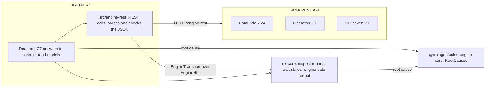

# Camunda 7 family adapter

- Status: accepted
- Last reviewed: 2026-11-04

## Context

Operaton and CIB seven are forks of Camunda 7 and keep its REST API, so one adapter
serves all three; the conformance kit runs on Operaton and CIB seven in CI (Camunda 7's
image left Docker Hub in November 2026; it passed on 7.24.0 until then). The adapter calls the
REST API itself:

## Decision

`apps/vscode/src/adapters/c7` implements `EngineAdapter`, `ProcessRuntime` and `ProcessCommands`
on top of a **small REST client** in `apps/vscode/src/adapters/c7/engine-rest/` and the
core of the Camunda 7 REST dialect family c7, `@miragon/pulse-c7-core` (its workflow domain),
the package the CLI and the MCP server run too.

- **One edge to c7-core, bundled.** c7-core has no runtime dependency but the engine
  contract's main entry and no Node built-in, takes its engine through a caller's port and
  returns data. Only this adapter
  imports it (its main entry; `apps/vscode/.dependency-cruiser.cjs`:
  `c7-core-only-in-the-c7-adapter`, and the root rule `family-core-consumers` with the
  adapter in `CORE_BUNDLES`); the contract, the core, the webview and the host stay
  engine-neutral. esbuild inlines it into `dist/extension.cjs`, the .vsix ships no
  `node_modules`. One home: a fix to wait states (c7-core) or root causes (the engine
  contract's `RootCauses`) lands once, and the conformance laws run both on all three engines.
- **c7-core's port over `EngineHttp`.** `HttpEngineTransport` implements c7-core's
  `EngineTransport`: `InspectOperations` maps each operation id c7-core's inspection
  sends to its REST path (a test holds the table equal to c7-core's
  `INSPECT_OPERATIONS`), a stack trace or error details are read as text, everything else
  as lossless JSON through `EngineHttp`. Its failure reading keeps the extension's
  missing resource (below), so c7-core's port reads a missing record, activity tree or
  stack trace exactly as the adapter does elsewhere.

- **Typed calls.** The `EngineClient` interface exposes `definitionStatistics`,
  `activityStatistics`, `diagramXml`, `historicInstances`, `historicInstanceCount`,
  `inspect`, `variables`, `incidents`, `incidentInstances`, `incident`, `jobStacktrace`,
  `externalTaskErrorDetails`, `activityInstances`, `batchStatistics`, `historicBatch`,
  `failedJobs`, `migrationPlan`, `migrationReport`, `product` and `version` with typed
  views; `RestEngineClient` implements it, `EngineWriter`/`RestEngineWriter` the writes.
- **One HTTP seam.** `EngineHttp` sends every request with `fetch` (VS Code's, so its proxy
  and certificate settings apply): `redirect: "manual"` (a redirect is an error, credentials
  never travel to another host), a 60 s deadline, at most 64 MiB of an answer, basic auth
  from the selected target only. A list without a page reads every page of 500. A
  connection for reads refuses every write before it leaves; `C7Adapter.commands` builds
  the writer on its own connection, a test holds both.
- **The engine shown is the engine queried.** URL and credentials come only from the
  selected target; Pulse reads the workspace's `.pulse.json` with the profile format
  (`TargetsParser` over `@miragon/pulse-profile`, held to its fixtures: the format's URL without
  trailing slashes, never an engine for a profile the format refuses).
  Ids must match `^[A-Za-z0-9_][\w.:-]*$` (no comma that would add ids to a list) and are
  refused before sending; variable names without control characters, at most 255.
- **`inspect` runs c7-core's `loadInstance`** over `EngineHttp` (`HttpEngineTransport`,
  `InspectOperations`), with variables and stack traces and without history. The adapter's
  `InspectView` is c7-core's `InstanceView` with no mirror type: its wait states,
  incidents, children and variables are c7-core's types, and the reader maps them to the
  contract (`InstanceDetailReader`; `InspectedVariables` turns the variable map into the
  adapter's `VariableView`, the one shape that differs). The rounds, their caps, the wait
  states and the retry of an instance that ends between the rounds are c7-core's
  (`packages/connectors/c7/c7-core/src/inspect.ts`). The adapter owns the history
  of activities (the path, and the calls in it): its own read of
  `GET /history/activity-instance`, in parallel with the rounds, read by c7-core's
  `timelineOf` after the adapter checked that each step names its activity and start time
  (else `UnexpectedAnswerError`, as before), because c7-core's history option would also read
  every historic incident of the instance on each live refresh. The view also guarantees the
  definition's version. When the view is ended, the path is read once more after it, so an
  instance that ended during the rounds shows its whole path (ended instances are not polled).
- **Incident details carry their root cause.** `IncidentTexts` adds engine-core's
  `RootCauses.of` and `RootCauses.lineOf` of the text to every `IncidentDetails` the adapter reads
  (`getIncidentDetails`, the details of `getInstanceDetail`); the core shows the root cause
  of complete details and the host opens the text at that line.
- **Writes** are seven requests:

  | Request                                                           | For                              |
  | ----------------------------------------------------------------- | -------------------------------- |
  | `PUT /job/{id}/retries` or `/external-task/{id}/retries`, 1 retry | `retryIncident`                  |
  | `PUT /process-instance/{id}/variables/{name}`                     | `setVariable`                    |
  | `POST /process-instance/{id}/modification`                        | `moveToken`                      |
  | `POST /process-instance/delete`                                   | `cancelInstances`                |
  | `POST /migration/executeAsync`                                    | `migrateInstances`               |
  | `PUT /batch/{id}/suspended`                                       | `stopBulkOperation`, first step  |
  | `DELETE /batch/{id}?cascade=false`                                | `stopBulkOperation`, second step |

  A retry reads the incident and, for a propagated one, its root cause; the job or
  external task of the root cause gets one retry. Another type is `skipped`, a root cause
  or resource that is gone is `gone`; both reject. Never cascade (the historic batch
  stays). The bodies: the variable body `{"value":…,"type":…}` losslessly, the move body
  (below), the cancel body
  `{"processInstanceIds":[…],"deleteReason":…,"skipCustomListeners":false,"skipSubprocesses":false,"skipIoMappings":false}`
  (`writing/cancel-body.ts`; no `deleteReason` without a reason), the migration body
  `{"migrationPlan":{"sourceProcessDefinitionId":…,"targetProcessDefinitionId":…,"instructions":[{"sourceActivityIds":[…],"targetActivityIds":[…],"updateEventTrigger":false}]},"processInstanceIds":[…],"skipCustomListeners":false,"skipIoMappings":false}`
  (`writing/migration-body.ts`). The commands read the batch for Stop through a client on
  the read connection. Allowed variable types: String, Boolean, Short, Integer, Long,
  Double, Date, Json, Null (a new variable infers its type); anything else, including
  names of object properties such as `constructor`, is rejected before sending.
  `ErrorTranslation` reads failures: no answer (network, deadline) is `unreachable`, 401
  `unauthorized`, 403 `forbidden`, a redirect or a 404 on a read `misconfigured`, any other
  4xx or 5xx `engineFailure`, an answer that is no JSON or not the expected shape
  `unexpectedResponse`, a refused id `misconfigured`. A write the engine refuses with 404,
  another 4xx or 5xx (C7 also reports rule violations as 500) is `rejected`, except on the
  submit of a cancel or a migration (`ErrorTranslation.submitted`): there only 4xx is
  `rejected`, while 5xx is `engineFailure`, because the engine may have failed after it
  created the batch and the core treats that outcome as unknown. The submitted value or
  the cancel reason (raw and JSON-escaped, `Redaction.ofValue` and `Redaction.ofText`) is
  removed from the engine's message, also when the engine reports something as not found.
  A missing resource is an engine 404 that c7-core's `isMissing` reads as missing (an
  exception other than `NotFoundException`, the 404 of a wrong REST root, and
  `QueryParamException`, an unreadable query value), a 500 `NullValueException` (a
  resource that ended between two reads) or a refused id.

- **A move pins the token it cancels.** `moveToken` costs two calls: the activity instance
  tree (`GET /process-instance/{id}/activity-instances`, read connection) and one
  modification. `SourceToken` finds the activity or transition instance (an async-before
  job is a transition instance) at the source and refuses none, several or a
  `#multiInstanceBody`; `MoveBody` writes
  `{"annotation":…,"instructions":[{"type":"startBeforeActivity","activityId":…},{"type":"cancel","activityInstanceId"|"transitionInstanceId":…}]}`
  as the body, element ids and reason only there. Cancelling by activity id would also cancel
  the token a re-run just started; no `ancestorActivityInstanceId`, so the engine picks the
  single instance of the target's scope and refuses when there are several. No skip flags. The engine keeps the annotation in its user operation log only
  for an authenticated user; the reason is removed from engine errors.

- **Query bodies.** The historic instance query and its count are `POST`s, so 1000
  instance ids (`processInstanceIds`, about 39 KB) fit. An empty `instanceIds` list
  answers without a call.
- **Variable conditions are `variables` of the historic query.** `equals`, `notEquals`,
  `greaterThan` and `lessThan` become `eq`, `neq`, `gt` and `lt` with the value parsed
  losslessly from `valueJson` (`null` included); a date's `at` is sent in UTC in the
  engine's date format (`2026-03-15T10:00:00.000+0000`), the only form the engine reads as
  a date; `like` becomes `like` with `*` turned into `%` and the
  engine's `%`, `_` and `\` escaped with `\`. The engine matches a variable of any scope,
  including task-local ones, and a JSON number matches an Integer variable of that value,
  `42` and `42.0` alike, while the text `"42"` does not (checked on Operaton 2.1.5, CIB seven 2.2.0 and Camunda 7.24.0).
- **Migrations are batches too.** `proposeMigration` is `POST /migration/generate`
  (`updateEventTriggers: false`) and `checkMigration` `POST /migration/validate`, both on
  the read connection. An instruction maps one source
  and one target activity; others are left out. `migrateInstances` costs two calls: one
  historic instance query for the given ids unfinished on the plan's source
  (in a migration batch an ended or unknown id would be a failed job, unlike in a
  deletion batch), then the submit with only those; with none left it is `rejected` and
  submits nothing. When that read fails as `unreachable`, `unexpectedResponse` or
  `engineFailure`, nothing was submitted, so the adapter rejects with "… so it submitted
  nothing" instead of leaving the outcome open. The submit's errors translate as a
  cancel's (`submitted`).
  `getBulkFailures` reads the batch statistics for its `batchJobDefinitionId` and, when
  jobs failed, `GET /job?jobDefinitionId=<id>&withException=true&noRetriesLeft=true&maxResults=100`; a failed job has no `processInstanceId`, so the instance comes from
  "process instance '<id>'" in its message, which is put on one line and cut to 300
  characters. Facts from the spikes are in [migrations.md](migrations.md).
- **Bulk operations are batches.** `cancelInstances` starts one instance-deletion batch
  and returns its id as the `BulkOperationId`; only `id` is read from the answer. `getBulkOperation` reads
  `GET /batch/statistics?batchId=<id>`: a batch there is `running` or `suspended` with
  item counts (jobs × `invocationsPerBatchJob`, completed and failed capped at the
  total). Otherwise `GET /history/batch/<id>`: `ended` with `endedAt`. `startedAt` is
  set when the engine reports a start time. Neither, or a
  batch type Pulse does not map (today `instance-deletion` → `cancelInstances` and
  `instance-migration` → `migrateInstances`),
  reads `undefined`.
- **Stop is suspend, then delete.** `stopBulkOperation` suspends the batch, then deletes
  it without cascade. Only when the engine refuses a step (404, another 4xx, 5xx) does the adapter read
  the batch: a suspended batch or one in history counts as halted and the step as done;
  otherwise the refusal stands, so an unknown batch is `rejected`. A refused login (401, 403) or a network failure is thrown at once, without a probe, so a stale password
  costs no further failed login and a delete refused with 403 never counts as stopped. Facts from a spike on Operaton 2.1.5:
  - a deletion batch silently skips unknown and already ended ids, without a failed job,
    so the adapter does not filter the ids first;
  - a small batch is done within about 70 ms, often before a Stop arrives;
  - suspending halts the batch, but jobs the executor already acquired still
    finish: counts kept rising for about a second after the suspend;
  - deleting right after the suspend can fail with HTTP 500 (optimistic locking
    against a running job) and succeeds once the batch is idle. Such a Stop still
    resolves; the batch stays suspended, the core offers Stop again, and a second Stop
    deletes it;
  - stopping a batch that ended resolves (its history exists).
- **Answers are validated.** JSON is parsed losslessly (`JSON.rawJSON` for integers above
  2^53), checked at runtime, and mapped; anything unexpected becomes
  `RuntimeError('unexpectedResponse')`.
- **Mapping rules.** Statistics by definition id (never by key, which only covers the
  latest version); the filter by element is `activityIdIn`, which also finds a token
  that waits before an async-before task (`activeActivityIdIn` misses it); propagated incidents (`id !== rootCauseIncidentId`) are dropped;
  `withIncident` counts distinct instances; timestamps normalised to UTC ISO; wait states
  from `inspect` across called instances with their `processInstanceId`; `active` is the
  activity's `instances` minus its root incidents (floored at 0); `workerTask.taskType` is
  the external task topic; `Incident.job` is the `jobId`/`externalTaskId` of `inspect`
  (topic as type) or the incident `configuration` of failed jobs and external tasks;
  `Incident.definition` comes from the `inspect` view (own incidents), one historic query
  for the called instances that hold incidents, or one join with the definition
  statistics (`searchIncidents`), never one call per incident.
- **Calls.** `getCalledProcesses` reads the deployed XML and the definition statistics in
  parallel (which carry every version's `deploymentId` and `versionTag`) and parses each
  `callActivity` start tag for `calledElement` and the binding attributes
  `calledElementBinding`, `calledElementVersion` and `calledElementVersionTag` under any
  prefix (`camunda:`, and `operaton:`, which Operaton reads first). `latest` (the default)
  is the newest version of the key, `deployment` the version from the caller's
  deployment, `version` that number, `versionTag` the newest version with that tag. A
  `calledElement`, version or tag with `${…}` or `#{…}` is left out, as is an unknown
  binding; tenants are not told apart.

- **Web UI.** `C7Adapter.webUi` returns a `CockpitWebUi` ("Cockpit") when the target's
  `cockpitUrl` names one, chosen by its path (the app root cannot be told from the REST
  endpoint: `/camunda`, `/operaton`, a context path, or no webapps at all):
  - `…/app/cockpit/{engine}/`: the classic Cockpit of Camunda 7, Operaton and CIB seven,
    `#/dashboard` for the engine overview, `#/process-instance/{id}/runtime`
    (`?detailsTab=incidents-tab` when the instance has an incident) and
    `#/process-definition/{id}/runtime`;
  - `…/webapp/`: the CIB seven webclient, `#/seven/auth/start` for the engine overview,
    `#/seven/auth/processes/instance/{id}` (`?tab=incidents`) and
    `#/seven/auth/processes/definition/{id}?tab=instances`;
  - any other path: no web UI. Ids are URL-encoded except the `:` of definition ids. The
    community Cockpits send an ended instance to its definition.

Engine calls per port method (`inspect` counts as one): `describeEngine` 1–2,
`listDefinitions`/`listVersions` 2, `getElementStatistics` 2, `getCalledProcesses` 2 in
parallel, `searchInstances` 2 per page (never per row), `listVariableNames` 2 (the newest 50
instances of the version, then the historic variable query without values
for their ids, at most 2000 variables), `countInstances` 1
(the historic instance count with the body of the search; 2 for instances
without an incident: all minus those with an open incident), `getInstanceDetail` 2 in
parallel (`inspect` and
`GET /variable-instance` without values, which carries the engine type and the
activity instance, hence the element scope, of every variable of a running instance;
+1 when an incident sits in a called instance), `searchIncidents` 2 per page (incidents and definition statistics in
parallel), `getIncidentDetails` 2, `getBulkOperation` 1–2 (statistics, then history once
the batch ended), `getBulkFailures` 1–2, `proposeMigration` 1, `checkMigration` 1,
`cancelInstances` 1, `migrateInstances` 2, `stopBulkOperation` 2 (suspend and delete; 1–2
more reads for each step the engine refuses). A search by ids asks for no more rows than
there are ids.

### Structure

Classes as in [code-structure.md](code-structure.md). Two places wire: `C7Adapter` builds
an `EngineHttp` per connection (for reads or for writes) around the `fetch` it is given;
`C7ProcessRuntime.create(client)` builds one reader per question. A reader decides which
engine calls answer a port method and maps their answers to the contract's read models in
private methods; nothing else does either. What one call needs from another (the inspected
instance, the definitions by instance) goes in as a parameter, never as constructor state.

| Folder                                            | Classes                                                                                                                                                                                                                             | Job                                                                                                                                            |
| ------------------------------------------------- | ----------------------------------------------------------------------------------------------------------------------------------------------------------------------------------------------------------------------------------- | ---------------------------------------------------------------------------------------------------------------------------------------------- |
| `apps/vscode/src/adapters/c7/web-ui`              | `CockpitWebUi`                                                                                                                                                                                                                      | the routes into Cockpit or the CIB seven webclient                                                                                             |
| `apps/vscode/src/adapters/c7`                     | `C7Adapter`, `C7ProcessRuntime`, `C7ProcessCommands`                                                                                                                                                                                | the entry and the two ports; every port call runs through `ErrorTranslation`                                                                   |
| `apps/vscode/src/adapters/c7/reading`             | `EngineReader`, `DefinitionReader`, `ElementStatisticsReader`, `CalledProcessReader`, `InstanceSearch`, `InstanceDetailReader`, `IncidentSearch`, `IncidentDetailsReader`, `BulkOperationReader`, `MigrationReader`, `OffsetPaging` | which engine calls answer a port method, in parallel where possible, and their answers as read models; offset paging behind the cursor         |
| `apps/vscode/src/adapters/c7/mapping`             | `DefinitionRefs`, `InstanceStates`, `Timestamps`, `RootIncident`, `IncidentTexts`, `InspectedVariables`                                                                                                                             | the translations several readers share, without I/O; the root cause of incident details (`RootCauses`)                                         |
| `apps/vscode/src/adapters/c7/writing`             | `VariableBody`, `CancelBody`, `MigrationBody`, `EngineValues`, `Redaction`, `SourceToken`, `MoveBody`                                                                                                                               | the bodies of a variable change, a move, a cancel and a migration, the allowed types and their engine form, what to keep out of error messages |
| `apps/vscode/src/adapters/c7/errors`              | `ErrorTranslation`                                                                                                                                                                                                                  | engine failures to `RuntimeError`: `translated`, `unlessMissing`, `commanded<Result>`, `submitted<Result>`, `isRefusal`                        |
| `apps/vscode/src/adapters/c7/engine-rest`         | `EngineClient`/`RestEngineClient`, `EngineWriter`/`RestEngineWriter`, `RequestArguments`, `Present`                                                                                                                                 | one method per engine call; strict ids and variable names                                                                                      |
| `apps/vscode/src/adapters/c7/engine-rest/http`    | `EngineHttp`, `EngineRequestError`                                                                                                                                                                                                  | one request: URL, auth, deadline, size cap, no redirects, lossless JSON, failures with status and engine type                                  |
| `apps/vscode/src/adapters/c7/engine-rest/inspect` | `InstanceInspection`, `HttpEngineTransport`, `InspectOperations`                                                                                                                                                                    | `inspect`: c7-core's rounds over `EngineHttp`, its instance view as the adapter's `InspectView`, the path from the history                     |
| `apps/vscode/src/adapters/c7/engine-rest/views`   | `JsonObject`, `LosslessJson`, `UnexpectedAnswerError` and one parser per view                                                                                                                                                       | the engine's JSON to typed views, checked at runtime                                                                                           |

Tests construct `new C7Adapter(send)` with a fake `fetch` that answers recorded REST
routes and so run every class above.

## Consequences

- The conformance kit passes all laws against `operaton/operaton:2.1.5` and
  `cibseven/cibseven:run-2.2.0` (and passed against Camunda 7.24.0 until its image left Docker Hub)
  (`PULSE_ENGINE_IMAGE=… pnpm --filter pulse-cockpit run test:engines`).
  The engines under test (`test:engines`, `engine:up`) run without their bundled invoice
  example: it sets the engine's global clock back by days while it seeds itself, after the
  REST API already answers, so instances seeded in that window got timestamps from the
  rewound clock, up to an end before their start. `startEngine` refuses an engine on which
  the example is deployed.
- Since c7-core reads the instance, two edge cases read as the CLI and the MCP tools
  read them: an empty string the engine sends for a business key, an assignee, an event or
  activity or definition name counts as absent, and an ended instance lists one historic
  variable per name (the last row of the engine's list). A field of the wrong JSON type in
  what c7-core reads is skipped instead of failing as `unexpectedResponse` (no engine
  of the family sends one). Every other answer, and every instance of the conformance world
  on all three engines, reads as before.
  The wire differs in paging details (the called instances are read with
  `firstResult=0`, the caller of an instance without history with `maxResults=2`), for
  an id the engine does not know one history read more, and for an ended instance one
  read of its path more (the parallel one, before the adapter knows that it ended).
- Rules the adapter still holds next to c7-core, for a later cut: which text holds an
  incident's cause and its fallbacks (`IncidentDetailsReader`, c7-core's cause read is
  not exported), the root incident (`RootIncident`), the incident retry, the date input and
  the Integer/Long inference of a variable, and the readings of `HttpEngineTransport` beyond
  c7-core's missing 404 (a refused id, a 500 `NullValueException`).
- Since the adapter reads a 404 by c7-core's `isMissing`, a 404 `QueryParamException`
  (a query value the engine cannot read) is no missing resource any more: a read fails as
  `misconfigured` instead of answering "none".
- A call costs its HTTP round trip, no process start. Certificates and proxies come from
  VS Code's settings, no longer from environment variables such as `NODE_EXTRA_CA_CERTS`.
- OAuth2 targets are refused with a clear message in v0.1.
- Known limits: pages can come back shorter than the limit when filters run after
  paging (root incidents only, `withIncident: false`); ended instances show the
  variables `inspect` reports, without engine types for plain values. Below history
  level FULL the engine keeps no historic batch: a finished batch reads `undefined` (the
  core then reconciles by ids) and a Stop after it ended is rejected. With
  `invocationsPerBatchJob` above 1 the item counts are approximate, because the last
  job may hold fewer items. Variable conditions read the historic variables, so below
  history level AUDIT a search by variables finds nothing, running instances included.
  JSON and object variables cannot be searched: the engine keeps their value serialized.
  A text value written in the engine's date format is read as a date by the engine.
