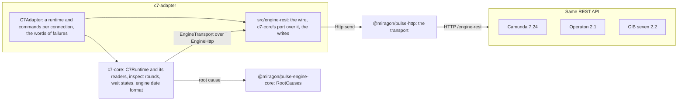

# Camunda 7 family adapter

- Status: accepted
- Last reviewed: 2026-11-20 (at history level NONE the instance search finds no instance and its count reads 0 where the history answers, the runtime's count with an incident and below 0 without one, a defect pinned as one, while the reads of the runtime still answer and those that join the history come back short, each pinned on Operaton and CIB seven by a suite of its own; a screen shows a hint where the history misses instances the runtime runs, no fallback to the runtime: [runtime-contract.md](runtime-contract.md)); 2026-11-16 (the read laws over the MCP server's wire run the engine connector's runtime, `runtimeOf`: c7-core's `C7Runtime` over the connector's port, its failures read by `runtimeErrorOf` in `src/lib/engine` instead of a test-support mapping); 2026-11-15 (the read laws run c7-core's `C7Runtime` over a second wire too, the MCP server's generated SDK through the engine connector's port, on both images of CI; the engine suites seed the conformance world through c7-core's `seedC7World` and `seedC7CommandWorld`, from the diagrams in `packages/connectors/c7/c7-core/world/`; the adapter is a thin plug: its commands read a move's activity tree, a migration's running instances and a Stop's batch through c7-core's reads of `./runtime` over the port of the read connection, and the adapter keeps no REST client of its own, only its wire, that port, its writes and the words of its failures; c7-core's `C7Runtime` answers every read of the engine contract over the adapter's port, the bulk operations and migration planning included, and the adapter words its wire's failures through `ErrorTranslation.runtimeError`; the engine, its processes, a version's diagram, the counts on it, the processes it calls, the instances and their count, a version's variable names, an instance's detail, the open incidents and an incident's details are read by c7-core's readers of `./runtime` over the adapter's port, with the same requests, the history's reading `POST`s included; a 401 to a connection without a login says to add one with Set credentials); 2026-11-14 ("with incident" reads one way, c7-core's rule: an open incident the runtime holds now, on every history level; the instance search pages the history's rows of the runtime's ids, and the read laws run on an engine at history level AUDIT too); 2026-11-12 (`C7Adapter.cli` gives the CLI command that triggers the event a token waits for, `PulseCli`, on the engine its `CliTarget` names: a profile with the target's URL, which beats a `PULSE_CLI_URL` of the user's shell and which the CLI refuses beside a profile of the same name in the user's config file that holds headers, whatever their names, or credentials for another origin, or the default engine's URL, on which the CLI takes no profile); 2026-11-11 (the editor hosts send the adapter no number beyond the range of a double, which it writes as text without a type; the refusal of a number that is not finite is c7-core's `toEngineVariable`, of which the adapter keeps no copy); 2026-11-10 (the adapter sends through `@miragon/pulse-http` and its inspection goes out as routes of c7-core's `CORE_ROUTES`; the incident retry's target, the built-in incident types, the request of an incident's cause and the typing of a written variable come from c7-core; the adapter joined the c7 family as `@miragon/pulse-c7-adapter`); 2026-11-09 (#585 merged: the adapter is a package, which Pulse for Orca bundles too)

## Context

Operaton and CIB seven are forks of Camunda 7 and keep its REST API, so one adapter
serves all three; the conformance kit runs on Operaton and CIB seven in CI (Camunda 7's
image left Docker Hub in November 2026; it passed on 7.24.0 until then). The adapter calls the
REST API itself:

## Decision

`packages/connectors/c7/c7-adapter/src` implements `EngineAdapter` (a port of the runtime
view, `@miragon/pulse-runtime-view/ports`), `ProcessRuntime` and `ProcessCommands` (the engine
contract of `@miragon/pulse-engine-core`) as a **thin plug** over the core of the Camunda 7 REST
dialect family c7, `@miragon/pulse-c7-core` (its workflow domain, and under `./runtime` every read
of the contract), the package the CLI and the MCP server run too: the adapter keeps its wire
(`packages/connectors/c7/c7-adapter/src/engine-rest/http`), the port c7-core reads over
(`src/engine-rest/inspect`), its writes (`src/engine-rest`, `src/writing`) and the words of its
failures (`src/errors`), and no reader of its own. The package belongs to the c7 family, whose
dialect it implements.

- **One edge to c7-core, bundled.** c7-core has no runtime dependency but the engine
  contract's main entry and no Node built-in, takes its engine through a caller's port and
  returns data. Only this adapter
  imports it among the editor hosts' code (its main entry and `./runtime`: the engine contract's
  reads c7-core holds, `C7Runtime`, which answers every one of them over the adapter's port, the
  reads the commands check before a write, `findActivityTree`, `readHistoricInstances`,
  `readBatchStatistics` and `findHistoricBatch`, the checked views `JsonView` and the id rule
  `isEngineId`;
  `packages/connectors/c7/c7-adapter/.dependency-cruiser.cjs`, the runtime view's
  `runtime-view-is-dialect-neutral`, the hosts' `extension-is-dialect-neutral` and
  `plugin-is-dialect-neutral`, and the root rule `adapters-own-their-family`, which lets a
  family's adapter import its own family's core); the runtime
  view's ports, core, webview and host kit and the hosts stay engine-neutral. esbuild inlines it
  into `dist/extension.cjs` and the Orca plugin's worker, which ship no `node_modules`. One home: a fix to wait states (c7-core) or root causes (the engine
  contract's `RootCauses`) lands once, and the conformance laws run it on CIB seven and
  Operaton (on Camunda 7 until its image left Docker Hub).
- **c7-core's port over `EngineHttp`.** `HttpEngineTransport` is the wire of c7-core's
  `routedTransport` over `CORE_ROUTES` (c7-core's main entry): each operation id c7-core's
  inspection and its readers of `./runtime` send goes out as its route, by the route's method (a
  reading `GET` without a body, a reading `POST` with its JSON body: the history's instance query,
  its count and the variable names; a write, a `GET` with a body or a `POST` without one is refused
  before it leaves), the path template filled with its encoded values (`CoreRequests`), an
  operation the table lacks refused before anything is sent; a `GET` route that answers
  `text/plain` only (a stack trace, error details) is read as text, everything else as lossless
  JSON through `EngineHttp`. No table of the adapter's own. Its failure reading keeps
  the extension's missing resource (below), so c7-core's port reads a missing record, activity
  tree or stack trace exactly as the adapter does elsewhere.

- **Every read is c7-core's.** `C7Adapter.runtime` builds c7-core's `C7Runtime` over the port
  of the read connection (`createEnginePort(HttpEngineTransport.over(http))`), with
  `ErrorTranslation.runtimeError` as its `failureOf`: a `RuntimeError` of c7-core (an unusable
  answer, an id no engine assigns) passes as it is, every failure of the wire gets the adapter's
  words below. The adapter keeps no reader of its own.
- **The commands read through c7-core.** `C7ProcessCommands` takes the writer
  (`EngineWriter`/`RestEngineWriter`, on a connection that may write) and the port of the read
  connection, the one `C7Runtime` reads over, and reads what it checks before a write with
  c7-core's reads of `./runtime` over it: a move's activity tree (`findActivityTree`; an instance
  that does not run, or an id no engine assigns, is not running and nothing is sent), a
  migration's running instances (`readHistoricInstances`) and a refused Stop step's batch
  (`readBatchStatistics`, then `findHistoricBatch`). `RestEngineWriter` reads the reference of a
  batch it started and an incident's root cause with c7-core's `JsonView` and checks every id it
  writes with `RequestArguments` (c7-core's `isEngineId`).
- **One HTTP seam, the shared transport.** `EngineHttp` (`src/engine-rest/http`, the
  adapter's wire) is a thin facade (`read`, `find`, `text`, `write`, each with its intent) over
  `Http.send` of `@miragon/pulse-http`, the transport the CLI and the MCP server send through,
  over the global `fetch` of the host's runtime (`C7Adapter`'s default; the hosts pass none: in
  VS Code's extension host it carries the proxy and certificate settings, in Orca it is the
  worker's): no redirect followed (a redirect is an error, credentials never travel to another
  host), a deadline to the last byte (the profile's `timeout`, else 60 s), at most 64 MiB of an
  answer, Basic as UTF-8 from
  the selected target only, the request's password (of four characters or more) and Basic value
  masked in each error answer the engine sends back (an answer that succeeds comes as the engine
  sent it). A connection for reads is the transport's `readOnly` and refuses every write
  before it leaves (`unsupported`, below); `C7Adapter.commands` builds the writer on its own
  connection, a test holds both. A URL or credentials the transport cannot use (a user name with a colon) fail
  each call as `misconfigured`, sending nothing, and so do client credentials, which only the C8
  adapter takes ([c8-adapter.md](c8-adapter.md)). Only the wire imports the transport, by its
  main entry (`http-only-in-the-wire`, `http-by-its-main-entry` in
  `packages/connectors/c7/c7-adapter/.dependency-cruiser.cjs`); the runtime view and the
  hosts never do (the repository's `http-consumers`). The wire passes the transport's
  `TRANSPORT_CASES` it can express against their loopback engine
  (`packages/connectors/c7/c7-adapter/test/engine-rest/transport-cases.test.ts`: Basic and a
  read-only connection, the deadline turned from the adapter's 60 s into the case's; no
  token, no caller's abort, no cap of its own, since the adapter fixes 64 MiB, and no write
  caveat, which the adapter does not report: a write it cannot confirm reads as unreachable
  or unexpected); the error-path goldens pin what it reports.
- **The engine shown is the engine queried.** URL and credentials come only from the
  selected target; Pulse reads the workspace's `.pulse.json` with the profile format
  (`TargetsParser` over `@miragon/pulse-profile`, held to its fixtures: the format's URL without
  trailing slashes, never an engine for a profile the format refuses).
  Ids must match `^[A-Za-z0-9_][\w.:-]*$` (no comma that would add ids to a list) and are
  refused before sending; variable names without control characters, at most 255.
- **The instance detail is c7-core's** (`InstanceDetailReader`, run by `C7Runtime` of `./runtime`
  over the adapter's port): its inspection (`InstanceInspection`) runs c7-core's `loadInstance` with
  variables and stack traces and without history, the reads all `GET`s, and its view is
  c7-core's `InstanceView` with no mirror type; the reader maps its wait states, incidents,
  children and variables to the contract, the inspection's variable map when the typed
  variables cannot be read. The rounds, their caps, the wait states and the retry of an
  instance that ends between the rounds are c7-core's
  (`packages/connectors/c7/c7-core/src/inspect.ts`). The history of activities (the path, and
  the calls in it) is the inspection's own read of `GET /history/activity-instance`, in
  parallel with the rounds, read by c7-core's `timelineOf` after it checked that each step
  names its activity and start time (else `RuntimeError("unexpectedResponse")`), because
  `loadInstance`'s history option would also read every historic incident of the instance on
  each live refresh. The view also guarantees the definition's version. When the view is
  ended, the path is read once more after it, so an instance that ended during the rounds
  shows its whole path (ended instances are not polled).
- **Incident details carry their root cause.** c7-core's `incidentDetailsOf` adds engine-core's
  `RootCauses.of` and `RootCauses.lineOf` of the text to every `IncidentDetails` (`getIncidentDetails`,
  c7-core's `IncidentDetailsReader`, and the details of `getInstanceDetail`); the core shows the
  root cause of complete details and the host opens the text at that line. `getIncidentDetails`
  reads the text from the request c7-core's `CAUSE_OPERATIONS` names for the incident's type (the
  stack trace or the error details, the request c7-core's inspection sends), of the job or
  external task c7-core's `incidentRecovery` names; without one (a custom type, no or an empty
  `configuration`) or when it is gone, the incident's message.
- **Writes** are seven requests:

  | Request                                                           | For                                                           |
  | ----------------------------------------------------------------- | ------------------------------------------------------------- |
  | `PUT /job/{id}/retries` or `/external-task/{id}/retries`, 1 retry | `retryIncident`, the target from c7-core's `incidentRecovery` |
  | `PUT /process-instance/{id}/variables/{name}`                     | `setVariable`                                                 |
  | `POST /process-instance/{id}/modification`                        | `moveToken`                                                   |
  | `POST /process-instance/delete`                                   | `cancelInstances`                                             |
  | `POST /migration/executeAsync`                                    | `migrateInstances`                                            |
  | `PUT /batch/{id}/suspended`                                       | `stopBulkOperation`, first step                               |
  | `DELETE /batch/{id}?cascade=false`                                | `stopBulkOperation`, second step                              |

  A retry reads the incident and, for a propagated one, its root cause; the job or
  external task that c7-core's `incidentRecovery` names for the root cause gets one retry
  (`RecoveryTargets`). Another type, or a built-in one without a `configuration` (an empty
  one too), is `skipped`, a root cause or resource that is gone is `gone`; both reject.
  Never cascade (the historic batch stays). The bodies: the variable body
  `{"value":…,"type":…}` losslessly, typed by c7-core's rules (below), the move body
  (below), the cancel body
  `{"processInstanceIds":[…],"deleteReason":…,"skipCustomListeners":false,"skipSubprocesses":false,"skipIoMappings":false}`
  (`writing/cancel-body.ts`; no `deleteReason` without a reason), the migration body
  `{"migrationPlan":{"sourceProcessDefinitionId":…,"targetProcessDefinitionId":…,"instructions":[{"sourceActivityIds":[…],"targetActivityIds":[…],"updateEventTrigger":false}]},"processInstanceIds":[…],"skipCustomListeners":false,"skipIoMappings":false}`
  (`writing/migration-body.ts`). The commands read the batch for Stop through c7-core's batch
  reads over the read connection's port. Allowed variable types: String, Boolean, Short, Integer, Long,
  Double, Date, Json, Null; anything else, including names of object properties such as
  `constructor`, is rejected before sending, a choice of the editor hosts, which edit only
  values they show as JSON (c7-core would write an Xml or an Object with its type name too).
  A variable change is JSON text (`VariableChange.valueJson`), the editor hosts' input form,
  and keeps the variable's type: the text must be a value of that type (a JSON string for
  String and Date, an integer for Short, Integer and Long, a number for Double); for each of
  these types a number beyond the range of a double (`1e400`), which JSON would send as null,
  is rejected before sending. Without a type (a new variable, or one that holds null) text
  that is no JSON is rejected before sending, a JSON string is a String, an object or an
  array Json, and any other value gets the type c7-core's `autoTypedValue` gives its text, as
  the CLI's `--var` does: an integer is an Integer within int32, else a Long within int64,
  else a String; a plain decimal is a Double within the range of a double, else a String. A
  JSON number in exponent form (`1e3`), which `autoTypedValue` leaves a String, is a Double
  within that range, since the editor hosts' "Write as: Number" writes a number. So without a
  type a number beyond the range of a double, in any form, goes out as a String of its exact
  text, as in the CLI, and so does an integer beyond int64. The editor hosts send neither: their
  runtime view refuses both before it asks for a variable that holds null, and a number beyond
  the range of a double for a Double variable (`writes.md`), by engine-core's `ValueKinds`, to
  which `packages/connectors/c7/c7-adapter/test/c7-number-parity.test.ts` holds this reading.
  c7-core's `toEngineVariable` gives the wire form: a Json value as its serialized text, a
  Date in the engine's format with its own offset (c7-core's `OFFSET_REQUIRED` reading: a
  time without an offset, `24:00`, a day the calendar lacks or a date without a day is
  rejected before sending), a Long beyond 2^53 with all its digits. The rejection of a number
  beyond the range of a double for one of the types above (its parsed text reads as Infinity)
  is `toEngineVariable`'s as well, c7-core's rule for a number that is not finite, which the MCP
  server's tools share; the adapter keeps no copy of it.
  The wire words each reason of the transport (`HttpFailures`, total over its
  `FailureReason`) and each error answer (`ErrorAnswers`: the status with its phrase, what
  the body states, a hint to the REST root for a 404 of no engine resource by c7-core's
  `isUnknownEndpoint` and for a redirect, a hint to add a login with Set credentials for a 401
  to a connection that sent none); a TLS handshake and a host name that does not
  resolve name their own reason and what to check, a broken connection the network path. A
  request the transport cannot send is a refused id when a path value is `.`, `..` or empty
  (no resource carries it), else a connection it cannot use, which fails loud.
  `ErrorTranslation` keeps the table onto the contract's failures (owner decision ND14: it stays per adapter): no answer (network,
  deadline, TLS, DNS) is `unreachable`, 401 `unauthorized`, 403 `forbidden`, a redirect or a
  404 on a read `misconfigured`, any other 4xx or 5xx `engineFailure`, an answer that is no
  JSON, above the cap or not the expected shape `unexpectedResponse`, a refused id or a
  connection the transport cannot use `misconfigured`; the wire's hint goes along. A write a
  connection for reads refuses is `unsupported`, without a hint ("Read-only. This connection
  only reads, so Pulse did not send PUT …", in both hosts under "… cannot do this."): the write
  is not sent (the reads a command needs first are), live updates go on. An engine text is
  cut after 500 characters on one line, after the redaction below. A write the engine refuses with 404,
  another 4xx or 5xx (C7 also reports rule violations as 500) is `rejected`, except on the
  submit of a cancel or a migration (`ErrorTranslation.submitted`): there only 4xx is
  `rejected`, while 5xx is `engineFailure`, because the engine may have failed after it
  created the batch and the core treats that outcome as unknown. The submitted value (as
  typed and in the form it is sent in, a number as its JSON number, a Date in the engine's
  format) or the cancel reason (raw and JSON-escaped; `Redaction.ofValue` and
  `Redaction.ofText`) is removed from the engine's message, also when the engine reports
  something as not found.
  A missing resource is an engine 404 that c7-core's `isMissing` reads as missing (an
  exception other than `NotFoundException`, the 404 of a wrong REST root, and
  `QueryParamException`, an unreadable query value), a 500 `NullValueException` (a
  resource that ended between two reads) or a refused id, never a write a connection for reads
  refuses: a retry there is no incident `gone`. A retry builds the path of the job or external
  task before it sends, so an id of the engine's that the adapter refuses there is a `rejected`
  retry ("… as an identifier is not accepted"), not a `gone` incident.

- **A move pins the token it cancels.** `moveToken` costs two calls: the activity instance
  tree (`GET /process-instance/{id}/activity-instances`, c7-core's `findActivityTree` over the
  read connection's port) and one
  modification. `SourceToken` finds the activity or transition instance (an async-before
  job is a transition instance) at the source and refuses none, several or a
  `#multiInstanceBody`; `MoveBody` writes
  `{"annotation":…,"instructions":[{"type":"startBeforeActivity","activityId":…},{"type":"cancel","activityInstanceId"|"transitionInstanceId":…}]}`
  as the body, element ids and reason only there. Cancelling by activity id would also cancel
  the token a re-run just started; no `ancestorActivityInstanceId`, so the engine picks the
  single instance of the target's scope and refuses when there are several. No skip flags. The engine keeps the annotation in its user operation log only
  for an authenticated user; the reason is removed from engine errors.

- **Query bodies.** The historic instance query and its count are `POST`s, so 1000
  instance ids (`processInstanceIds`, about 39 KB) fit. An empty `instanceIds` list
  answers without a call.
- **Variable conditions are `variables` of the historic query.** `equals`, `notEquals`,
  `greaterThan` and `lessThan` become `eq`, `neq`, `gt` and `lt` with the value parsed
  losslessly from `valueJson` (`null` included); a date's `at` is sent in UTC in the
  engine's date format (`2026-03-15T10:00:00.000+0000`), the only form the engine reads as
  a date; `like` becomes `like` with `*` turned into `%` and the
  engine's `%`, `_` and `\` escaped with `\`. The engine matches a variable of any scope,
  including task-local ones, and a JSON number matches an Integer variable of that value,
  `42` and `42.0` alike, while the text `"42"` does not (checked on Operaton 2.1.5, CIB seven 2.2.0 and Camunda 7.24.0).
- **Migrations are batches too.** `proposeMigration` is `POST /migration/generate`
  (`updateEventTriggers: false`) and `checkMigration` `POST /migration/validate`, both reading
  `POST`s on the read connection (c7-core's `MigrationReader`). An instruction maps one source
  and one target activity; others are left out. `migrateInstances` costs two calls: one
  historic instance query for the given ids unfinished on the plan's source
  (in a migration batch an ended or unknown id would be a failed job, unlike in a
  deletion batch), then the submit with only those; with none left it is `rejected` and
  submits nothing. When that read fails as `unreachable`, `unexpectedResponse` or
  `engineFailure`, nothing was submitted, so the adapter rejects with "… so it submitted
  nothing" instead of leaving the outcome open. The submit's errors translate as a
  cancel's (`submitted`).
  `getBulkFailures` reads the batch statistics for its `batchJobDefinitionId` and, when
  jobs failed, `GET /job?jobDefinitionId=<id>&withException=true&noRetriesLeft=true&maxResults=100`; a failed job has no `processInstanceId`, so the instance comes from
  "process instance '<id>'" in its message, which is put on one line and cut to 300
  characters. Facts from the spikes are in [migrations.md](migrations.md).
- **Bulk operations are batches.** `cancelInstances` starts one instance-deletion batch
  and returns its id as the `BulkOperationId`; only `id` is read from the answer. `getBulkOperation`
  (c7-core's `BulkOperationReader`) reads
  `GET /batch/statistics?batchId=<id>`: a batch there is `running` or `suspended` with
  item counts (jobs × `invocationsPerBatchJob`, completed and failed capped at the
  total). Otherwise `GET /history/batch/<id>`: `ended` with `endedAt`. `startedAt` is
  set when the engine reports a start time. Neither, or a
  batch type Pulse does not map (today `instance-deletion` → `cancelInstances` and
  `instance-migration` → `migrateInstances`),
  reads `undefined`.
- **Stop is suspend, then delete.** `stopBulkOperation` suspends the batch, then deletes
  it without cascade. Only when the engine refuses a step (404, another 4xx, 5xx) does the adapter read
  the batch: a suspended batch or one in history counts as halted and the step as done;
  otherwise the refusal stands, so an unknown batch is `rejected`. A refused login (401, 403) or a network failure is thrown at once, without a probe, so a stale password
  costs no further failed login and a delete refused with 403 never counts as stopped. Facts from a spike on Operaton 2.1.5:
  - a deletion batch silently skips unknown and already ended ids, without a failed job,
    so the adapter does not filter the ids first;
  - a small batch is done within about 70 ms, often before a Stop arrives;
  - suspending halts the batch, but jobs the executor already acquired still
    finish: counts kept rising for about a second after the suspend;
  - deleting right after the suspend can fail with HTTP 500 (optimistic locking
    against a running job) and succeeds once the batch is idle. Such a Stop still
    resolves; the batch stays suspended, the core offers Stop again, and a second Stop
    deletes it;
  - stopping a batch that ended resolves (its history exists).
- **Answers are validated.** JSON is parsed losslessly (`JSON.rawJSON` for integers above
  2^53), checked at runtime by c7-core's `JsonView` (`@miragon/pulse-c7-core/runtime`, whose
  words name what was wrong, such as `id is missing`), and mapped; anything unexpected becomes
  `RuntimeError('unexpectedResponse')`. An id is checked by c7-core's one id rule, `isEngineId`,
  before it goes into a path or a query.
- **Mapping rules.** Statistics by definition id (never by key, which only covers the
  latest version); the filter by element is `activityIdIn`, which also finds a token
  that waits before an async-before task (`activeActivityIdIn` misses it); propagated
  incidents (copies by c7-core's `isRootIncident`: an incident that names another incident
  as its root; one that names none is a root) are dropped;
  `withIncident` counts distinct instances; timestamps normalised to UTC ISO; wait states
  from `inspect` across called instances with their `processInstanceId`; `active` is the
  activity's `instances` minus its root incidents (floored at 0); `workerTask.taskType` is
  the external task topic; `Incident.job` is the `jobId`/`externalTaskId` of `inspect`
  (topic as type) or, in `searchIncidents`, the job or external task c7-core's
  `incidentRecovery` names, both none for an empty `configuration`;
  `Incident.definition` comes from the `inspect` view (own incidents), one historic query
  for the called instances that hold incidents, or one join with the definition
  statistics (`searchIncidents`), never one call per incident.
- **With incident is the runtime's** (owner decision 2026-11-14), c7-core's rule
  (`packages/connectors/c7/c7-core/src/with-incident.ts`), the reading the MCP cockpit and the CLI
  share: an instance the runtime holds an open incident for, now (`GET /process-instance` with
  `withIncident`, `ACT_RU_INCIDENT`). The history's incident filters (`incidentStatus`,
  `withIncidents`) read `ACT_HI_INCIDENT`, which only history level FULL writes, so at AUDIT they
  found nothing (measured on Operaton 2.1.5 and CIB seven 2.2.0: the version counts said 6 with
  incident, the scope "With incident" 0). `listDefinitions` and `listVersions` count the runtime's
  instances with an open incident per version; `searchInstances` with `withIncident: true` pages the
  history's rows (newest first, the other filters the history's) of the runtime's ids in the scope
  (version, process, business key), none for `lifecycle: "ended"`; `countInstances` counts them in
  one runtime count when the runtime knows the whole filter, else the history's count of those ids;
  a row's flag asks the runtime for the page's running ids, 50 per request; without an incident is
  all minus those with one. The runtime laws run on a second engine at history level AUDIT
  (`packages/connectors/c7/c7-adapter/test/c7-history-audit.engine.test.ts`).
- **Calls.** `getCalledProcesses` reads the deployed XML and the definition statistics in
  parallel (which carry every version's `deploymentId` and `versionTag`) and parses each
  `callActivity` start tag for `calledElement` and the binding attributes
  `calledElementBinding`, `calledElementVersion` and `calledElementVersionTag` under any
  prefix (`camunda:`, and `operaton:`, which Operaton reads first). `latest` (the default)
  is the newest version of the key, `deployment` the version from the caller's
  deployment, `version` that number, `versionTag` the newest version with that tag. A
  `calledElement`, version or tag with `${…}` or `#{…}` is left out, as is an unknown
  binding; tenants are not told apart.

- **CLI.** `C7Adapter.cli` returns a `PulseCli`, which gives the command of Pulse's CLI that
  triggers the event a token waits for, for the editors' refusal behind an event-based gateway
  ([writes.md](writes.md)): `pulse advance <instance> --activity-id <activity>`, on the engine the
  port's `CliTarget` names: `--profile <name> --url <endpoint>` when the editor read the target
  from a project file, whose `--url` beats a `PULSE_CLI_URL` of the user's shell, so the profile's
  headers and login go to the URL the editor shows; a profile of the same name in the user's
  config file, which the CLI takes in place of the project file's, sends its headers and credentials
  there only when its own URL has that origin: the CLI refuses one that holds headers, whatever
  their names, or credentials for another origin (CONFIG), so the copied command fails with the
  CLI's error ([writes.md](writes.md)); and `--url <endpoint> --auth none` for its default engine,
  which it reaches without a login: a `--url` without `--profile` takes no profile in the CLI, so
  only the user's `PULSE_CLI_*` environment applies, whose login `--auth none` switches off
  ([writes.md](writes.md)). It names one for a message, a signal or a timer (`advance` delivers the
  message to that execution's subscription, the signal to that execution, or executes the timer's
  job) and only when no other wait state of the instance tree waits at the activity, since `advance`
  refuses an activity where more than one waits. It quotes a word as the CLI quotes the words of its
  own ready commands; no package imports an app, so it keeps a copy of the CLI's `shellWord`, which
  `scripts/shell-words.test.mjs` holds to the CLI's rule.

- **Web UI.** `C7Adapter.webUi` returns a `CockpitWebUi` ("Cockpit") when the target's
  `cockpitUrl` names one, chosen by its path (the app root cannot be told from the REST
  endpoint: `/camunda`, `/operaton`, a context path, or no webapps at all):
  - `…/app/cockpit/{engine}/`: the classic Cockpit of Camunda 7, Operaton and CIB seven,
    `#/dashboard` for the engine overview, `#/process-instance/{id}/runtime`
    (`?detailsTab=incidents-tab` when the instance has an incident) and
    `#/process-definition/{id}/runtime`;
  - `…/webapp/`: the CIB seven webclient, `#/seven/auth/start` for the engine overview,
    `#/seven/auth/processes/instance/{id}` (`?tab=incidents`) and
    `#/seven/auth/processes/definition/{id}?tab=instances`;
  - any other path: no web UI. Ids are URL-encoded except the `:` of definition ids. The
    community Cockpits send an ended instance to its definition.

Engine calls per port method (`inspect` counts as one): `describeEngine` 1–2,
`listDefinitions`/`listVersions` 2 (the runtime's instances with an open incident, every
page), `getElementStatistics` 2, `getCalledProcesses` 2 in parallel, `searchInstances` 2 per
page (never per row; the flag 1 per 50 running rows; with an incident first the runtime's ids,
then the history's page of them), `listVariableNames` 2 (the newest 50
instances of the version, then the historic variable query without values
for their ids, at most 2000 variables), `countInstances` 1
(the historic instance count with the body of the search; with an incident the runtime's count, or
its ids and the historic count of them under an element or variable condition; 2 for instances
without an incident: all minus those with an open incident), `getInstanceDetail` 2 in
parallel (`inspect` and
`GET /variable-instance` without values, which carries the engine type and the
activity instance, hence the element scope, of every variable of a running instance;
+1 when an incident sits in a called instance), `searchIncidents` 2 per page (incidents and definition statistics in
parallel), `getIncidentDetails` 2, `getBulkOperation` 1–2 (statistics, then history once
the batch ended), `getBulkFailures` 1–2, `proposeMigration` 1, `checkMigration` 1,
`cancelInstances` 1, `migrateInstances` 2, `stopBulkOperation` 2 (suspend and delete; 1–2
more reads for each step the engine refuses). A search by ids asks for no more rows than
there are ids.

### Structure

Classes as in [code-structure.md](code-structure.md). Two places wire: `C7Adapter` builds
an `EngineHttp` per connection (for reads or for writes) around the `fetch` it is given,
whose transport `EngineWire` builds, and c7-core's port over the one for reads, which the
runtime and the commands read over;
`C7Runtime.over(port, { failureOf })` (c7-core's `./runtime`) builds one reader per question over
the port of that connection. A reader decides which
engine calls answer a port method and maps their answers to the contract's read models in
private methods; nothing else does either. What one call needs from another (the inspected
instance, the definitions by instance) goes in as a parameter, never as constructor state.

| Folder                                                      | Classes                                                                                                                                                                                                                                                                                      | Job                                                                                                                                                                                                                                                                                                                                                                                                                                                                                                                                                                                                                                                                                                                                                                                                                                                                                        |
| ----------------------------------------------------------- | -------------------------------------------------------------------------------------------------------------------------------------------------------------------------------------------------------------------------------------------------------------------------------------------- | ------------------------------------------------------------------------------------------------------------------------------------------------------------------------------------------------------------------------------------------------------------------------------------------------------------------------------------------------------------------------------------------------------------------------------------------------------------------------------------------------------------------------------------------------------------------------------------------------------------------------------------------------------------------------------------------------------------------------------------------------------------------------------------------------------------------------------------------------------------------------------------------ |
| `packages/connectors/c7/c7-adapter/src/web-ui`              | `CockpitWebUi`                                                                                                                                                                                                                                                                               | the routes into Cockpit or the CIB seven webclient                                                                                                                                                                                                                                                                                                                                                                                                                                                                                                                                                                                                                                                                                                                                                                                                                                         |
| `packages/connectors/c7/c7-adapter/src`                     | `C7Adapter`, `C7ProcessCommands`                                                                                                                                                                                                                                                             | the entry (per connection a runtime, c7-core's `C7Runtime`, and the commands) and the commands port; every command runs through `ErrorTranslation`, every failure of the wire a read meets through its `runtimeError`                                                                                                                                                                                                                                                                                                                                                                                                                                                                                                                                                                                                                                                                      |
| `packages/connectors/c7/c7-core/src/runtime`                | `C7Runtime`, `EngineReader`, `DefinitionReader`, `ElementStatisticsReader`, `CalledProcessReader`, `InstanceSearch`, `VariableNameReader`, `InstanceDetailReader`, `InstanceInspection`, `IncidentSearch`, `IncidentDetailsReader`, `BulkOperationReader`, `MigrationReader`, `OffsetPaging` | c7-core's runtime and its readers over the adapter's port: the engine, its processes and versions, a version's diagram, the counts on it, the processes it calls, the instances and their count, a version's variable names, an instance's detail (its inspection, the path from the history, its typed variables), the open incidents and an incident's details, a bulk operation and its failures, a migration's plan and its check, offset paging behind the cursor; with them the incidents of an answer, a version's reference, timestamps, states and the root cause of incident details (`definitionRefOf`, `timestampOf`, `instanceStateOf`, `incidentDetailsOf`), the root incident by the rule of c7-core's main entry (`isRootIncident`); the reads the commands check before a write (`findActivityTree`, `readHistoricInstances`, `readBatchStatistics`, `findHistoricBatch`) |
| `packages/connectors/c7/c7-adapter/src/writing`             | `VariableBody`, `CancelBody`, `MigrationBody`, `Redaction`, `SourceToken`, `MoveBody`                                                                                                                                                                                                        | the bodies of a variable change (typed by c7-core), a move, a cancel and a migration, the allowed types, what to keep out of any error message                                                                                                                                                                                                                                                                                                                                                                                                                                                                                                                                                                                                                                                                                                                                             |
| `packages/connectors/c7/c7-adapter/src/errors`              | `ErrorTranslation`                                                                                                                                                                                                                                                                           | engine failures to `RuntimeError`: `translated`, `runtimeError` (the runtime's `failureOf`), `commanded<Result>`, `submitted<Result>`, `isRefusal`                                                                                                                                                                                                                                                                                                                                                                                                                                                                                                                                                                                                                                                                                                                                         |
| `packages/connectors/c7/c7-adapter/src/engine-rest`         | `EngineWriter`/`RestEngineWriter`, `RecoveryTargets`, `RequestArguments`, `Present`                                                                                                                                                                                                          | one method per write the commands send, a started batch's reference and an incident's root cause read by c7-core's `JsonView`; the job or external task c7-core's `incidentRecovery` names; strict ids (c7-core's `isEngineId`) and variable names                                                                                                                                                                                                                                                                                                                                                                                                                                                                                                                                                                                                                                         |
| `packages/connectors/c7/c7-adapter/src/engine-rest/http`    | `EngineHttp`, `EngineWire`, `EngineRequestError`, `ErrorAnswers`, `HttpFailures`, `EngineTexts`                                                                                                                                                                                              | the wire: one request over `@miragon/pulse-http`, lossless JSON, failures with status, engine type and hint, the cut of an engine text                                                                                                                                                                                                                                                                                                                                                                                                                                                                                                                                                                                                                                                                                                                                                     |
| `packages/connectors/c7/c7-adapter/src/engine-rest/inspect` | `HttpEngineTransport`, `CoreRequests`                                                                                                                                                                                                                                                        | the port c7-core's readers and its inspection run on: each route of `CORE_ROUTES` sent over `EngineHttp` by its method                                                                                                                                                                                                                                                                                                                                                                                                                                                                                                                                                                                                                                                                                                                                                                     |
| `packages/connectors/c7/c7-adapter/src/engine-rest/views`   | `LosslessJson`, `UnexpectedAnswerError`                                                                                                                                                                                                                                                      | the wire's: the engine's JSON parsed without losing a digit (and a variable written so), an answer that is no JSON                                                                                                                                                                                                                                                                                                                                                                                                                                                                                                                                                                                                                                                                                                                                                                         |

Tests construct `new C7Adapter(send)` with a fake `fetch` that answers recorded REST
routes and so run every class above.

## Consequences

- The conformance kit passes all laws against `operaton/operaton:2.1.5` and
  `cibseven/cibseven:run-2.2.0` (and passed against Camunda 7.24.0 until its image left Docker Hub)
  (`PULSE_ENGINE_IMAGE=… pnpm --filter @miragon/pulse-c7-adapter run test:engines`; its suites
  skip on a `camunda/camunda` image, which the C8 suites run, and fail on an image of neither).
  Its harness seeds the kit's world with c7-core's `seedC7World` and `seedC7CommandWorld`
  (`@miragon/pulse-c7-core/testing`: the same requests over any fetch-shaped `send`, plain ids the
  test-support helper brands, fixed unknown ids), from the diagrams in
  `packages/connectors/c7/c7-core/world/`, which `engine:up` deploys too.
  The same read laws run c7-core's `C7Runtime` over the MCP server's wire as well, the generated
  SDK through the engine connector's port, as the connector's runtime (`runtimeOf`, its failures
  read by `runtimeErrorOf`; `PULSE_ENGINE_IMAGE=… pnpm --filter @miragon/pulse-engine-connector
run test:engines`, two cases of its own on a bulk operation, which no read law reads), on the
  same two images in CI: the reads are one implementation, proven on both C7 wires. The two wires
  differ where the kit does not look: an integer beyond 2^53 arrives over the SDK as a string of
  its digits, and only this adapter's transport reads a refused id and a 500 `NullValueException`
  as a 404.
  The engines under test (`test:engines`, `engine:up`) run without their bundled invoice
  example: it sets the engine's global clock back by days while it seeds itself, after the
  REST API already answers, so instances seeded in that window got timestamps from the
  rewound clock, up to an end before their start. `startEngine` refuses an engine on which
  the example is deployed.
- Since c7-core reads the instance, two edge cases read as the CLI and the MCP tools
  read them: an empty string the engine sends for a business key, an assignee, an event or
  activity or definition name counts as absent, and an ended instance lists one historic
  variable per name (the last row of the engine's list). A field of the wrong JSON type in
  what c7-core reads is skipped instead of failing as `unexpectedResponse` (no engine
  of the family sends one). Every other answer, and every instance of the conformance world
  on all three engines, reads as before.
  The wire differs in paging details (the called instances are read with
  `firstResult=0`, the caller of an instance without history with `maxResults=2`), for
  an id the engine does not know one history read more, and for an ended instance one
  read of its path more (the parallel one, before the adapter knows that it ended).
- Rules the adapter still holds next to c7-core, for a later cut: the readings of
  `HttpEngineTransport` beyond c7-core's missing 404 (a refused id, a 500 `NullValueException`)
  and the words of its wire's failures (`ErrorTranslation`); the fallbacks of an incident's cause
  text (`IncidentDetailsReader`) and the root incident are c7-core's (`isRootIncident`). Which incident types the engine raises itself, what a retry
  retries and which request holds an incident's cause are c7-core's (`BUILT_IN_INCIDENT_TYPES`,
  `incidentRecovery`, `CAUSE_OPERATIONS`), so a built-in incident with an empty `configuration` is
  `skipped` as one without, no longer `gone`, and `searchIncidents` lists it without a job, as
  `inspect` always did.
- Since a written variable is typed by c7-core (`autoTypedValue`, `toEngineVariable`), a new
  variable (or one that holds null) given an integer beyond int64 or a number beyond the
  range of a double is a String of its exact text, no longer a Long the engine refused or a
  number sent as written for the engine to judge; neither reaches the adapter from the editor
  hosts for a variable that holds null any more, whose confirmation would name a number, since
  their runtime view refuses a whole number beyond 64 bits and a number beyond the range of a
  double before it asks (`writes.md`); a Date is sent with the offset it was given instead of in
  UTC (the same instant), and one with a day the calendar lacks, which `Date.parse` rolled
  over into the next month, or with `24:00`, which it read as the next day's midnight, is
  rejected before sending, as is an integer with a leading zero, which went out as JSON the
  engine refused, and a number beyond the range of a double for a Short, Integer, Long or
  Double, which went out as written for the engine to judge.
- Since the adapter reads a 404 by c7-core's `isMissing`, a 404 `QueryParamException`
  (a query value the engine cannot read) is no missing resource any more: a read fails as
  `misconfigured` instead of answering "none".
- A call costs its HTTP round trip, no process start. Certificates and proxies come from
  VS Code's settings, no longer from environment variables such as `NODE_EXTRA_CA_CERTS`.
- OAuth2 targets are refused when they connect (the host kit's `TargetPolicy`), with a message
  that names the way out: auth.type none, or basic without the OAuth keys, or the profile kept
  for the CLI.
- Known limits: a page of root incidents or of instances without an incident
  (`withIncident: false`) drops rows of the engine's answer and fills from further
  windows, at most 10 in all (c7-core's README), so only a page where nearly every row
  drops can come back short, even empty, with a cursor at the first row not read and no
  kept row skipped. Its cut follows the engine's order, and `GET /incident` sorts by the
  time alone: of two incidents raised in the same millisecond at a page's boundary, one
  may repeat or be skipped between two reads. Ended instances show the variables `inspect`
  reports, without engine types for plain values. Below history level FULL the engine
  keeps no historic batch: a finished batch reads `undefined` (the core then reconciles by
  ids) and a Stop after it ended is rejected. With `invocationsPerBatchJob` above 1 the
  item counts are approximate, because the last job may hold fewer items. Variable
  conditions read the historic variables, so below history level AUDIT a search by
  variables finds nothing, running instances included. At history level NONE the history holds
  no instance at all: the instance search finds none in any scope, and its count reads 0 where
  the history answers, the runtime's count where it knows a filter with an incident whole and
  below 0 without an incident (a defect, pinned as one); the counts of the processes and
  versions, the statistics and the incidents still answer from the runtime, while an instance's
  detail lacks its path and the incident raised in a called instance, an ended instance has none
  and a version names no variables
  (`packages/connectors/c7/c7-adapter/test/c7-history-none.engine.test.ts`, which pins each of
  these answers; [runtime-contract.md](runtime-contract.md)). JSON and object variables cannot be
  searched: the engine keeps their value serialized. A text value written in the engine's
  date format is read as a date by the engine.
