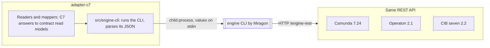
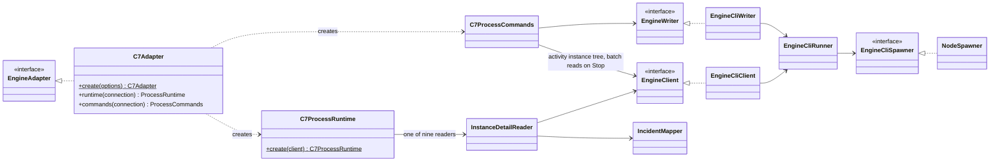

# Camunda 7 family adapter

- Status: accepted
- Last reviewed: 2026-10-26

## Context

[`@miragon/operate`](https://github.com/Miragon/operate) (0.9.0) is Miragon's CLI for the
Camunda 7 REST API (Operaton, CIB seven, Camunda 7). Its workflow commands already
aggregate what a cockpit needs (`inspect`: wait states across called instances, root
incidents, root cause, variables; `status`). It ships only a CLI bundle: no `exports`,
no type declarations, and loading the bundle runs the CLI. Operate's own pure `src/workflow` layer
would be importable, but only by deep-importing internals behind its own boundary rules.

Operaton and CIB seven are forks of Camunda 7 and keep its REST API, so one adapter
serves all three; the conformance kit runs on each of them in CI:

## Decision

`apps/vscode/src/adapters/c7` implements `EngineAdapter`, `ProcessRuntime` and `ProcessCommands`
on top of a **local engine CLI wrapper** in `apps/vscode/src/adapters/c7/engine-cli/`.

- **Wrapper = future library API.** The `EngineClient` interface exposes typed calls
  (`definitionStatistics`, `activityStatistics`, `diagramXml`, `historicInstances`,
  `historicInstanceCount`, `inspect`, `variables`, `incidents`, `incidentInstances`,
  `incident`, `jobStacktrace`, `externalTaskErrorDetails`, `activityInstances`,
  `batchStatistics`, `historicBatch`, `failedJobs`, `migrationPlan`, `migrationReport`,
  `product`, `version`) with typed views;
  `EngineCliClient.create(options)` implements it, `EngineWriter`/`EngineCliWriter`
  the writes (`retryIncident`, `setVariable`, `modify`, `deleteInstancesAsync`,
  `migrateInstancesAsync`, `suspendBatch`, `deleteBatch`). The wrapper imports only `node:*` and itself (dependency rule
  `engine-cli-wrapper-is-self-contained`), so an in-process engine client (a `-domain`
  package the CLI and the MCP server share) can replace it without touching the readers.
- **Today it spawns the bundled CLI** with VS Code's own runtime (`process.execPath`,
  `ELECTRON_RUN_AS_NODE=1`; VS Code ≥ 1.101 ships Node ≥ 22.12). The extension build
  bundles `@miragon/operate/dist/operate.js` (pinned exactly) with its dependencies into
  `dist/engine-cli.js`, since the .vsix carries no `node_modules`
  (`apps/vscode/test/architecture/engine-cli-bundle.test.ts` runs it without them).
- **The engine shown is the engine queried.** URL and credentials come only from the
  selected target, credentials only through `OPERATE_USERNAME`/`OPERATE_PASSWORD`/
  `OPERATE_TOKEN`; inherited `OPERATE_*` and `NODE_*` variables (`NODE_OPTIONS`,
  `NODE_TLS_REJECT_UNAUTHORIZED`, …) and `LD_PRELOAD`/`DYLD_INSERT_LIBRARIES` are
  dropped, while `NODE_EXTRA_CA_CERTS`, `NODE_USE_SYSTEM_CA` and the proxy variables
  stay; `OPERATE_READ_ONLY=1`; `OPERATE_CONFIG` points at an extension-owned
  `{"profiles":{}}` so the CLI never resolves a profile of its own: Pulse reads the
  workspace's `.pulse-cli.json` itself (the only source of engines, read in
  `TargetsParser`) and passes the chosen profile's URL. Ids must match
  `^[A-Za-z0-9_][\w.:-]*$` (no `-` in front, no comma that operate would split) and are
  refused before spawning.
- **Writes use their own runner.** `C7Adapter.commands` builds an `EngineCliWriter`
  whose runner has no `OPERATE_READ_ONLY` and knows exactly seven commands:

  | Command                                                         | For                              |
  | --------------------------------------------------------------- | -------------------------------- |
  | `retry --incident <id> --retries 1`                             | `retryIncident`                  |
  | `process-instance set-variable --body - -- <instanceId> <name>` | `setVariable`                    |
  | `process-instance modify --body - -- <instanceId>`              | `moveToken`                      |
  | `process-instance delete-async --yes --body -`                  | `cancelInstances`                |
  | `migration execute-plan-async --yes --body -`                   | `migrateInstances`               |
  | `batch suspend <batchId>`                                       | `stopBulkOperation`, first step  |
  | `batch delete <batchId> --yes --no-cascade`                     | `stopBulkOperation`, second step |

  `--yes` appears only on the three commands that would otherwise ask; never `--cascade`
  (the historic batch stays) or `--now`. Bodies go on stdin, never on the command line:
  the variable body `{"value":…,"type":…}` losslessly, the move body (below), the cancel body
  `{"processInstanceIds":[…],"deleteReason":…,"skipCustomListeners":false,"skipSubprocesses":false,"skipIoMappings":false}`
  (`writing/cancel-body.ts`; no `deleteReason` without a reason), the migration body
  `{"migrationPlan":{"sourceProcessDefinitionId":…,"targetProcessDefinitionId":…,"instructions":[{"sourceActivityIds":[…],"targetActivityIds":[…],"updateEventTrigger":false}]},"processInstanceIds":[…],"skipCustomListeners":false,"skipIoMappings":false}`
  (`writing/migration-body.ts`). The commands read the
  batch for Stop through a client on the read runner. Allowed variable types: String, Boolean, Short, Integer, Long, Double, Date,
  Json, Null (a new variable infers its type); anything else, including names of object
  properties such as `constructor`, is rejected before spawning.
  operate's exits 5–7 (not found, engine 4xx, engine 5xx, which C7 also uses for rule
  violations) become `rejected`, except on the submit of a cancel
  (`ErrorTranslation.submitted`): there only 5 and 6 are `rejected`, while 7 is
  `engineFailure`, because the engine may have failed after it created the batch and the
  core treats that outcome as unknown. The submitted value or the cancel reason (raw and
  JSON-escaped, `Redaction.ofValue` and `Redaction.ofText`) is removed from the engine's
  message, also when the engine reports something as not found.
  The read runner keeps `OPERATE_READ_ONLY=1`; a test holds both.

- **A move pins the token it cancels.** `moveToken` costs two calls: the activity instance
  tree (`process-instance get-activity-instance-tree`, on the read runner) and one
  modification. `SourceToken` finds the activity or transition instance (an async-before
  job is a transition instance) at the source and refuses none, several or a
  `#multiInstanceBody`; `MoveBody` writes
  `{"annotation":…,"instructions":[{"type":"startBeforeActivity","activityId":…},{"type":"cancel","activityInstanceId"|"transitionInstanceId":…}]}`
  on stdin, element ids and reason only there. Cancelling by activity id would also cancel
  the token a re-run just started; no `ancestorActivityInstanceId`, so the engine picks the
  single instance of the target's scope and refuses when there are several. No skip flags,
  no `--annotation` flag. The engine keeps the annotation in its user operation log only
  for an authenticated user; the reason is removed from engine errors.

- **Query bodies on stdin.** `historic-process-instance query` and `query-count` send
  their body with `--body -` on stdin: 1000 instance ids (`processInstanceIds`) are about
  39 KB, beyond Windows' command-line limit of 32 KB. An empty `instanceIds` list
  answers without a call.
- **Variable conditions are `variables` of the historic query.** `equals`, `notEquals`,
  `greaterThan` and `lessThan` become `eq`, `neq`, `gt` and `lt` with the value parsed
  losslessly from `valueJson` (`null` included); a date's `at` is sent in UTC in the
  engine's date format (`2026-03-15T10:00:00.000+0000`), the only form the engine reads as
  a date; `like` becomes `like` with `*` turned into `%` and the
  engine's `%`, `_` and `\` escaped with `\`. The engine matches a variable of any scope,
  including task-local ones, and a JSON number matches an Integer variable of that value,
  `42` and `42.0` alike, while the text `"42"` does not (checked on Operaton 2.1.5, CIB seven 2.2.0 and Camunda 7.24.0).
- **Migrations are batches too.** `proposeMigration` is `migration generate-plan --body -`
  (`updateEventTriggers: false`) and `checkMigration` `migration validate-plan --body -`,
  both on the read runner (operate counts them as reads). An instruction maps one source
  and one target activity; others are left out. `migrateInstances` costs two calls: one
  `historic-process-instance query` for the given ids unfinished on the plan's source
  (in a migration batch an ended or unknown id would be a failed job, unlike in a
  deletion batch), then the submit with only those; with none left it is `rejected` and
  submits nothing. When that read fails as `unreachable`, `unexpectedResponse` or
  `engineFailure`, nothing was submitted, so the adapter rejects with "… so it submitted
  nothing" instead of leaving the outcome open. The submit's errors translate as a
  cancel's (`submitted`).
  `getBulkFailures` reads the batch statistics for its `batchJobDefinitionId` and, when
  jobs failed, `job list --job-definition-id <id> --with-exception --no-retries-left
--max-results 100`; a failed job has no `processInstanceId`, so the instance comes from
  "process instance '<id>'" in its message, which is put on one line and cut to 300
  characters. Facts from the spikes are in [migrations.md](migrations.md).
- **Bulk operations are batches.** `cancelInstances` starts one instance-deletion batch
  and returns its id as the `BulkOperationId`; only `id` is read from the answer. `getBulkOperation` reads
  `batch get-statistics --batch-id <id>`: a batch there is `running` or `suspended` with
  item counts (jobs × `invocationsPerBatchJob`, completed and failed capped at the
  total). Otherwise `historic-batch get <id>`: `ended` with `endedAt`. `startedAt` is
  set when the engine reports a start time. Neither, or a
  batch type Pulse does not map (today `instance-deletion` → `cancelInstances` and
  `instance-migration` → `migrateInstances`),
  reads `undefined`.
- **Stop is suspend, then delete.** `stopBulkOperation` suspends the batch, then deletes
  it without cascade. Only when the engine refuses a step (exit 5–7) does the adapter read
  the batch: a suspended batch or one in history counts as halted and the step as done;
  otherwise the refusal stands, so an unknown batch is `rejected`. A refused login (401, 403) or a network failure is thrown at once, without a probe, so a stale password
  costs no further failed login and a delete refused with 403 never counts as stopped. Facts from a spike on Operaton 2.1.5:
  - a deletion batch silently skips unknown and already ended ids, without a failed job,
    so the adapter does not filter the ids first;
  - a small batch is done within about 70 ms, often before a Stop arrives;
  - `batch suspend` halts the batch, but jobs the executor already acquired still
    finish: counts kept rising for about a second after the suspend;
  - `batch delete` right after the suspend can fail with HTTP 500 (optimistic locking
    against a running job) and succeeds once the batch is idle. Such a Stop still
    resolves; the batch stays suspended, the core offers Stop again, and a second Stop
    deletes it;
  - stopping a batch that ended resolves (its history exists).
- **Output is validated.** JSON is parsed losslessly (`JSON.rawJSON` for integers above
  2^53), checked at runtime, and mapped; anything unexpected becomes
  `RuntimeError('unexpectedResponse')`. operate's error line (exit codes 3–8) maps to the
  contract's failure kinds.
- **Mapping rules.** Statistics by definition id (never by key, which only covers the
  latest version); the filter by element is `activityIdIn`, which also finds a token
  that waits before an async-before task (`activeActivityIdIn` misses it); propagated incidents (`id !== rootCauseIncidentId`) are dropped;
  `withIncident` counts distinct instances; timestamps normalised to UTC ISO; wait states
  from `inspect` across called instances with their `processInstanceId`; `active` is the
  activity's `instances` minus its root incidents (floored at 0); `workerTask.taskType` is
  the external task topic; `Incident.job` is the `jobId`/`externalTaskId` of `inspect`
  (topic as type) or the incident `configuration` of failed jobs and external tasks;
  `Incident.definition` comes from the `inspect` view (own incidents), one historic query
  for the called instances that hold incidents, or one join with the definition
  statistics (`searchIncidents`), never one call per incident.
- **Calls.** `getCalledProcesses` reads the deployed XML and the definition statistics in
  parallel (which carry every version's `deploymentId` and `versionTag`) and parses each
  `callActivity` start tag for `calledElement` and the binding attributes
  `calledElementBinding`, `calledElementVersion` and `calledElementVersionTag` under any
  prefix (`camunda:`, and `operaton:`, which Operaton reads first). `latest` (the default)
  is the newest version of the key, `deployment` the version from the caller's
  deployment, `version` that number, `versionTag` the newest version with that tag. A
  `calledElement`, version or tag with `${…}` or `#{…}` is left out, as is an unknown
  binding; tenants are not told apart.

- **Web UI.** `C7Adapter.webUi` returns a `CockpitWebUi` ("Cockpit") when the target's
  `cockpitUrl` names one, chosen by its path (the app root cannot be told from the REST
  endpoint: `/camunda`, `/operaton`, a context path, or no webapps at all):
  - `…/app/cockpit/{engine}/`: the classic Cockpit of Camunda 7, Operaton and CIB seven,
    `#/dashboard` for the engine overview, `#/process-instance/{id}/runtime`
    (`?detailsTab=incidents-tab` when the instance has an incident) and
    `#/process-definition/{id}/runtime`;
  - `…/webapp/`: the CIB seven webclient, `#/seven/auth/start` for the engine overview,
    `#/seven/auth/processes/instance/{id}` (`?tab=incidents`) and
    `#/seven/auth/processes/definition/{id}?tab=instances`;
  - any other path: no web UI. Ids are URL-encoded except the `:` of definition ids. The
    community Cockpits send an ended instance to its definition.

Engine calls per port method (one call ≈ 120–170 ms spawn): `describeEngine` 1–2,
`listDefinitions`/`listVersions` 2, `getElementStatistics` 2, `getCalledProcesses` 2 in
parallel, `searchInstances` 2 per page (never per row), `listVariableNames` 2 (the newest 50
instances of the version, then `historic-variable-instance query --no-deserialize-values`
for their ids, at most 2000 variables), `countInstances` 1
(`historic-process-instance query-count` with the body of the search; 2 for instances
without an incident: all minus those with an open incident), `getInstanceDetail` 2 in
parallel (`inspect` and
`variable-instance list --no-deserialize-values`, which carries the engine type and the
activity instance, hence the element scope, of every variable of a running instance;
+1 when an incident sits in a called instance), `searchIncidents` 2 per page (incidents and definition statistics in
parallel), `getIncidentDetails` 2, `getBulkOperation` 1–2 (statistics, then history once
the batch ended), `getBulkFailures` 1–2, `proposeMigration` 1, `checkMigration` 1,
`cancelInstances` 1, `migrateInstances` 2, `stopBulkOperation` 2 (suspend and delete; 1–2
more reads for each step the engine refuses). A search by ids asks for no more rows than
there are ids.

### Structure

Classes as in [code-structure.md](code-structure.md). Two
static `create` methods are the only places that wire: `C7Adapter.create({ cliPath,
configPath })` spawns with the `NodeSpawner` and turns an `EngineConnection` (endpoint,
`none` or `basic` credentials) into operate's connection; `C7ProcessRuntime.create(client)`
builds the readers and hands each its mappers through the constructor. Readers decide
which operate calls answer a port method; mappers translate; nothing else does either. A
mapper that needs the context of one call (the inspected instance, the definitions by
instance, the open incidents of a page) gets it as part of its input object
(`IncidentFacts`, `WaitFacts`, `HistoricFacts`, …), never as constructor state.

| Folder                                            | Classes                                                                                                                                                                                                                                                                                                                                                                                                                                                                                                                                                                                                                                                                              | Job                                                                                                                                                  |
| ------------------------------------------------- | ------------------------------------------------------------------------------------------------------------------------------------------------------------------------------------------------------------------------------------------------------------------------------------------------------------------------------------------------------------------------------------------------------------------------------------------------------------------------------------------------------------------------------------------------------------------------------------------------------------------------------------------------------------------------------------ | ---------------------------------------------------------------------------------------------------------------------------------------------------- |
| `apps/vscode/src/adapters/c7/web-ui`              | `CockpitWebUi`                                                                                                                                                                                                                                                                                                                                                                                                                                                                                                                                                                                                                                                                       | the routes into Cockpit or the CIB seven webclient                                                                                                   |
| `apps/vscode/src/adapters/c7`                     | `C7Adapter`, `C7ProcessRuntime`, `C7ProcessCommands`                                                                                                                                                                                                                                                                                                                                                                                                                                                                                                                                                                                                                                 | the entry and the two ports; every port call runs through `ErrorTranslation`                                                                         |
| `apps/vscode/src/adapters/c7/reading`             | `EngineReader`, `DefinitionReader`, `ElementStatisticsReader`, `CalledProcessReader`, `InstanceSearch`, `InstanceDetailReader`, `IncidentSearch`, `IncidentDetailsReader`, `BulkOperationReader`, `MigrationReader`, `OffsetPaging`                                                                                                                                                                                                                                                                                                                                                                                                                                                  | which operate calls answer a port method, in parallel where possible; offset paging behind the cursor                                                |
| `apps/vscode/src/adapters/c7/mapping`             | `Mapper<From, To>` and its players `DefinitionRefMapper`, `HistoricDefinitionRefMapper`, `VersionSummaryMapper`, `DefinitionSummaryMapper`, `ElementStatisticsMapper`, `CalledElementMapper`, `CalledProcessMapper`, `InstanceQueryMapper`, `HistoricSummaryMapper`, `InstanceSummaryMapper`, `WaitStateMapper`, `IncidentMapper`, `CalledInstanceMapper`, `VariableMapper`, `IncidentQueryMapper`, `IncidentRowMapper`, `IncidentDetailsMapper`, `BulkOperationMapper`, `BulkFailureMapper`, `MigrationPlanMapper`, `MigrationRequestMapper`, `MigrationCheckMapper`; utilities `InstanceStates`, `Timestamps`, `RootIncident`, `IncidentDetailsMapper`; utilities `InstanceStates` | operate views to contract read models and contract filters to operate queries, without I/O                                                           |
| `apps/vscode/src/adapters/c7/writing`             | `VariableBody`, `CancelBody`, `MigrationBody`, `EngineValues`, `Redaction`, `SourceToken`, `MoveBody`                                                                                                                                                                                                                                                                                                                                                                                                                                                                                                                                                                                | the stdin bodies of a variable change, a move, a cancel and a migration, the allowed types and their engine form, what to keep out of error messages |
| `apps/vscode/src/adapters/c7/errors`              | `ErrorTranslation`                                                                                                                                                                                                                                                                                                                                                                                                                                                                                                                                                                                                                                                                   | operate failures to `RuntimeError`: `translated`, `unlessMissing`, `commanded<Result>`, `submitted<Result>`, `isRefusal`                             |
| `apps/vscode/src/adapters/c7/engine-cli`          | `EngineClient`/`EngineCliClient`, `EngineWriter`/`EngineCliWriter`, `EngineCliFailure`, `EngineCliOutputError`, `Present`                                                                                                                                                                                                                                                                                                                                                                                                                                                                                                                                                            | the wrapper's API                                                                                                                                    |
| `apps/vscode/src/adapters/c7/engine-cli/running`  | `EngineCliRunner`, `EngineCliSpawner`/`NodeSpawner`, `EngineCliEnvironment`, `EngineCliErrorLine`                                                                                                                                                                                                                                                                                                                                                                                                                                                                                                                                                                                    | one CLI call: isolated environment, spawn, exit to output or `EngineCliFailure`                                                                      |
| `apps/vscode/src/adapters/c7/engine-cli/commands` | `ReadCommands`, `WriteCommands`, `EngineCliArguments`                                                                                                                                                                                                                                                                                                                                                                                                                                                                                                                                                                                                                                | the arguments of each call; strict ids and variable names                                                                                            |
| `apps/vscode/src/adapters/c7/engine-cli/views`    | `JsonObject`, `LosslessJson`, `EngineViewParser`, `DefinitionViewParser`, `InspectViewParser`, `IncidentViewParser`, `HistoricInstanceViewParser`, `VariableViewParser`, `RetryViewParser`, `BatchViewParser`, `MigrationViewParser`, `ActivityInstanceViewParser`                                                                                                                                                                                                                                                                                                                                                                                                                   | operate's JSON to typed views, checked at runtime                                                                                                    |

Tests construct `new C7Adapter(options, spawner)` with a fake `EngineCliSpawner` and so run
every class above against recorded CLI output.

## Consequences

- The conformance kit passes all 49 laws (34 read, 15 command) against `operaton/operaton:2.1.5`,
  `cibseven/cibseven:run-2.2.0` and `camunda/camunda-bpm-platform:run-7.24.0`
  (`PULSE_ENGINE_IMAGE=… pnpm --filter pulse-cockpit run test:engines`).
- Spawning costs ~80 ms of Node start-up per call. Acceptable for one call per view;
  in-process calls take 2–12 ms. Once the engine use cases live in a `-domain` package of
  this repository (shared with the CLI and the MCP server), in-process implementations of
  `EngineClient` and `EngineWriter` replace `EngineCliClient` and `EngineCliWriter`: only the wrapper internals switch
  from spawning to importing; the adapter, the kit and the core do not change.
- OAuth2 targets are refused with a clear message in v0.1; operate has no client
  credentials flow, the extension would fetch the token and pass `OPERATE_TOKEN`.
- Known limits: pages can come back shorter than the limit when filters run after
  paging (root incidents only, `withIncident: false`); ended instances show the
  variables `inspect` reports, without engine types for plain values. Below history
  level FULL the engine keeps no historic batch: a finished batch reads `undefined` (the
  core then reconciles by ids) and a Stop after it ended is rejected. With
  `invocationsPerBatchJob` above 1 the item counts are approximate, because the last
  job may hold fewer items. Variable conditions read the historic variables, so below
  history level AUDIT a search by variables finds nothing, running instances included.
  JSON and object variables cannot be searched: the engine keeps their value serialized.
  A text value written in the engine's date format is read as a date by the engine.
