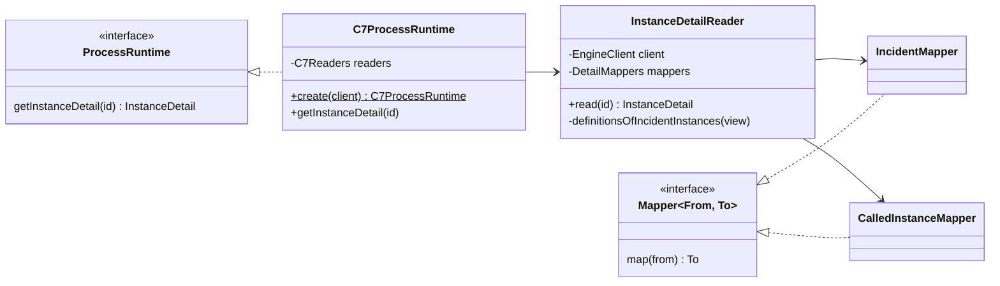

# Code structure

- Status: accepted
- Last reviewed: 2026-10-22

## Context

Until v0.2 the code was written as modules of functions: an adapter was a factory that
returned an object literal, a view was a function of a dozen helper functions, and a
file often held several loosely related functions. The ports and adapters were there,
but not visible: nothing in `c7-runtime.ts` said "this implements `ProcessRuntime`",
and a reader of `instance-detail.ts` saw nine functions without an owner.

The product owner asked for the structure to show the architecture: the contract
describes what something looks like, an adapter implements it, the core calls whichever
adapter is active; classes that implement a role and keep their helpers private; one
visible responsibility per file.

## Decision

### Ports are interfaces, adapters are classes

| Where                               | What                                                                                                                                                     |
| ----------------------------------- | -------------------------------------------------------------------------------------------------------------------------------------------------------- |
| `apps/vscode/src/contract/ports`    | `ProcessRuntime` (read), `ProcessCommands` (write), `EngineAdapter` (one per engine family: turns a connection into a runtime and, if it can, commands)  |
| `apps/vscode/src/contract/model`    | what the ports exchange: ids, read models, queries, `RuntimeError`, value kinds                                                                          |
| `apps/vscode/src/adapters/<engine>` | `class <Engine>Adapter implements EngineAdapter`, `class <Engine>ProcessRuntime implements ProcessRuntime`, `class <Engine>ProcessCommands implements …` |
| `apps/vscode/src/host`              | the composition root keeps one `EngineAdapter` per engine kind and hands the core what the active one returns                                            |
| `apps/vscode/src/core`              | sees only `ProcessRuntime` and `ProcessCommands`, never an adapter                                                                                       |

### Classes own behaviour

1. **One class per file**, named after it: `InstanceDetailReader` lives in
   `instance-detail-reader.ts`. Types and interfaces that are part of that class's API
   may sit next to it.
2. **No module-level functions.** Behaviour is a method of the class that owns the job:
   public methods say what the class does and come first; private methods say how.
   Module-level constants are fine.
3. **Utility classes** hold stateless helpers that several classes need, as static
   methods, named after the concept (`Timestamps.fromEngine`, `JsonText.pretty`). No
   `utils.ts` grab bags; a utility class has one topic.
4. **Roles are interfaces.** A class implements an interface when it plays a role that
   has, or is meant to have, more than one player, or when it is a seam other code
   depends on: the ports, `Mapper<From, To>` for the adapters' translations,
   `Panel` in the core, `Command` and the VS Code provider interfaces in the extension.
   Not every class gets an interface.
5. **Constructor injection.** Ports and I/O seams come through the constructor (a
   runtime, an API or CLI client, a spawner, the panel's effects), and so do an
   adapter's mappers; per-session parts may be built inside, as the core's panels
   build their `ViewSession`, `CallJumps` and `InstanceWrites` from the context they
   receive. Wiring happens in a static `create` of an adapter's entry classes
   (`C7Adapter.create`, `C7ProcessRuntime.create`) or in the composition root. Tests pass fakes the same way.
6. **The budgets stay** (complexity 10, 300 lines per file, 60 per function, 4
   parameters, 20 statements). A class that outgrows them splits along its
   responsibilities, not into helper files.

Exceptions, each for a reason outside our control:

- branded id constructors in `model/ids.ts` (`InstanceId('…')`): a type and its value
  constructor share a name, like `Number('3')`;
- `activate` and `deactivate` in `apps/vscode/src/host/extension.ts`: VS Code calls
  these exported functions;
- Preact components and hooks (functions named `Xyz` or `useXyz` in `.tsx` files): the
  framework's idiom; their helpers follow the rules above.
- tests and their support code.

### Example: reading an instance in the C7 adapter

### Enforcement

ESLint, configured in the `apps/vscode` blocks of the repository's `eslint.config.mjs` and
proven in `apps/vscode/test/architecture/lint-rules.test.ts`:

- `no-restricted-syntax` rejects module-level function declarations and functions
  assigned to module-level constants in shipped code (`apps/vscode/src`), with the
  exceptions above, in every layer: `contract`, `core`, `webview`, the adapters, `model`
  and `host`;
- `max-classes-per-file: 1`;
- `@typescript-eslint/member-ordering`: fields, constructor, public before private
  methods;
- `@typescript-eslint/no-extraneous-class` allows static-only utility classes.

The rules were switched on package by package while the code moved to classes; since the
move into the monorepo they hold for every layer. In the webview, helpers of components are static utility
classes (`JsonText` and `TimeLabels` in `src/format`, `VariableEditorText` next to its screen), and a file that
holds a Preact context and its hook is a `.tsx` file. In the extension, every command
is a class implementing `Command` (`id`, `run`) that `CommandRegistrar` registers;
`PulseExtension` wires VS Code, `CompositionRoot` wires the engines, and the panel
manager hands the core's `Panel` sessions a `VsCodePanelEffects` per connection.

## Consequences

- The C7 adapter, every fake and any future adapter implement the same interfaces; the
  composition root picks one by the target's `engine` and nothing else branches on
  engines.
- Many small files. Navigation goes by class name; the folder says the area
  (`mapping/`, `reading/`, `views/`, `panels/`).
- Preact components stay functions: class components are the framework's legacy API
  and would not make the webview clearer.
