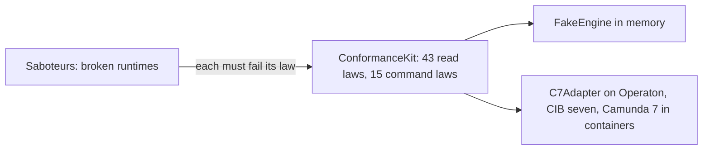

# Runtime contract

- Status: accepted
- Last reviewed: 2026-10-26

## Context

C7 family engines and Camunda 8 expose similar runtime data with different
vocabulary, identifiers and consistency. In C7 `processDefinitionKey` is the BPMN id;
in C8 `processDefinitionId` is the BPMN id and `processDefinitionKey` an int64 per
version. C7 copies an incident to every parent of a call chain; C8 keeps it in the
child. C7 stores engine stack traces; C8 only has the worker's error message. C8
search results are eventually consistent and page with cursors.

## Decision

### Three ports

The ports are interfaces in `apps/vscode/src/contract/ports`; what they exchange lives in
`apps/vscode/src/contract/model`. Adapters implement them with classes
([code-structure.md](code-structure.md)).

`ProcessRuntime` (`ports/process-runtime.ts`) has one method per
engine question:

| Method                 | Question                                                                                                                        |
| ---------------------- | ------------------------------------------------------------------------------------------------------------------------------- |
| `describeEngine`       | Which product and version answers?                                                                                              |
| `listDefinitions`      | Which processes are deployed, latest version, running and with-incident counts?                                                 |
| `listVersions`         | Per version of one process: running and with-incident counts, newest first                                                      |
| `getDiagramXml`        | The deployed XML of one version                                                                                                 |
| `getElementStatistics` | Per element of one version: active, incidents raised here, incidents in called instances                                        |
| `getCalledProcesses`   | Per call activity of one version: the process it calls and the deployed version its binding starts                              |
| `searchInstances`      | Instances by version or process, lifecycle, incident, business key, active element, variable conditions; cursor paging          |
| `countInstances`       | How many instances the same filter finds, without paging                                                                        |
| `getInstanceDetail`    | Wait states (across called instances), root incidents, called instances, variables, the path (elements run, with start and end) |
| `searchIncidents`      | Root incidents by process, version or instance; cursor paging                                                                   |
| `getIncidentDetails`   | The complete stack trace or error message of one incident                                                                       |
| `getBulkOperation`     | State and item counts of one bulk operation; `undefined` when the engine does not know it (any more)                            |
| `getBulkFailures`      | At most 100 reasons why items of a bulk operation failed, each naming its instance when the engine can; `[]` when none failed   |
| `proposeMigration`     | The engine's mapping of elements between two versions (`MigrationPlan`)                                                         |
| `checkMigration`       | The problems the engine finds in a plan, each naming its mapping when it can (`MigrationCheck`); tokens are not its concern     |

`InstanceDetail.path` lists the instance's own element runs (`ElementRun`: element, start,
end, canceled) in start order; called instances keep their own path. A run that has not
ended has no end. An engine may record an element only once it really starts (C7 starts an
async element when its job runs), so the core counts the elements an instance waits at as
reached when it marks the flows taken.

`ProcessCommands` (`ports/process-commands.ts`) holds the writes, separate so that a
connection without write access simply has none ([writes.md](writes.md)):

| Method              | Effect                                                                                                                                                                                                                                                                                                                                                                                                                                 |
| ------------------- | -------------------------------------------------------------------------------------------------------------------------------------------------------------------------------------------------------------------------------------------------------------------------------------------------------------------------------------------------------------------------------------------------------------------------------------- |
| `retryIncident`     | Give the failed job or worker task behind one root incident one more attempt                                                                                                                                                                                                                                                                                                                                                           |
| `setVariable`       | Set an instance-scope variable from `{ name, valueJson, type? }`; `type` is the engine label read before, kept on write                                                                                                                                                                                                                                                                                                                |
| `moveToken`         | Move the one token at `fromElementId` of the instance itself to `toElementId` with a `reason`, in one atomic request: start before the target, then cancel exactly that token. `rejected` when the instance is unknown or ended, the reason is blank or invalid (`MoveReasons`), or the source holds no token, several tokens or a multi-instance body. Which targets make sense is core policy ([writes.md](writes.md)), not contract |
| `cancelInstances`   | Cancel the given instances (`{ reason? }`, which the engine keeps) as one asynchronous bulk operation; returns its `BulkOperationId` at once                                                                                                                                                                                                                                                                                           |
| `migrateInstances`  | Migrate the given instances with a `MigrationPlan` as one asynchronous bulk operation of kind `migrateInstances`; ended and unknown ids are skipped, nothing left to migrate is `rejected` ([migrations.md](migrations.md))                                                                                                                                                                                                            |
| `stopBulkOperation` | Halt a bulk operation: it stops running and soon cancels nothing more; what is done stays done; stopping an ended one resolves, an unknown one is `rejected`                                                                                                                                                                                                                                                                           |

`EngineAdapter` (`ports/engine-adapter.ts`) is the plug every engine family provides:
given an `EngineConnection` (endpoint and credentials) it returns a `ProcessRuntime` and,
when the family can write, `ProcessCommands`. `webUi(webUiUrl)` takes the configured URL
of the engine's web UI and, when it fits the family's web UI, returns an `EngineWebUi`:
its `name` ("Cockpit") and the routes into it: `overviewUrl()` (its start page,
for the engine overview), `instanceUrl(InstanceSummary)` and
`definitionUrl(DefinitionRef)`. A link needs neither endpoint nor credentials, so the URL
is not part of the connection; a target without one gets no web UI. The adapter
knows the routes; nobody guesses the web UI from the endpoint. The composition root holds
one adapter per engine kind of a target and is the only place that chooses between them.

### Local sources

Next to the engine ports the contract holds `ModelSource` and `CodeLocator`, the ports for
the local `.bpmn` file and the code that implements an element, and the `WorkspaceFiles`
seam they read through. They are no engine questions: the model adapter implements them
for any workspace, and the conformance kit does not cover them
([local-sources.md](local-sources.md)).

### Rules

- **Own vocabulary.** `bpmnProcessId`, `definitionId` (one deployed version),
  `instanceId`, `elementId`. Ids are branded opaque strings, never numbers.
- **Facts, not interpretations.** Adapters deliver facts and normalise engine quirks
  (UTC ISO timestamps, lossless big integers, root incidents only, error mapping).
  The core interprets: root-cause line, grouping, overlays, notices.
- **Optional fields, no capability flags.** What one engine cannot deliver is an
  optional field (`details?`, `calledFromElementId?`, `retriesLeft?`). A later real
  capability gap becomes an optional method, never a flags object that can disagree
  with behaviour. No engine family enum crosses the port.
- **Errors.** A missing single item is `undefined`. Everything else throws
  `RuntimeError` with a closed `failure` (`unreachable`, `unauthorized`, `forbidden`,
  `misconfigured`, `engineFailure`, `unexpectedResponse`, and `rejected` when the engine
  refuses a command: unknown or closed incident, ended instance, invalid value, a move
  without exactly one token at its source, unknown bulk operation).
  `new FailingRuntime(error)` is the one runtime that rejects every call with a given
  error (unreachable engine, unsupported target).
- **Counts** mean instances, not incidents (`withIncident`), on both engines.
  `countInstances(filter)` counts exactly what `searchInstances(filter, …)` pages through.
- **Statistics** always address one version (`definitionId`), never a process.
- **Incidents name their version.** `Incident.definition` is the `DefinitionRef` of the
  version the incident was raised in, so grouping by process and version needs no
  further call.
- **Statistics are disjoint.** `active` counts element instances without an incident
  raised at that element, so `active + incidents` is what the element holds;
  `incidentsInCalledInstances` marks active tokens whose called instance failed.
- **Neutral work vocabulary.** A `workerTask` wait names its `taskType` (C7 topic, C8
  job type); `Incident.job?` names the unit of work that failed (C7 job or external
  task with its topic, C8 job key and type).
- **Calls are resolved by the adapter.** `CalledProcess` names a call activity's
  `elementId`, the `bpmnProcessId` it calls and, as `definition`, the deployed version its
  binding starts right now (latest, a fixed version, the caller's deployment, a version
  tag: the adapter reads its engine's attributes and applies its rules). Without a
  matching deployed version `definition` is absent. A call activity whose called process
  or version only an expression decides is left out; called instances say at runtime
  where such a call went. An unknown definition has no calls (`[]`).
- **Variables know their kind and scope.** `Variable.kind` is `string`, `integer`,
  `decimal`, `boolean`, `date`, `json`, `null` or `opaque` (serialized objects, bytes,
  files); `type` stays the engine's label for display. A variable set on an element
  (a task-local variable) has `scope.kind: 'element'` with that element's id.
- **Variable conditions.** `InstanceFilter.variables` holds `VariableCondition`s, all of
  which must hold (AND). A comparison (`equals`, `notEquals`, `greaterThan`, `lessThan`)
  carries its value as `valueJson`, so big integers stay exact and a JSON number never
  matches text: `42` finds the integer 42, `"42"` only the text. `greaterThan` and
  `lessThan` compare numbers. `like` carries a `pattern` in which `*` is any run of
  characters and every other character, `%` and `_` included, stands for itself. A
  condition holds when the instance has a variable of that name, at any scope (the C7
  family matches task-local variables too, so a C8 adapter must as well), whose value
  satisfies it: `notEquals` never finds an instance without the variable, and a value
  of another type differs (`route ≠ 42` finds the text `"review"`). Ended instances
  match by their variables. An unknown name finds nothing, an empty list constrains
  nothing (unlike `instanceIds: []`). How letter case compares is the engine's (its
  database's) business, so no law pins it.
- **Bulk operations are facts about items.** `BulkOperation` has `id`, `kind`
  (`cancelInstances`, `migrateInstances`), `state` (`running`, `suspended`, `ended`), the optional
  timestamps `startedAt` and `endedAt` and the optional counts `total`, `completed` and
  `failed`. Counts are instances, never
  engine jobs, and `completed + failed` never exceeds `total`. All counts are optional:
  C7 forgets them once a batch ended, and C8 reports a total of 0 until it has set a
  batch up. An instance that already ended or an unknown id is skipped, not counted as
  failed. `BulkOperationId` is opaque and may stand for several engine batches. Each
  kind gets a method of its own (`cancelInstances`, `migrateInstances`; retry later),
  never a generic submit with a payload. An operation is worked off when it `ended` or
  when `completed + failed` reached a `total` above 0 (an engine may report 0 before it has
  set the operation up): an engine may keep an operation with
  failed items (a C7 batch with failed jobs never ends). `failed` may exceed the instances
  that really stayed behind (one ended between the submit and its turn), so callers decide
  outcomes by counting instances, never by `failed`. `BulkFailure.instanceId` is optional.
- **Migration plans are pairs of elements.** `MigrationPlan` names the source and target
  `DefinitionId` and `ElementMapping { sourceElementId, targetElementId }` pairs; which
  pairs make sense, where tokens wait and what to tell the user is core policy
  ([migrations.md](migrations.md)).
- **Instances by id.** `InstanceFilter.instanceIds` narrows `searchInstances` and
  `countInstances` to at most 1000 ids, combined with the other fields (version,
  lifecycle): ids of another version than `definitionId` are not found. An empty list
  finds and counts nothing. The core re-reads a selection before a bulk
  write and reconciles a finished bulk operation with it.
- **Truncation is explicit.** Details in an instance detail may be truncated and say
  so; `getIncidentDetails` never is. The core derives a root cause only from complete
  text.

### Conformance kit

`apps/vscode/src/contract/conformance` holds 43 read laws and 15 command laws as
executable cases, modelled on `@miragon/modeler-api/conformance`:
`new ConformanceKit(test).registerRuntimeLaws(prepare)` and `.registerCommandLaws(prepare)`
bind them to any `(name, fn)` runner and throw a `ConformanceViolation` when a law fails. Command laws run on
their own instances (`CMD-*`, seeded after the read laws) so that writes never change
what the read laws see: a retry closes exactly that incident; an unknown or already
closed incident is rejected; a changed variable reads back with its value, kind and
type; integers beyond 2^53 and JSON survive; an unknown or ended instance is rejected; a
moved token waits at its target with its source and incident gone and the instance
running (skip from a failed async task); a token moved onto its own element runs it
again with the old run canceled (re-run); a move in an unknown or ended instance, without
a reason, from an element without a token or with two tokens is rejected and leaves both
tokens in place. Four
bulk laws (`laws/bulk-laws.ts`) follow: cancelling 50 instances ends exactly those (a
neighbour keeps running), the operation ends with `completed ≤ total` and nothing failed;
an instance that already ended and an unknown id are left alone and not counted as
failed; a stopped operation (read once before the Stop, so that the fake has worked
part of it off) no longer reads `running` and then cancels nothing more, while the
instances it did not reach still run; an unknown operation reads `undefined`
and stopping it is rejected. The read law `instances: filter by up to 1000 instance ids`
finds and counts exactly two known ids among 1000, combines the ids with the lifecycle
and with a `definitionId` (an id of the other version is not found), and finds and counts
nothing for an empty list. The read law `instances: filter by the element they wait at`
also finds an instance whose token waits before an asynchronous task. Two read laws cover
migration plans: the proposal from order v1 to v2 maps `Activity_ReviewOrder` and
`Activity_ChargePayment` onto themselves and checks clean, and the check names the
mapping of a user task onto a service task. Three migration laws (`laws/migration-laws.ts`,
own instances `CMD-MIG-*` on order v1) follow the bulk laws: migrating with the proposal
moves exactly the given instances to v2, at the same elements, the incident kept, a
neighbour left alone, nothing failed, kind `migrateInstances`; dropping the mapping of
Review order leaves the two instances there on v1, moves the one at Charge payment and
names non-empty reasons, only for submitted instances; ended and unknown ids are left
alone and not counted as failed, and a submit of only those is rejected. The fake closes
the element runs of every instance it cancels and keeps a migration with failed items
running, as C7 does. The kit owns a canonical world
(an order process in two versions, a dispatch process calling a label process, five
instances with a user-task wait, a failed task, a completed instance and an incident
in a called instance, plus two sets of 50 instances waiting on order v2,
`WORLD_BULK_INSTANCES`, for the bulk laws). Each adapter's harness deploys BPMN with the same element ids
and seeds the world; the fake seeds it in memory.

**Writes may become visible later.** Every read that checks a write (the open
incidents after a retry, the variables after a change) runs in
`Ensure.eventually`. Without `writeVisibility` in its harness an engine must show
the write on the very next read (read-your-writes, as the C7 family and the fake do),
so the check runs once. An eventually consistent engine (such as Camunda 8, whose
searches lag behind its commands) declares `writeVisibility: { withinMs, wait }`: the check is
repeated every 100 ms until it holds or `withinMs` has passed. Only a
`ConformanceViolation` is repeated; an engine error fails the law at once. The kit
takes the wait between checks from the harness; the deadline uses `Date.now()`.

**Background work has its own deadline.** Read-your-writes covers the effect of a
command, not the work a bulk operation does afterwards. `writeVisibility` still holds
for the command itself (a stopped operation no longer reads `running`). How long an
engine may take to work a bulk operation off is `asyncWork: { withinMs, wait }` in the
command harness, used by the checks that wait for the end of an operation and for its
instances: 90 s for the C7 family; the fake works off ten items per
`getBulkOperation`, without a clock, and declares it too. Without `asyncWork` those
checks run once.

The kit tests itself: the fake passes every case, and a table of saboteurs (statistics
by process, incidents counted as active, incidents reported on the latest version,
leaked propagated incidents, a call without the version it starts, ignored cursor, local
timestamps, truncated details, throwing on unknown ids, per-version definition lists, raw
errors, missing kinds, flattened scopes, counts that ignore the element and the business
key, counts without an incident that include those with one, variable conditions that are
ignored by the search or the count, one condition instead of all, numbers compared as
text, `%` and `_` read as wildcards, not equals finding instances without the variable,
task-local variables left out, ended instances left out, an empty list that finds
nothing; for commands: a retry that
closes everything, a silently ignored retry, values stored as text, numbers through a
double, engine failures instead of
rejections, a move that cancels without starting, a silently ignored refused move, a
move without a reason, a move that keeps its source, reads that lag behind writes
without a declared write visibility; for bulk
operations: a cancel that sends the query instead of the ids, a Stop that is
acknowledged but ignored, an ended instance that rejects the whole operation, ended
instances counted as failed, progress counted in jobs, an unknown operation as an engine
failure, stopping an unknown operation silently, background work without a declared
`asyncWork`; for migrations: a plan whose first mapping is dropped, a migration that also
sends the query, ended instances counted as failed, a migration that drops the incident
of the instances it moves, a migration that reads as a
cancellation, a failed migration without reasons, a failure that names an instance that
was not submitted, a check that finds nothing, a problem without its mapping, a proposal
of user tasks only, an element filter that misses tokens before an asynchronous task)
each fails exactly its cases. The counts that ignore the element and the
business key fail the ids law too, as does a search that ignores the instance ids.

## Consequences

- Every adapter is proven against the same laws on a real engine
  (`*.engine.test.ts`); an architecture test fails when an adapter has none.
- The contract is ready for engines beyond the C7 family: a Camunda 8 adapter on the
  REST API v2 passed every law against an API mock with a read lag during the spike,
  without a change to the contract, and was removed again to keep the prototype small.
- Panel loads have fixed engine-call budgets (definition ≤ 7, three of them the scope
  counts queried in parallel with the page; instance ≤ 2 plus lazy details; both + 1
  `getCalledProcesses` when the diagram has a call activity; engine overview exactly 2,
  `listDefinitions` and `describeEngine`, and none per process or for a filter), pinned by
  tests against a call-counting fake. A bulk operation's progress poll costs one
  `getBulkOperation`, its end one `countInstances` (two for a migration: still on the
  source, now on the target) and one `getBulkFailures` when items failed. A migration tab
  loads with `listVersions`, two diagrams, the statistics, one id search, the proposal,
  one check and at most 10 searches for the instances that wait at an element; each edit
  costs one check.
