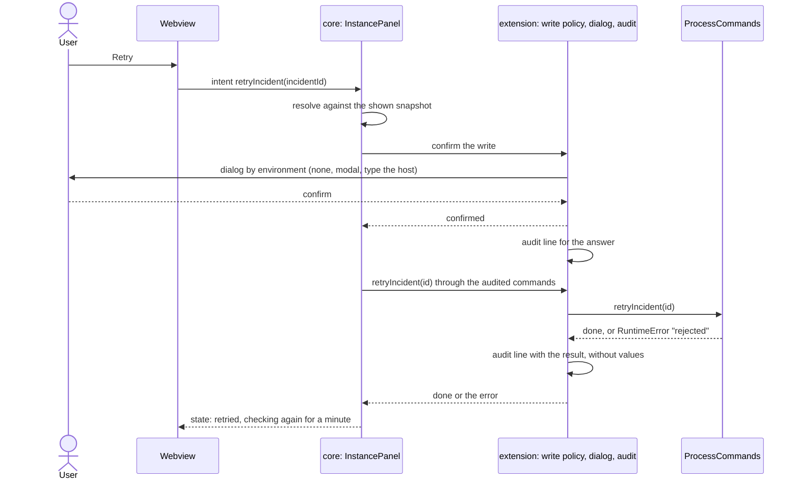
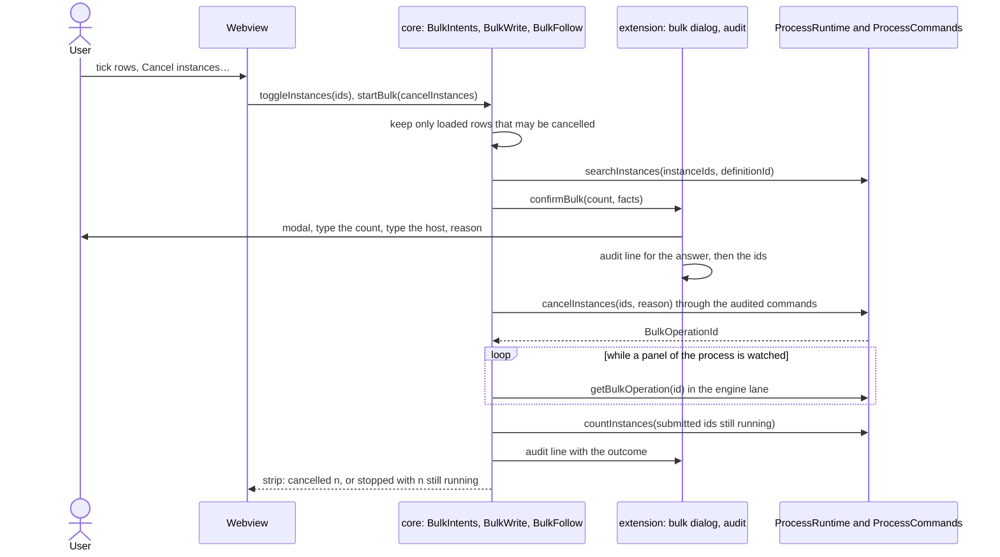

# Guarded writes

- Status: accepted
- Last reviewed: 2026-10-23

## Context

Until v0.1 Pulse only read. The product owner asked for the two writes every cockpit
user reaches for first: retry an incident and change a process variable. Three personas
reviewed the design before it was built (an ops engineer on call, an application
security engineer, the UX designer of the webviews). Their shared concern: a click in an
editor tab must not damage production, a repository must not be able to lower that
protection, and the feedback after a write must be honest.

Issue #18 added a third write: moving a running instance's token from one element to
another, to skip a broken step or run it again after a hotfix. In Camunda 7 and CIB
seven Cockpit that is enterprise-only process instance modification. Three personas
(an engine architect, an ops engineer with a UX designer, a safety engineer) drafted it
in isolation and agreed on the rules below.

Issue #16 added the first bulk write: cancel many instances as one batch, follow it and
stop it. In the C7 family, batch operations and their monitoring are enterprise-only
Cockpit features. Three persona groups designed it in isolation (Sophie, architect for
C7 and C8; Aylin and Eva, ops and security; Clara and Jonas, UX and process developer),
and a ballot of the same three viewpoints signed the merged plan off with amendments.
The maintainer asked for an open concept: bulk retry and asynchronous migration must
later reuse selection, preview, confirmation, progress, Stop and reconciliation without a
redesign. Cancel came first because it is the strictest case.

Issue #17 added the second bulk write: migrate selected instances to another version with
a plan the engine proposes and the user can change. Its own record is
[migrations.md](migrations.md); what it changed in the pieces below is noted here.

## Decision

### Ports

`ProcessRuntime` stays read-only. Writes go through a second, optional port
`ProcessCommands` (`retryIncident`, `setVariable`, `moveToken`, `cancelInstances`,
`migrateInstances`, `stopBulkOperation`); progress and what a write needs to be planned
are reads (`ProcessRuntime.getBulkOperation`, `getBulkFailures`, `proposeMigration`,
`checkMigration`). See
[runtime-contract.md](runtime-contract.md). A connection carries commands only when the
policy allows writes for it, so the core and the webview never decide whether writing
is allowed; they only see whether commands are there.

### Who may write

| Rule                                                                                                                                                                                                                | Where                                                                    |
| ------------------------------------------------------------------------------------------------------------------------------------------------------------------------------------------------------------------- | ------------------------------------------------------------------------ |
| `pulse.writes`: `localOnly` (default), `enabled`, `disabled`, scope `application`; only the user's value is read (`inspect().globalValue`), never a workspace or dev container one                                  | `connections/pulse-settings.ts`, `connections/write-policy.ts`, manifest |
| `localOnly` means the literal loopback hosts `localhost`, `127.0.0.1`, `[::1]`; `host.docker.internal` is not local, neither for writes nor for the LOCAL badge                                                     | `connections/target-hosts.ts`, `write-policy.ts`                         |
| A remote target writes only when it is configured with `auth: basic` and credentials are stored; otherwise the engine could not record who changed what                                                             | `write-policy.ts`                                                        |
| Commands exist only for adapters that have them (today the C7 adapter) and only after the target policy accepted the connection                                                                                     | `composition-root.ts`, `connections/connection-builder.ts`               |
| A bulk cancel and a migration follow the same policy; there is no setting of their own. The policy's note names them: "Pulse may retry incidents, change variables, move tokens, cancel and migrate instances on …" | `write-policy.ts`                                                        |

### How a write is confirmed

The level is worked out when the write runs, not when the panel opened:

| Engine                                                     | Confirmation                                                                                                                            |
| ---------------------------------------------------------- | --------------------------------------------------------------------------------------------------------------------------------------- |
| on this machine (loopback), not marked otherwise           | none: the Retry or Save click is the confirmation                                                                                       |
| on this machine, marked test                               | a modal that names instance (business key and id), element, cause, retries or old → new, engine with its environment, host and identity |
| on this machine marked production, and every remote engine | the same modal, then typing the host                                                                                                    |
| any engine, for a move                                     | at least the modal, also on this machine; the remote and production rules above still apply                                             |

`connections/confirmation-policy.ts` works the level out, with a floor per action
(`ACTION_FLOORS`, a `Record` over every `WriteAction`, so a new write has to declare one); `panels/write-confirmation.ts`
shows the dialogs of `panels/write-dialog.ts` and records the answer. Settings can only
raise the level, from any scope: a repository, a dev container's machine settings and
the user's own settings fold into the same values, so none of them may lower it. A
remote test engine therefore asks for its host too; if that proves too much friction,
an application-scoped list of test origins would be the way to lower it. The
environment label follows the same rule for workspace values (a repository can mark an
engine production, never turn production into test). Dialog text is stripped of
control, format and line-separator characters (`NotificationText.printable`).

### Intents carry no authority

The path of a retry, end to end:

The webview sends `retryIncident { incidentId }` and `setVariable { name, valueJson }`
(name ≤ 255 characters, value ≤ 64 KiB). The core resolves both against the snapshot it
shows: the incident must be listed and retryable (it has a job or worker task); the
variable must be an editable instance-scope variable of a running instance whose value
is not cut off; the type always comes from the snapshot. Values are checked per kind
before anything is sent. A variable that is currently null asks which type to write
("Write as": text, whole number, number, true or false, JSON), and the dialog names it
("Null → text"), so `4117` never turns into a number by accident.

### Moving a token

The webview sends `moveToken { fromElementId, toElementId, reason }` (ids ≤ 255
characters, reason ≤ 500). The core offers a move only on a writable engine for a
running instance that is not cut off, and only for a source and target it lists itself
(`views/move-options.ts`, from the deployed diagram in `bpmn/flow-nodes.ts` and the
snapshot). The intent is resolved against that list; anything else is ignored.

| Rule                                                                                                                                                                                                                                                                           | Why                                                                              |
| ------------------------------------------------------------------------------------------------------------------------------------------------------------------------------------------------------------------------------------------------------------------------------ | -------------------------------------------------------------------------------- |
| The source is a token of the instance itself (not of a called instance, not a boundary subscription, not a sub-process), the only one at its element, not behind an event-based gateway, not multi-instance, not in an event sub-process or a repeated sub-process             | v1 moves only unambiguous tokens; the element-instance model can lift this later |
| Refused targets: start events, boundary events, events behind an event-based gateway (the list Camunda 8 Operate uses), end events, event sub-processes, multi-instance elements, elements in a sub-process that runs more than once, other processes                          | a move never ends the instance; the engine could not pick the scope              |
| Any other element of the process is a target, also one that does not wait                                                                                                                                                                                                      | as in Cockpit and Operate; the token runs on until it waits                      |
| Warnings, not refusals: a converging join the token newly reaches or no longer feeds, a target that already holds a token, a sub-process that keeps running with other tokens; the join search stops at the next fork, so a join behind a nested fork and join gets no warning | Operate warns about a stuck join too; a second move can fix it                   |
| A token with an incident can be moved; the review says it cancels the step and closes the incident                                                                                                                                                                             | skipping a step that Retry cannot fix is the main use                            |
| A reason is required: trimmed, 1–500 characters, one line (`MoveReasons` in the contract, checked by core and adapter); it goes to the engine as the annotation of its operation log                                                                                           | the reason lives in the engine, not in our log                                   |
| Variables are not part of a move in v1                                                                                                                                                                                                                                         | cancelling the source drops its locals; edit in the Variables tab first          |

The C7 adapter reads the activity instance tree (read-only), refuses 0, more than one or
a multi-instance body at the source, and sends one modification on stdin: start before
the target, then cancel exactly that token by its activity or transition instance id
(see [c7-adapter.md](c7-adapter.md)). The adapter reads the tree when the write runs: a
token that left since the snapshot is refused ("no token waits"), one that left between
that read and the modification makes the engine refuse the whole request, so the core
does not re-read before the write. A new token that reached the same element meanwhile
is the one that moves. The review list
and the modal name what happens (cancel, closed incident, listeners and input
mappings run, sub-process entered or ended, warnings, the reason),
end with "This can't be undone." and, when the engine has no login, "No login: the
engine records neither who nor why.": the C7 family writes the operation log only for an
authenticated user. After the move the panel reloads once and says where the token
waits now, that it failed there, that the instance ran to its end, that the engine
still shows the same token at the source, or that it could not read the instance again; a
refusal says that nothing was changed.

### Feedback

One write per panel at a time. The view carries the write state (`pending`, `done`,
`cancelled`, `failed` with the reason) so the webview can show "Retrying…", keep the
editor open on failure and close it when done. After a retry the panel reloads and keeps
checking for a minute (2, 5, 10, 20, 40, 60 s) until the instance settles: "Failed
again" with the new root cause, "Moved on", or "Waiting … for the next attempt". The C7
job executor can take up to a minute to pick a retried job up; checking stops when the
user refreshes or writes again. The outcome is a strip of its own under the header. After
a variable change the panel offers "Retry now" when exactly one incident can be retried:
the change happens on the Variables tab, the incident card's Retry sits on another. A warning marks a process variable
that the failing element shadows with a local one.

### Bulk cancel

The definition panel cancels many instances of the version it shows as one asynchronous
bulk operation (a C7 batch), follows its progress and can stop it. The screens are in
[user-interface.md](user-interface.md).

**The ids come from the core, never from the webview.** `toggleInstances` names ids
(at most 1000, checked by `MessageGuards`), but the core keeps only those among its
loaded rows that an offered action may touch (running or suspended); everything else is
dropped. "Select all n running" names nothing: the core takes n from its scope counts
and collects the ids itself (the panel's filter narrowed to running instances, pages of
250). Pulse sends the engine ids, never a query or filter. Selecting and starting are
ignored when the panel cannot write or shows the _Ended_ scope. The selection is
cleared when the filter or the version changes, and when a run registers, before its
submit; it comes back when the engine refused the start. Ticks and Load more keep it.

**The cap refuses, it never cuts.** A bulk operation takes at most 1000 instances. When
more run, the selection bar says "1234 match · narrow the filter to 1000 or fewer" and
offers no Select all; a toggle that would go beyond 1000 is refused as a whole. Pulse
never cancels the first 1000 of more without saying so.

**Re-read before the dialog.** `BulkWrite` reads the selected ids again
(`searchInstances` with `instanceIds` and the panel's `definitionId`, one call). Only
those still running or suspended are planned; the rest (ids that are not in this
version too) count as skipped, are named in the dialog as "already ended" and are never
counted as failed. When nothing is left the panel says "Nothing left to cancel." and asks
nothing. An instance that ends between the dialog and the engine's work is skipped by
the engine, not failed.

**Confirmation.** The level is the single write's, worked out the same way; a bulk
cancel always asks for more:

| Engine                                                                 | Confirmation of a bulk cancel                                   | Audited as      |
| ---------------------------------------------------------------------- | --------------------------------------------------------------- | --------------- |
| on this machine (loopback), not marked otherwise                       | the modal, then typing the count; no reason asked               | `typeCount`     |
| on this machine, marked test                                           | the modal, typing the count, then an optional reason            | `typeCount`     |
| on this machine marked production or unclassified, every remote engine | the modal, typing the count, typing the host, a required reason | `typeCountHost` |

- The modal's facts, one short line each: "Cancel 44 instances of Order fulfillment v3?",
  the filter (scope, element, business key), the first three in one line
  ("ORD-1, ORD-2, ORD-3 and 41 more", the short id where there is no business key),
  "3 already ended, left alone" only when some did, what lasts ("Called instances end
  with them." and "Can't be undone; Stop only halts the rest."), "Checked just now" and
  the engine line with host and identity. The title carries the count, so the dialog
  does not repeat it; it stays short with 1000 instances as with one.
- The count is typed as digits, exactly ("Type 44 to cancel 44 instances"). Its prompt
  names engine, environment and host and repeats the action's warning; an empty box
  shows no error yet.
- The reason is asked only for actions that send it to the engine (`takesReason`), with
  the action's prompt ("The engine keeps it with the cancelled instances. Pulse does not
  log it."). It is cleaned first (`NotificationText.printable`, then trimmed) and then
  checked: at most 500 characters, and not empty where it is required, so a reason of
  only invisible characters does not pass. An empty optional reason is sent as none. The
  engine keeps it with the cancelled instances (C7's delete reason). Pulse never logs it,
  and the C7 adapter removes it, raw and JSON-escaped, from every engine error.
- `connections/confirmation-policy.ts` (`bulkConfirmationOf`), `panels/bulk-dialog.ts`
  and `WriteConfirmation.confirmBulk` implement it; the webview button is never the
  confirmation. A panel that was closed while its dialog was open writes nothing.

**One run per engine and process.** `BulkRuns` holds the run of each BPMN process and
refuses a second one while a run is active. The extension keeps one `BulkRuns` per
endpoint (`EngineBulkRuns`, keyed by the URL's origin and path), not per credentials, so
every panel of that process on that engine shows the same run, and a connection reload
or a rebound panel keeps it. While a run is active the selection bar says "Wait until
cancelling 44 instances ends" instead of the action. `BulkWrite` checks again after the
dialog; when another panel started a run meanwhile, it says "Another bulk write runs on
this process." and submits nothing. A run lives for the VS Code session only: a window
reload loses track of it, the audit's `bulk=` lines remain, and the batch keeps running
in the engine.

**Progress.** The panel polls `getBulkOperation` through the engine lane (cadence and
gating in [live-updates.md](live-updates.md)). One watched panel follows a run; it lets
go when it is hidden or closed, and any watched panel of the process picks the run up
again when it loads or is shown. An operation is worked off when it ended, when
`completed + failed` reached a known total, or when the engine no longer knows it (C7
below history level FULL). Then the core counts the submitted ids that are still running
(one `countInstances`); that count decides the outcome, the panel reloads once and the
outcome goes to the audit. Progress counts are capped at the submitted count. The strip
shows "No progress for 5 min" when nothing moved for 2 minutes on a local engine and 5
minutes elsewhere, counted only while a panel watches and from the moment one comes back.
A failed read is no stall: the strip warns "Pulse can't read its progress: …" with the
problem, which is "Paused until the engine accepts the login again." while the engine
lane is blocked.

**Stop.** One click, no confirmation: it only halts, it is idempotent and audited, and
it uses the commands of the current connection; without commands there is no Stop. The
strip says "Stopping…" until the operation no longer runs and a second count settled,
then "Stopped. 23 of 117 cancelled, 94 still running." with "Select the 94 still
running" (only while the run's version is shown) and Dismiss. Stopping does not undo
what is done. When the engine still holds the operation suspended (its delete failed
against a running job), the strip says "The engine keeps the halted operation. Stop
again to remove it." and offers Stop once more. A failed Stop returns the run to where
it was with the engine's message; an unauthorized, forbidden or misconfigured answer
also blocks the engine lane.

**Outcomes and failures.** A submit that fails as `unreachable` (a timeout included),
`unexpectedResponse` or `engineFailure` has an unknown outcome: the engine may have
started the batch. Pulse never retries a submit on its own. The strip says "Unknown
whether cancelling started." and offers "Check instances" (one count of the submitted ids
still running, then a reload) and Dismiss; the next bulk write re-reads anyway. A refusal
(`rejected`, `forbidden`, …) is "Could not start cancelling.", and the selection comes
back. A finished run names the instances that had already ended; one with instances
still running names them with "Select the n still running".

### Audit

Every confirmation and every write is a line in the "Pulse" log channel: engine,
origin, environment, confirmation shown and answer, operation, ids, variable name, type,
byte size, result; for a move the instance, `from` and `to`, the reason's length and
`oplog=none` when the engine has no login. Never values, the reason, credentials or
command lines. `WriteAudit`
(`connections/write-audit.ts`) writes the lines; `AuditedCommands` wraps the commands of
every writable connection. The C7 adapter passes values on stdin, not as arguments, and
removes the submitted value and the reason from engine errors.

A bulk cancel writes, in this order:

| Line                                                                                                   | When                                            |
| ------------------------------------------------------------------------------------------------------ | ----------------------------------------------- |
| `confirm cancelInstances … confirmation=typeCountHost answer=confirmed selected=47 skipped=3 count=44` | after the dialog, also when cancelled           |
| `cancelInstances … part=1/1 ids=…`, 100 ids per line                                                   | before the submit                               |
| `cancelInstances … count=44 reason=given result=done bulk=<operation id>`                              | after the submit (`reason=none` without one)    |
| `stopBulkOperation … bulk=<operation id> result=done`                                                  | after each Stop                                 |
| `cancelInstancesOutcome … bulk=<operation id> phase=finished done=44 remaining=0`                      | when the run ended (`phase=stopped` after Stop) |

The ids are written before the submit, so they survive a submit whose outcome is
unknown. The operation id ties the lines of one run together; there is no correlation
number of Pulse's own. Never the reason's text, business keys or filter values. The
outcome line comes from the core through `PanelEffects.reportBulkOutcome`
(`WriteAudit.recordOutcome`).

### Open for further bulk writes

Bulk retry and migration reuse everything above. Each adds a port method of its own
(no generic `submitBulk(kind, payload)`), one `BulkAction` with its `BulkWording`, and
one kind literal (`BulkOperationKind` in the contract, `BulkKind` in the protocol).
Migration needed three reads besides its write (the proposal, the check and the reasons of
failed items), because a plan has to be built and checked before it is confirmed; the
reasons are kind-neutral and serve every bulk write.
`BulkAction` (`apps/vscode/src/core/panels/bulk-action.ts`: `CancelInstancesAction` and
`MigrateInstancesAction`) owns
what differs per kind: which instances are eligible and the filter that finds them, how
many the scope counts offer, whether it sends a reason, and the port call. Its wording
holds every kind-specific text: offer, verbs, what is eligible ("running") and skipped
("already ended"), what lasts, the warning, what was not done, the stall hint and the
reason prompt; they reach the dialog through `BulkRequest.warning` and
`BulkRequest.reasonPrompt`. The list of actions drives the offers and which rows can be
ticked; "Select all" uses the first. Selection, re-read, dialog, runs, progress, Stop,
reconciliation and the strip stay. The selection stays one for all actions (decided with
#17): cancel and migrate find the same instances eligible, running or suspended. The
second action brought these additions, all optional for the first:

- `BulkWrite` asks its subject to `prepare` the preview and the dialog request: the
  definition panel re-reads the selected ids (`SelectionPreview`), the migration tab also
  re-checks the frozen plan and where instances wait (`MigrationPreview`).
- `BulkAction.arrivedFilter` counts the instances that reached their goal, besides
  `eligibleFilter` for those still left; the outcome then names what ended meanwhile.
  `BulkWording.arrival` (" to v3") and `BulkPlan.leftOut` reach the strip.
- When items failed, the core reads their reasons once (`BulkFailures`), also before a
  Stop, and the strip offers "Show why". A worked-off operation the engine keeps (C7 with
  failed jobs) offers "Remove batch", which is the Stop; until it is removed the strip
  offers no Dismiss and no other bulk write of the process starts ("The engine keeps the
  batch of the last bulk write.").
- The migration action is not one of the selection bar's offers (no `startBulk`): its
  "Migrate to version…" button sends `openMigration`, which hands the selection over to the
  migration tab, and the tab builds the action with the frozen plan when the user migrates. `BulkOperationId` is opaque and may stand for
  several engine batches; a C7 bulk retry needs two (failed jobs and failed external
  tasks). In the core, `BulkIntents` routes and selects, `BulkRunControl` stops, checks,
  selects the remainder and dismisses, and `views/BulkDecoration` builds rows, selection
  and strip.

### Decisions on the open questions of #16

| Question                            | Decision                                                                                                                                                                                                            |
| ----------------------------------- | ------------------------------------------------------------------------------------------------------------------------------------------------------------------------------------------------------------------- |
| Bulk retry first?                   | No. Cancel forces the hard parts: it is destructive, needs Stop, and instances can end between preview and write. Retry is the next ticket and the second `BulkAction`.                                             |
| Synchronous below a threshold?      | No (unanimous). One code path: every bulk cancel is a batch.                                                                                                                                                        |
| Reason required on production?      | Yes `[2:1]`, Sophie dissents. Required where the host is typed (production, unclassified, every remote engine), optional on test, not asked on loopback.                                                            |
| A tree node or a strip?             | The strip only (unanimous). No batch list, tree node or status bar item.                                                                                                                                            |
| Poll only while a panel is watched? | Yes `[2:1]`, Aylin dissents: she wanted a hidden poll at most every 60 s. A hidden run is read again as soon as a panel of the process is watched.                                                                  |
| Stop: suspend, then delete?         | Yes `[2:1]`, as the issue proposed; Sophie wanted delete alone. The spike sided with suspend first: suspend halts the batch even when the delete then fails against a running job ([c7-adapter.md](c7-adapter.md)). |

Four reviewers checked the built feature (contract and adapter, ops and security, UX and
accessibility, architecture); their accepted findings are part of the text above.
Rejected: a correlation number of Pulse's own (the operation id and the outcome line
do it), stopping batch types Pulse does not create (it only stops ids it started), and a
C7 engine test with the job executor switched off (heavy; the fake's stop law covers a
partly worked-off operation).

## Consequences

- The header chip says "Writable" (pencil) or "Read-only" with the reason in its
  tooltip; the status bar icon follows.
- Out of scope: task-local and new variables, deleting variables; for moves:
  batch or definition-wide moves, multi-instance, picking an ancestor, start after,
  skipping listeners or mappings, asynchronous modification, event sub-processes,
  variables in the move, undo. For bulk writes: bulk retry (next, on the same pieces), adopting a batch after an unknown outcome or a window
  reload, runs that survive a restart, a list or history of batches, a tree node or
  status bar item for them, opening a batch in Cockpit, shift-range selection, skip
  options, suspending and activating instances.
- The conformance kit proves all six commands on Operaton, CIB seven and Camunda 7.24.
- Review record: `.context/writes/decision.md` (not versioned).
