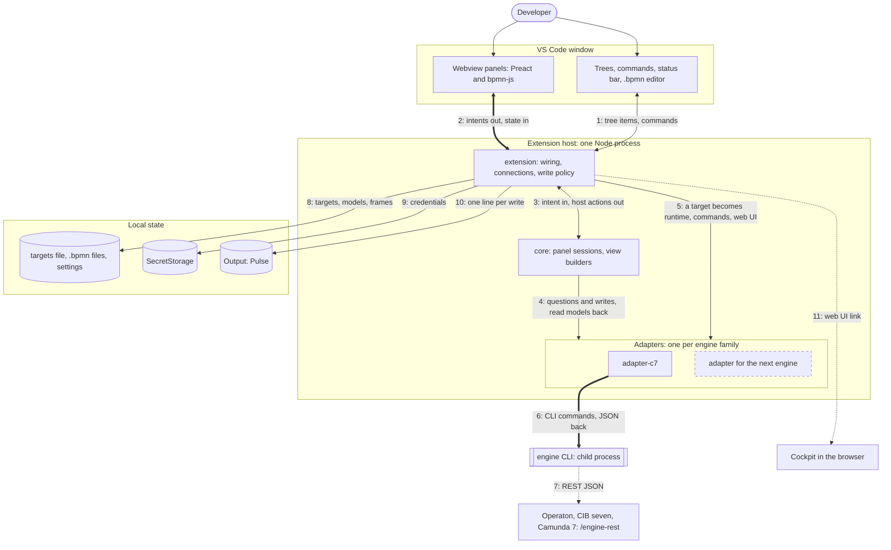
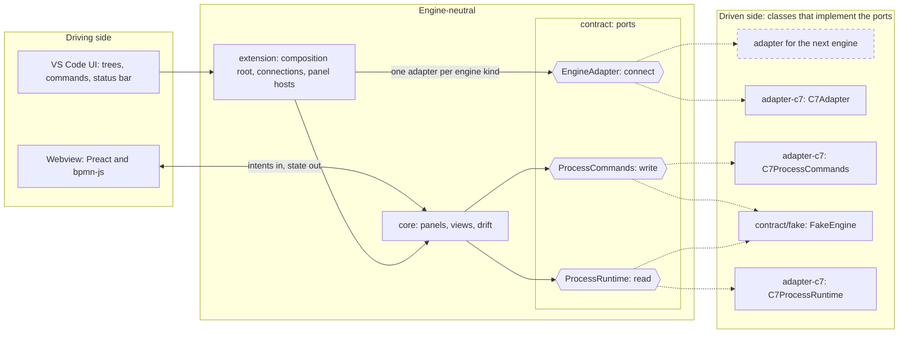
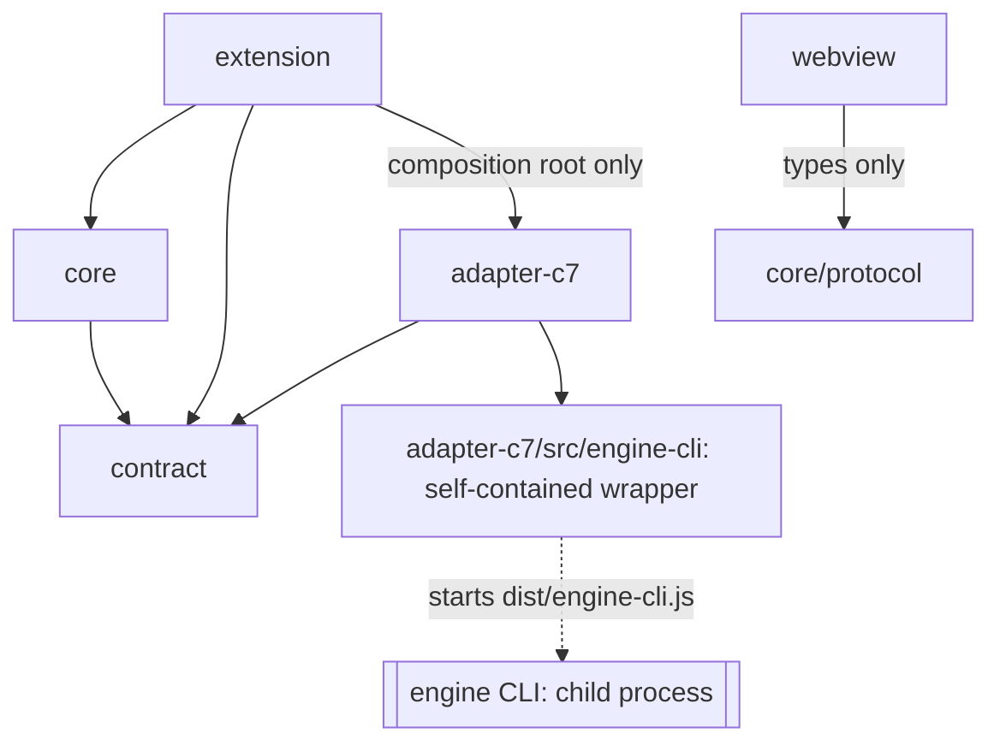
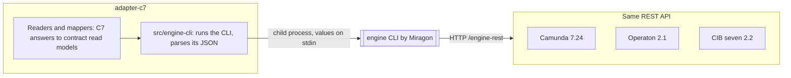
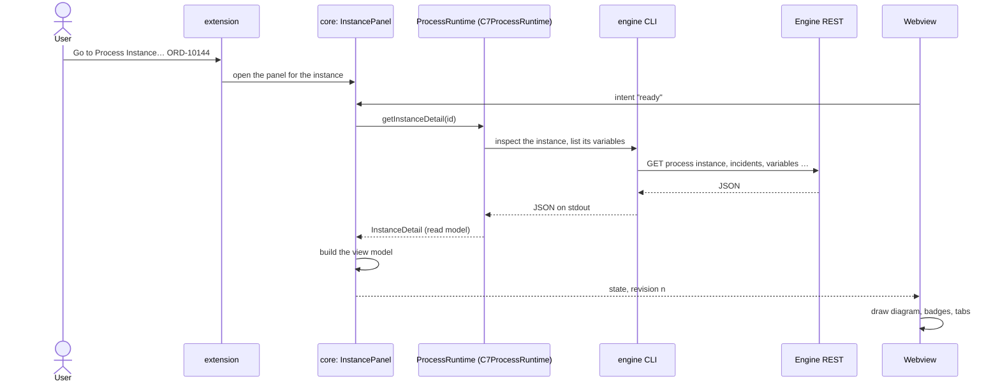
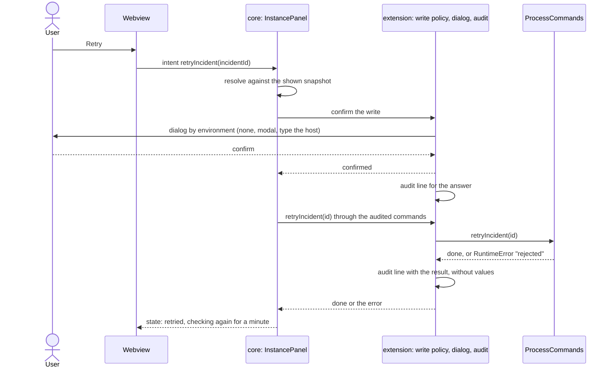
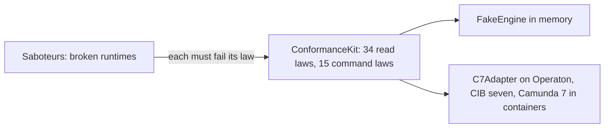

# Pulse's architecture in pictures

The decisions behind these pictures are in [docs/adr](adr/README.md); this page shows
how the parts fit together.

## 1. Who talks to whom, about what, and how

Thin lines are calls inside a process (the VS Code API or a port), thick lines are
messages to another process, dotted lines leave the machine. The dashed box is where the
next engine plugs in: one more adapter package and one entry in the composition root.

| #   | Who → whom                      | About what                                                                                                                | How                                                                                 |
| --- | ------------------------------- | ------------------------------------------------------------------------------------------------------------------------- | ----------------------------------------------------------------------------------- |
| 1   | VS Code ⇄ extension             | engines and processes in the trees, commands, the status bar, the `.bpmn` file in the editor                              | VS Code API (`TreeDataProvider`, commands)                                          |
| 2   | webview ⇄ extension             | intents out (`ready`, `filterInstances`, `openCall`, `retryIncident`, …); the complete panel state with a revision back   | `postMessage`, JSON, checked by `MessageGuards`; the webview drops stale revisions  |
| 3   | extension ⇄ core                | the intent for a panel session; host actions back: open a panel, pick an instance, confirm a write, copy, open the web UI | method calls: `Panel.handle`, `PanelEffects`                                        |
| 4   | core → adapter                  | engine questions and writes; read models back, or a `RuntimeError`                                                        | the ports `ProcessRuntime` and `ProcessCommands`, async                             |
| 5   | extension → adapter             | a configured target becomes a runtime, commands (wrapped in the audit) and web UI links                                   | `EngineAdapter`, only in `composition-root.ts`                                      |
| 6   | adapter-c7 → engine CLI         | one to three CLI commands per question; values on stdin, credentials in environment variables; JSON on stdout             | child process (`execFile` with VS Code's own Node), read-only flag unless it writes |
| 7   | engine CLI → C7 family          | definitions, instances, incidents, variables; retries and variable changes                                                | HTTP(S) REST `/engine-rest`, basic auth                                             |
| 8   | extension → your files          | the engines to show, the model to compare with a deployed version, stack frames to link to your sources                   | `.pulse-cli.json` (watched), `.bpmn` files, `pulse.*` settings                      |
| 9   | extension → SecretStorage       | user name and password per target, bound to the endpoint's origin                                                         | VS Code `SecretStorage`                                                             |
| 10  | extension → output channel      | one audit line per confirmation and per write, without values                                                             | the "Pulse" output channel                                                          |
| 11  | extension → the engine's web UI | the shown version or instance, or the engine's start page                                                                 | `vscode.env.openExternal` with a URL built from the target's `cockpitUrl`           |

Pulse reads what an engine is running and shows it next to the models. Writes
(retry an incident, change a variable) are guarded and audited
([writes.md](adr/writes.md)). Each package has a README with its own picture:
[contract](../src/contract/README.md), [core](../src/core/README.md),
[webview](../src/webview/README.md), [extension](../src/host/README.md),
[adapter-c7](../src/adapters/c7/README.md).

## 2. Ports and adapters

The core never knows which engine it talks to. It calls the ports of the contract; an
adapter per engine family implements them.

- **Contract:** the ports are interfaces (`apps/vscode/src/contract/ports`); what they
  exchange are read models (`apps/vscode/src/contract/model`). No engine word appears in
  them.
- **Adapters:** a class per role (`C7ProcessRuntime implements ProcessRuntime`, …). The
  composition root picks the adapter by the target's `engine` and is the only place that
  does.
- **Core:** panel sessions and view builders work on read models only; the webview
  renders the view models the core sends.

## 3. Packages and the imports they may make

Every import edge not drawn fails `pnpm lint:architecture:vscode` (dependency-cruiser, closed world). The
dotted line is no import: the wrapper starts the bundled CLI as a child process.

## 4. One adapter for Operaton, CIB seven and Camunda 7

Operaton and CIB seven are forks of Camunda 7 and keep its REST API. So one adapter
serves all three, and the conformance kit proves it on each of them in CI. Camunda 8 is a
different engine (Zeebe) with a different API, so it would get an adapter of its own.

The engine CLI is Miragon's command-line client for that REST API. Pulse uses it
instead of its own HTTP client: paging, authentication and the REST details live in one
tool that the modeler uses too. The wrapper is written so that it can move into
the CLI as a library later.

| Question                             | Answer                                                                                                                 |
| ------------------------------------ | ---------------------------------------------------------------------------------------------------------------------- |
| Does the C7 adapter cover all three? | Yes: all 34 read laws and 15 command laws pass on Operaton 2.1.5, CIB seven 2.2.0, Camunda 7.24.0                      |
| Do we need an adapter per fork?      | No, only per API family                                                                                                |
| What does a new engine family need?  | A package `adapter-<family>` with an `EngineAdapter`, its conformance test, one line in the composition root           |
| Where does Camunda 8 stand?          | Not included. The spike built a C8 adapter on REST v2 against an API mock, then removed it to keep the prototype small |

## 5. Reading an instance

## 6. Retrying an incident

## 7. How every adapter is proven

The same executable laws run against every implementation. A saboteur breaks one
behaviour on purpose; the kit has to catch it, so a law that passes everything would
show up.

## 8. Inside a package

Classes implement the ports and keep their helpers private; one class per file.
[code-structure.md](adr/code-structure.md) has the rules and a class diagram of how the
C7 adapter reads an instance.
