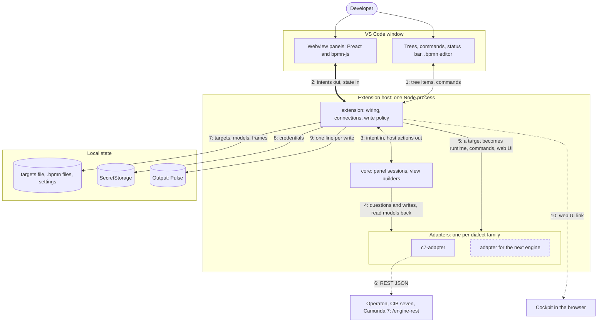
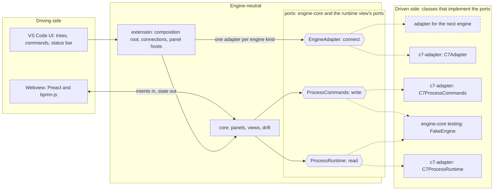
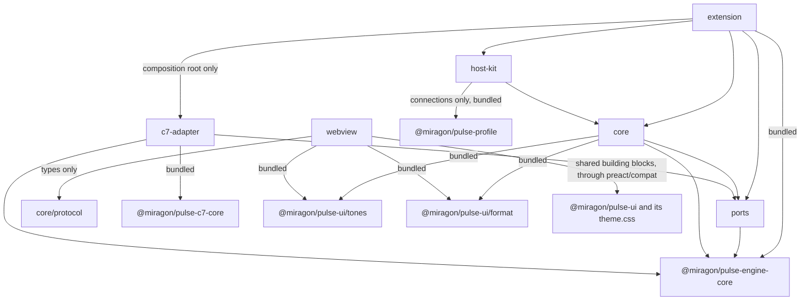
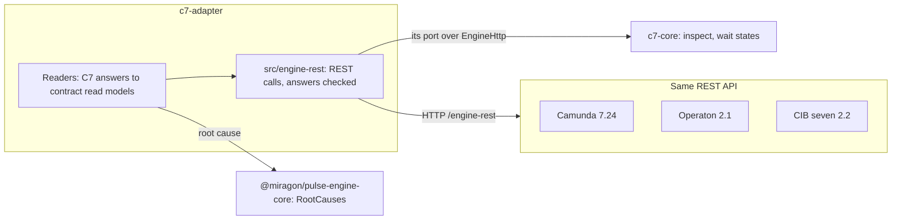
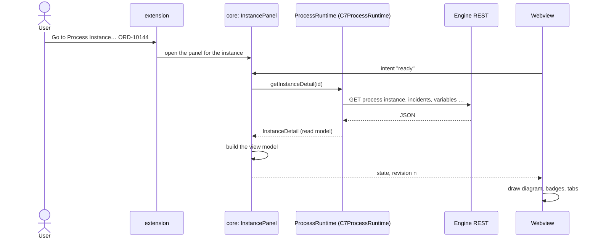
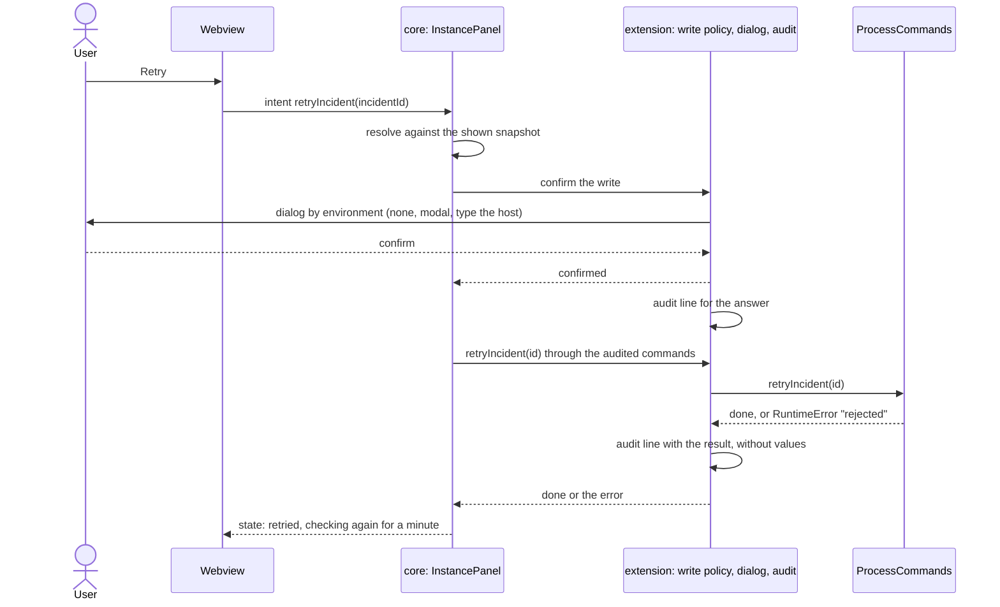
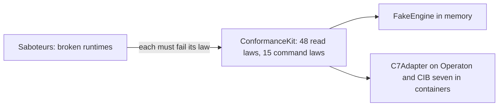

# Pulse's architecture in pictures

The decisions behind these pictures are in [docs/adr](adr/README.md); this page shows
how the parts fit together.

## 1. Who talks to whom, about what, and how

Thin lines are calls inside a process (the VS Code API or a port), thick lines are
messages to another process, dotted lines leave the machine. The dashed box is where the
next engine plugs in: one more adapter package and one entry in the composition root.

| #   | Who → whom                      | About what                                                                                                                | How                                                                                                                      |
| --- | ------------------------------- | ------------------------------------------------------------------------------------------------------------------------- | ------------------------------------------------------------------------------------------------------------------------ |
| 1   | VS Code ⇄ extension             | engines and processes in the trees, commands, the status bar, the `.bpmn` file in the editor                              | VS Code API (`TreeDataProvider`, commands)                                                                               |
| 2   | webview ⇄ extension             | intents out (`ready`, `filterInstances`, `openCall`, `retryIncident`, …); the complete panel state with a revision back   | `postMessage`, JSON, checked by `MessageGuards`; the webview drops stale revisions                                       |
| 3   | extension ⇄ core                | the intent for a panel session; host actions back: open a panel, pick an instance, confirm a write, copy, open the web UI | method calls: `Panel.handle`, `PanelEffects`                                                                             |
| 4   | core → adapter                  | engine questions and writes; read models back, or a `RuntimeError`                                                        | the ports `ProcessRuntime` and `ProcessCommands`, async                                                                  |
| 5   | extension → adapter             | a configured target becomes a runtime, commands (wrapped in the audit) and web UI links                                   | `EngineAdapter`, only in `composition-root.ts`                                                                           |
| 6   | c7-adapter → C7 family          | definitions, instances, incidents, variables; retries and variable changes                                                | HTTP(S) REST `/engine-rest` through `@miragon/pulse-http` over VS Code's `fetch`, basic auth; no redirects, 60 s, 64 MiB |
| 7   | extension → your files          | the engines to show, the model to compare with a deployed version, stack frames to link to your sources                   | `.pulse.json` (watched), `.bpmn` files, `pulse.*` settings                                                               |
| 8   | extension → SecretStorage       | user name and password per target, bound to the endpoint's origin                                                         | VS Code `SecretStorage`                                                                                                  |
| 9   | extension → output channel      | one audit line per confirmation and per write, without values                                                             | the "Pulse" output channel                                                                                               |
| 10  | extension → the engine's web UI | the shown version or instance, or the engine's start page                                                                 | `vscode.env.openExternal` with a URL built from the target's `cockpitUrl`                                                |

Pulse reads what an engine is running and shows it next to the models. Writes
(retry an incident, change a variable) are guarded and audited
([writes.md](adr/writes.md)). Each package has a README with its own picture:
[engine contract](../../../packages/connectors/engine/engine-core/README.md), [ports](../../../packages/core/runtime-view/src/ports/README.md), [core](../../../packages/core/runtime-view/src/core/README.md),
[webview](../../../packages/core/runtime-view/src/webview/README.md), [extension](../src/host/README.md),
[c7-adapter](../../../packages/connectors/c7/c7-adapter/src/README.md).

## 2. Ports and adapters

The core never knows which engine it talks to. It calls the ports of the contract; an
adapter per dialect family implements them.

- **Contract:** the engine's ports are interfaces of the engine contract
  (`packages/connectors/engine/engine-core/src/ports`, the engine family's core
  `@miragon/pulse-engine-core`); what they exchange are read models
  (`packages/connectors/engine/engine-core/src/model`). The runtime view
  (`packages/core/runtime-view`) imports them directly; its `src/ports` holds `EngineAdapter` and
  the local ports. No engine word appears in them.
- **Adapters:** a class per role (`C7ProcessRuntime implements ProcessRuntime`, …). The
  composition root picks the adapter by the target's `engine` and is the only place that
  does.
- **Core:** panel sessions and view builders work on read models only; the webview
  renders the view models the core sends.

## 3. Packages and the imports they may make

Every import edge not drawn fails the closed world of its package (dependency-cruiser:
`pnpm lint:architecture:vscode`, `:runtime-view`, `:c7-adapter`). The layers live in the
runtime view (`packages/core/runtime-view`) and the C7 adapter
(`packages/connectors/c7/c7-adapter`), which Pulse for Orca hosts too, and esbuild
bundles each workspace package that reaches the extension. engine-core, the core of the engine
family, holds the contract every engine dialect implements, the language they answer in, and is
the runtime view's one contract: its ports, core, model reader and host kit, the adapter and the
host import its main entry (its kit and fake only in tests and the dev hosts). c7-core is the core
of the Camunda 7 REST dialect family c7, the workflow domain the CLI and the MCP server run too:
only the C7 adapter imports it. `@miragon/pulse-profile` is Pulse's profile format, which the CLI
reads its files with too: only the host kit's connections import it, through its main entry, to
read `.pulse.json`. `@miragon/pulse-ui/tones` and `@miragon/pulse-ui/format` are
Pulse's UI foundation without React: the tone vocabulary and the one tone per situation, and the
formatters for times, durations, counts and short ids, both as the MCP widgets show them. The
core and the webview may import the tones, only their label helpers the formatters (they set the
locale). The webview alone may also import pulse-ui's React kit and its `theme.css`, for the
building blocks the surfaces share, which it renders through `preact/compat`; the core, the ports,
the model reader and the host kit import nothing else of pulse-ui
(`apps/vscode/docs/adr/ui-foundation.md`).

## 4. One adapter for Operaton, CIB seven and Camunda 7

Operaton and CIB seven are forks of Camunda 7 and keep its REST API. So one adapter
serves all three, and the conformance kit proves it on Operaton and CIB seven in CI (Camunda 7
passed on 7.24.0 until its image left Docker Hub in November 2026). Camunda 8 is a
different engine (Zeebe) with a different API, so it would get an adapter of its own.

| Question                             | Answer                                                                                                                                      |
| ------------------------------------ | ------------------------------------------------------------------------------------------------------------------------------------------- |
| Does the C7 adapter cover all three? | Yes: all 48 read laws and 15 command laws pass on Operaton 2.1.5 and CIB seven 2.2.0; Camunda 7.24.0 passed until its image left Docker Hub |
| Do we need an adapter per fork?      | No, only per API family                                                                                                                     |
| What does a new dialect family need? | A package `packages/connectors/<family>/<family>-adapter` with an `EngineAdapter`, its conformance test, one entry in each composition root |
| Where does Camunda 8 stand?          | Not included. The spike built a C8 adapter on REST v2 against an API mock, then removed it to keep the prototype small                      |

## 5. Reading an instance

## 6. Retrying an incident

## 7. How every adapter is proven

The same executable laws run against every implementation. A saboteur breaks one
behaviour on purpose; the kit has to catch it, so a law that passes everything would
show up.

## 8. Inside a package

Classes implement the ports and keep their helpers private; one class per file.
[code-structure.md](adr/code-structure.md) has the rules and a class diagram of how the
C7 adapter reads an instance.
