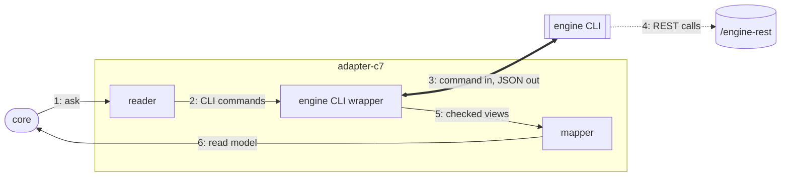

# The C7 adapter

The adapter that answers Pulse's questions and writes for Operaton, CIB seven and Camunda 7.

## Why

Operaton and CIB seven are forks of Camunda 7 and keep its REST API, so one adapter serves all
three. It has no HTTP client of its own: Miragon's engine CLI ([c7-adapter.md](../../../docs/adr/c7-adapter.md))
CLI handles login, paging and the REST details, and its `inspect` gathers an instance's waits,
incidents and variables in one call. The CLI has no library entry yet, so it runs as a process.

## How it works

1. The core asks a question through the `ProcessRuntime` port, e.g. "details of instance X".
2. A reader turns it into one or more CLI commands and runs them in parallel where it can.
3. The wrapper starts the bundled CLI with VS Code's own Node; credentials go in env variables.
4. The CLI calls the engine's REST API, read-only for reads, and prints JSON.
5. The wrapper parses the JSON without losing digits and checks each field it reads.
6. Mappers turn these views into the contract's read model; failures become a `RuntimeError`.

Writes (`ProcessCommands`) take the same road without the read-only flag, the value on stdin.

## Where things are

- `apps/vscode/src/adapters/c7`: `C7Adapter` builds a runtime and commands per engine connection
- `apps/vscode/src/adapters/c7/reading`: one reader per question, e.g. `InstanceDetailReader`
- `apps/vscode/src/adapters/c7/mapping`: mappers from the CLI's views to the contract's read models, no I/O
- `apps/vscode/src/adapters/c7/writing`, `apps/vscode/src/adapters/c7/errors`: the bodies of a variable change and a move, the token a move cancels; failures to `RuntimeError`
- `apps/vscode/src/adapters/c7/web-ui`: `CockpitWebUi`: links into Cockpit or the CIB seven webclient
- `apps/vscode/src/adapters/c7/engine-cli`: the engine CLI wrapper: runs the CLI and parses its JSON; replaced by an in-process client

## Rules

- `apps/vscode/src/adapters/c7` imports only the contract; Node built-ins only inside `apps/vscode/src/adapters/c7/engine-cli` (dependency-cruiser)
- `apps/vscode/src/adapters/c7/engine-cli` imports nothing of ours, so an in-process engine client can replace it as a whole (dependency-cruiser)
- Engine words are allowed here, not in contract, core or webview; classes, no comments (ESLint)

## Proven on

CI runs all 39 conformance laws on real Operaton 2.1.5, CIB seven 2.2.0 and Camunda 7.24.0.

## More

[C7 adapter](../../../docs/adr/c7-adapter.md) · [code structure](../../../docs/adr/code-structure.md) · [runtime contract](../../../docs/adr/runtime-contract.md) · [writes](../../../docs/adr/writes.md)
