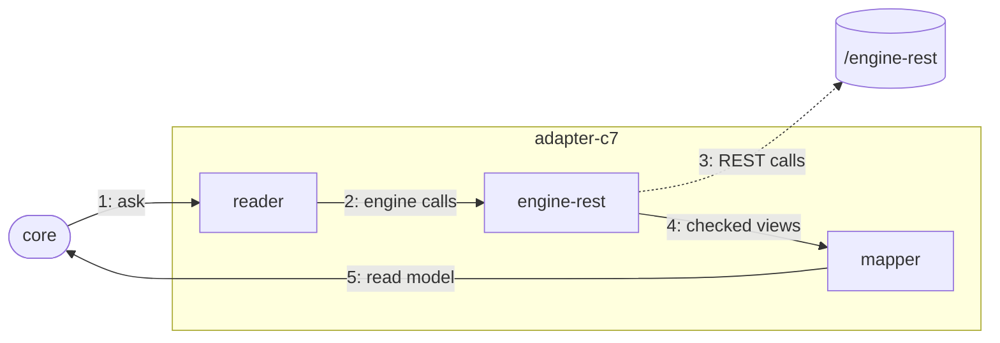

# The C7 adapter

The adapter that answers Pulse's questions and writes for Operaton, CIB seven and Camunda 7.

## Why

Operaton and CIB seven are forks of Camunda 7 and keep its REST API, so one adapter serves all
three. It calls that REST API itself with `fetch` ([c7-adapter.md](../../../docs/adr/c7-adapter.md)):
no child process, no library of its own beyond the extension.

## How it works

1. The core asks a question through the `ProcessRuntime` port, e.g. "details of instance X".
2. A reader turns it into one or more engine calls and runs them in parallel where it can.
3. `engine-rest` sends them with the connection's credentials, never follows a redirect, stops after 60 s or 64 MiB; a connection for reads refuses every write.
4. It parses the JSON without losing digits and checks each field it reads.
5. Mappers turn these views into the contract's read model; failures become a `RuntimeError`.

Writes (`ProcessCommands`) take the same road on a connection that may write.

## Where things are

- `apps/vscode/src/adapters/c7`: `C7Adapter` builds a runtime and commands per engine connection
- `apps/vscode/src/adapters/c7/reading`: one reader per question, e.g. `InstanceDetailReader`
- `apps/vscode/src/adapters/c7/mapping`: mappers from the engine's views to the contract's read models, no I/O
- `apps/vscode/src/adapters/c7/writing`, `apps/vscode/src/adapters/c7/errors`: the bodies of a variable change and a move, the token a move cancels; failures to `RuntimeError`
- `apps/vscode/src/adapters/c7/web-ui`: `CockpitWebUi`: links into Cockpit or the CIB seven webclient
- `apps/vscode/src/adapters/c7/engine-rest`: the REST client: requests, paging, the instance inspection, parsed and checked views

## Rules

- `apps/vscode/src/adapters/c7` imports only the contract and no Node built-in (dependency-cruiser)
- Engine words are allowed here, not in contract, core or webview; classes, no comments (ESLint)

## Proven on

CI runs all conformance laws on real Operaton 2.1.5, CIB seven 2.2.0 and Camunda 7.24.0.

## More

[C7 adapter](../../../docs/adr/c7-adapter.md) · [code structure](../../../docs/adr/code-structure.md) · [runtime contract](../../../docs/adr/runtime-contract.md) · [writes](../../../docs/adr/writes.md)
