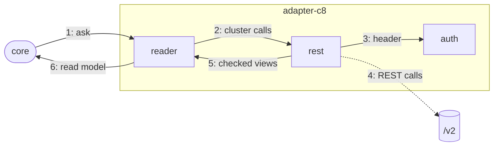

# The C8 adapter

The adapter that answers Pulse's questions for Camunda 8, on SaaS and Self-Managed, from 8.9 on. It
reads and doesn't write.

## Why

Camunda 8 has another API than the C7 family, so it gets an adapter of its own that shares no code
with the C7 one. It calls the Orchestration Cluster REST API itself with `fetch`
([c8-adapter.md](../../../docs/adr/c8-adapter.md)), no client library and no child process.

## How it works

1. The core asks a question through the `ProcessRuntime` port, e.g. "details of instance X".
2. A reader checks the version floor once and turns the question into one or more cluster calls.
3. `auth` gives the request its header: none, basic or a token from the client's token source.
4. `rest` sends the calls, never follows a redirect, stops after 60 s or 64 MiB, and retries once
   after a 401 when the token may have gone stale.
5. It checks each field it reads, so an answer of another shape fails as `unexpectedResponse`.
6. The reader turns these views into the contract's read model; failures become a `RuntimeError`.

## Where things are

- `apps/vscode/src/adapters/c8`: `C8Adapter` builds a runtime per connection and holds the token sources
- `apps/vscode/src/adapters/c8/auth`: the header of a request; client credentials with single flight, early refresh and holds
- `apps/vscode/src/adapters/c8/reading`: one reader per question, e.g. `InstanceDetailReader`, and the version floor
- `apps/vscode/src/adapters/c8/mapping`: keys, definition refs, incidents and their root cause, cursors, variable filters, the BPMN text reader
- `apps/vscode/src/adapters/c8/errors`: `ErrorTranslation` from an answer to a `RuntimeError`
- `apps/vscode/src/adapters/c8/web-ui`: `OperateWebUi`: links into Operate
- `apps/vscode/src/adapters/c8/rest`: the REST client: requests, paging, parsed and checked views

## Rules

- `apps/vscode/src/adapters/c8` imports only the contract, no Node built-in, no workspace package
- Engine words are allowed here, not in contract, core or webview; classes, no comments (ESLint)
- A secret never appears in an error, and a refused token request isn't repeated within its hold

## Proven on

`apps/vscode/test/adapters/c8/c8-conformance.engine.test.ts` runs all read laws on Self-Managed 8.9
and 8.10, on H2 and Elasticsearch, without security, with basic authentication and with OIDC, as a
read-only principal. CI runs it once the repository variable `PULSE_C8_ENGINES` is `true`.

## More

[C8 adapter](../../../docs/adr/c8-adapter.md) · [runtime contract](../../../docs/adr/runtime-contract.md) · [Camunda 8 in the docs](../../../../../docs/vscode/camunda8.md)
