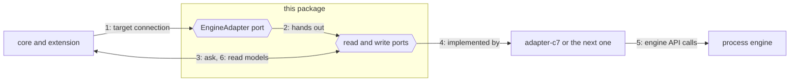
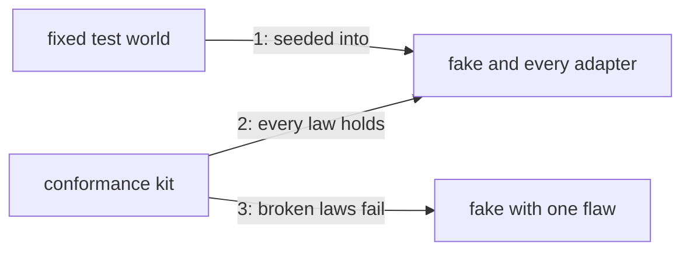

# Contract

The ports, read models and conformance laws between Pulse and any process engine.

## Why

Camunda 7 family engines and Camunda 8 hold the same runtime data, named and numbered differently.
This package fixes Pulse's questions and the words of the answers, so the core never learns
which engine answers. It is its own layer, so tools can prove that it imports nothing.

## How it works

1. The extension gives the adapter of a target's engine family a connection: endpoint, credentials.
2. The adapter hands out `ProcessRuntime` with 11 reads and, if it can write, `ProcessCommands`.
3. Core and extension ask in Pulse's words: process, version, instance and element ids.
4. Only the adapter behind the ports knows which engine answers.
5. The adapter turns each question into engine API calls and normalises the answer.
6. Facts come back as read models; a missing item is `undefined`, a failure a `RuntimeError`.

1. Each test harness seeds one fixed world of processes, element ids and instances into its engine.
2. The kit runs 43 read laws and 15 command laws; the fake and every adapter must pass all of them.
3. It tests itself: 55 saboteurs in `apps/vscode/test/contract`, each the fake with one flaw, fail exactly their laws.

## Where things are

- `apps/vscode/src/contract/ports`: the read and write ports and the plug that hands them out (`EngineAdapter`)
- `apps/vscode/src/contract/model`: ids, filters, pages and read models the ports exchange, plus `RuntimeError`
- `apps/vscode/src/contract/failing-runtime.ts`: a runtime that rejects every call, for a target Pulse refuses
- `apps/vscode/src/contract/conformance`: the kit, its laws and the fixed world, imported through its `index.ts`
- `apps/vscode/src/contract/fake`: an in-memory engine for tests and the dev host, imported through its `index.ts` (`FakeEngine`)

## Rules

- Imports nothing: no other layer, no npm package, no Node built-in (dependency-cruiser)
- Runs on any host: no DOM, no Node globals (tsc `lib` and `types` of `apps/vscode/tsconfig.contract.json`, `apps/vscode/test/contract/runtime.boundary.ts`)
- No engine words such as `camunda` or `processDefinitionKey` in `apps/vscode/src/contract` (ESLint)

## More

[runtime contract](../../docs/adr/runtime-contract.md) · [writes](../../docs/adr/writes.md) · [code structure](../../docs/adr/code-structure.md) · [architecture overview](../../docs/architecture-overview.md)
