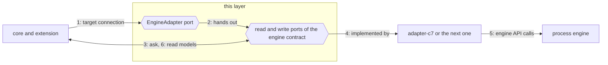

# Contract

The ports, read models and conformance laws between Pulse and any process engine, as the
extension sees them: the engine contract re-exported, plus the ports of the IDE.

## Why

Camunda 7 family engines and Camunda 8 hold the same runtime data, named and numbered differently.
The engine contract, [`@miragon/pulse-engine-contract`](../../../../packages/core/engine-contract/README.md),
fixes Pulse's questions and the words of the answers, so the core never learns which engine
answers. It is a package of its own, the shared language of the dialects. This layer is the one
place of the extension that imports it: its `index.ts` re-exports it, next to the ports only the
extension needs (connecting to an engine, the engine's web UI, the local model and its code), so
the core, the adapters and the host keep importing one entry, and tools can prove that this
layer imports nothing else.

## How it works

1. The extension gives the adapter of a target's engine family a connection: endpoint, credentials.
2. The adapter hands out `ProcessRuntime` with 17 methods, three of them optional
   (`refusedVariableConditions?`, `proposeMigration?`, `checkMigration?`), and, if it can write,
   `ProcessCommands`.
3. Core and extension ask in Pulse's words: process, version, instance and element ids.
4. Only the adapter behind the ports knows which engine answers.
5. The adapter turns each question into engine API calls and normalises the answer.
6. Facts come back as read models; a missing item is `undefined`, a failure a `RuntimeError`.

The conformance kit, its fixed world and the in-memory `FakeEngine` come from
`@miragon/pulse-engine-contract/testing`: the adapters' engine tests run the kit, the core's tests
and the browser dev host run the fake. They never ship in the extension.

## Where things are

- `apps/vscode/src/contract/index.ts`: the one entry, `@miragon/pulse-engine-contract` re-exported plus the ports below
- `apps/vscode/src/contract/ports`: the plug every engine family provides (`EngineAdapter` with `EngineConnection`, `EngineCredentials` and `EngineWebUi`) and the local ports `ModelSource`, `CodeLocator` and `WorkspaceFiles`
- `apps/vscode/src/contract/model`: the read models of the local sources (the `.bpmn` file and the code that implements an element)
- `packages/core/engine-contract`: the engine's ports, read models, `RuntimeError`, the kit and the fake

## Rules

- Imports only `@miragon/pulse-engine-contract`'s main entry: no other layer, no other npm package, no Node built-in (dependency-cruiser)
- Runs on any host: no DOM, no Node globals (tsc `lib` and `types` of `apps/vscode/tsconfig.contract.json`, `apps/vscode/test/contract/runtime.boundary.ts`)
- No engine words such as `camunda` or `processDefinitionKey` in `apps/vscode/src/contract` (ESLint), nor in the engine contract
- A new engine question goes into the engine contract (port, read model, law and saboteur), never here

## More

[runtime contract](../../docs/adr/runtime-contract.md) · [writes](../../docs/adr/writes.md) · [code structure](../../docs/adr/code-structure.md) · [architecture overview](../../docs/architecture-overview.md)
