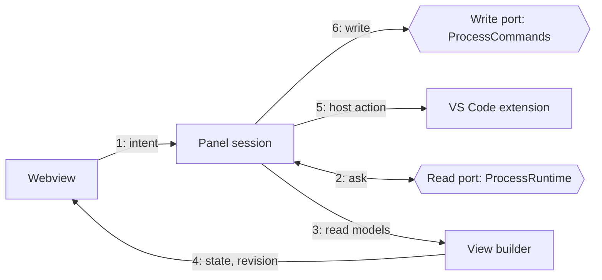
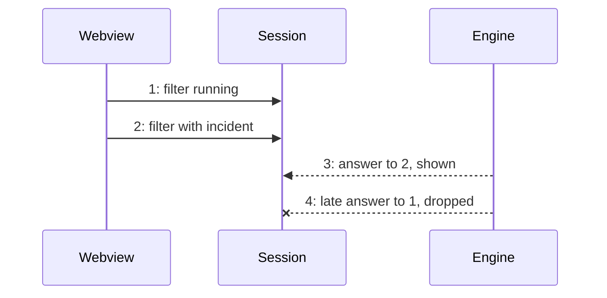

# @miragon/pulse-vscode-core

The engine-neutral logic of Pulse: it answers what the webview asks with complete views.

## Why

The webview should only draw and the extension should only wire VS Code. What lies between is
product logic: which version to show, how incidents group, which load wins, what a retry may touch.
It lives here without VS Code, DOM, Node or engine words, so it runs in the extension, the browser
dev host and tests against a fake engine, and a new engine changes nothing here.

## How it works

1. The webview sends an intent, such as "show instances with an incident". It carries no authority.
2. The panel session reads through the `ProcessRuntime` port and never learns which engine answers.
3. A view builder turns the read models into one view model.
4. The webview gets the complete state with a revision number and drops older revisions.
5. Opening a panel, a quick pick or a write confirmation goes to the extension (`PanelEffects`).
6. A retry or variable change goes through `ProcessCommands`; without it the view is read-only.

Answers can arrive out of order. Only the newest load may publish (`ViewSession`):

## Where things are

- `apps/vscode/src/core/protocol` – intents, states and view models shared with the webview (`MessageGuards`)
- `apps/vscode/src/core/panels` – the three panel sessions and their loading (`ViewSession`, `InstanceWrites`)
- `apps/vscode/src/core/views` – view builders: read models in, one view model out
- `apps/vscode/src/core/health`, `apps/vscode/src/core/explorer` – what the Health and Engines trees list (`IncidentHealthReport`)
- `apps/vscode/src/core/drift` – does a local `.bpmn` file match a deployed version? (`ModelDrift`)
- `apps/vscode/src/core/bpmn`, `apps/vscode/src/core/incidents`, `apps/vscode/src/core/diagrams` – text rules for BPMN XML and errors, diagram cache

## Rules

- Imports the contract only, no `vscode`, Node or npm; the protocol none (dependency-cruiser)
- No DOM and no Node globals: `lib` is ES2023 only (tsc, `apps/vscode/test/core/runtime.boundary.ts`)
- No engine words, no comments, one class per file, no module functions (ESLint)

## More

[architecture](../../docs/adr/architecture.md) · [code structure](../../docs/adr/code-structure.md) · [writes](../../docs/adr/writes.md) · [guardrails](../../docs/adr/guardrails.md) · [overview](../../docs/architecture-overview.md)
