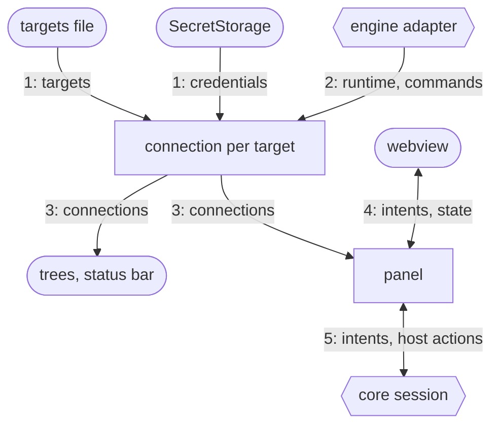
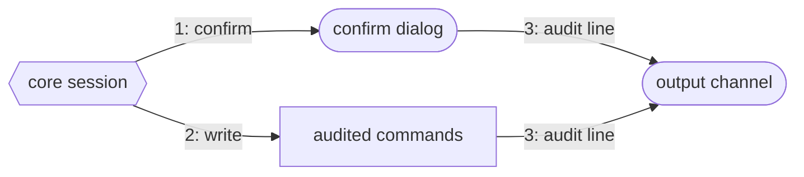

# Host

The VS Code host of Pulse: it turns configured engines into connections and shows them in
trees, the status bar and webview panels. The Marketplace page is [MARKETPLACE.md](../../MARKETPLACE.md).

## Why

Only this package uses the VS Code API, so the core's sessions also run in the browser dev host.
It wires and decides trust (targets, writes, confirmation); runtime-data rules live in `core`.

## How it works

1. It reads every `.pulse-cli.json` and each target's login from SecretStorage.
2. The composition root picks the adapter for the target's engine; it supplies runtime and commands.
3. Trees, status bar and panels show the connections; a reload rebinds open panels.
4. The webview sends intents and gets the complete panel state back.
5. A core session handles each intent and asks the panel for dialogs, other panels or links.

1. A write is confirmed by environment: not at all, a modal, or a modal plus typing the host.
2. Confirmed, the session writes through audited commands, present only where writes are allowed.
3. Each answer and each write leaves one line in the "Pulse" output channel, never values.

## Where things are

- `apps/vscode/src/host/pulse-extension.ts`: wiring on activation; `apps/vscode/src/host/composition-root.ts`: the adapters
- `apps/vscode/src/host/connections`: targets, logins, write policy, audit (`ConnectionRegistry`, `WritePolicy`)
- `apps/vscode/src/host/panels`: webview panels and their host actions (`PanelManager`, `VsCodePanelEffects`)
- `apps/vscode/src/host/commands`, `apps/vscode/src/host/explorer`: one class per command, the Engines tree

## Rules

- In `apps/vscode/src/host/`, only `composition-root.ts` imports an adapter (dependency-cruiser, `pnpm lint:architecture:vscode`)
- Engine words only in `composition-root.ts` and `connections/` (ESLint `no-restricted-syntax`)
- One class per file; `activate` and `deactivate` are the only module functions (ESLint)

## Build and test

`pnpm --filter pulse-cockpit run build` bundles the host, the webview and the engine CLI into `dist/` (`apps/vscode/scripts/build.mjs`).
`pnpm --filter pulse-cockpit test` runs `apps/vscode/test/host/` on a `vscode` fake; `test:smoke` and `test:e2e` start a real VS Code.

## More

[architecture](../../docs/adr/architecture.md) · [writes](../../docs/adr/writes.md) · [code structure](../../docs/adr/code-structure.md) · [guardrails](../../docs/adr/guardrails.md)
