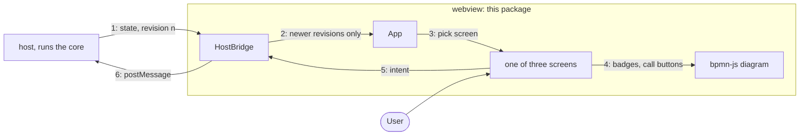

# Webview

The UI inside Pulse's editor tabs: Preact screens and a bpmn-js diagram, drawn from the
view models the core sends.

## Why

A thin renderer: the core decides what a panel shows (rows, counts, badges, whether a write is
allowed); the webview draws it and sends back what the user did. So the logic is tested without
a browser, a click carries no authority, and the same bundle runs in VS Code or a browser.

## How it works

1. The host sends the complete panel state with a revision number, never a patch.
2. The bridge drops any revision that is not newer than the last one it saw.
3. The app picks a screen: loading, failed, or engine, definition or instance by the view's kind.
4. Definition and instance screens draw the deployed diagram with badges, markers, call buttons.
5. A click or a typed search becomes an intent like `filterInstances`; nothing changes locally.
6. The bridge posts the intent to the host; the core acts on it, and its answer is step 1 again.

Only UI state (open tab, split, column widths, zoom) stays in the webview's own VS Code state.

## Where things are

- `apps/vscode/src/webview/host`: the bridge to the host and the stored UI state (`HostBridge`, `UiStateStore`)
- `apps/vscode/src/webview/screens`: the three screens, filter bars, instance tabs and the variable editor
- `apps/vscode/src/webview/diagram`: the bpmn-js viewer with its badges and call buttons (`RuntimeCanvas`)
- `apps/vscode/src/webview/components`: shared parts: the table with resizable columns, header bar, tabs, icons
- `apps/vscode/src/webview/theme`, `apps/vscode/src/webview/styles`: vendored Miragon design tokens and the CSS on top of them
- `apps/vscode/dev/webview`, `apps/vscode/test/webview`: a fixture page, bundle and screenshot scripts; browser tests with a fake host

## Rules

- Takes only the core's protocol types, nothing else of ours (dependency-cruiser)
- No `vscode` and no Node: it runs in a browser sandbox (dependency-cruiser, `apps/vscode/tsconfig.webview.json`)
- Colours only from Miragon `--cd-*` tokens, never `--vscode-*`; no engine words (ESLint)

## Develop and test

- `pnpm --filter pulse-vscode run build`, then `pnpm --filter pulse-vscode run dev`, runs the real core on a fake engine at localhost:5180
- `pnpm --filter pulse-vscode test` runs the browser tests in Chromium with the unit tests, and checks the 200 000 B gzip budget of the bundle (`apps/vscode/test/__golden__/bundle-budget.json`)
- `apps/vscode/dev/webview/serve.mjs` serves the fixture page with the webview alone, `screenshot.mjs` shoots its fixtures and `bundle-size.mjs` lists what the bundle is made of; run them by hand with `node`

## More

[user interface](../../docs/adr/user-interface.md) · [protocol](../../docs/adr/architecture.md#host--webview-protocol) · [writes](../../docs/adr/writes.md) · [code structure](../../docs/adr/code-structure.md) · [guardrails](../../docs/adr/guardrails.md)
