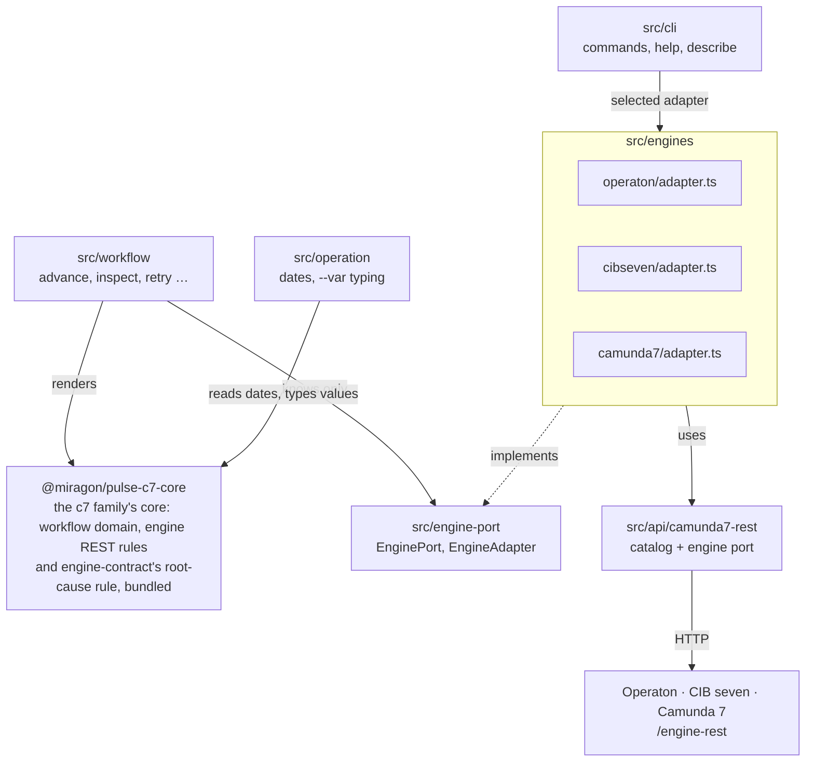
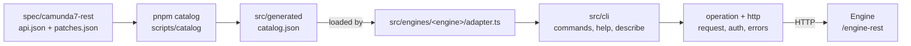
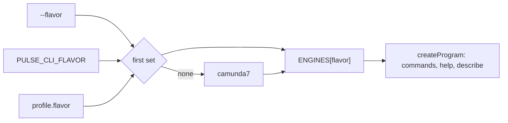
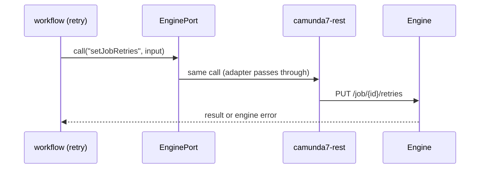

# Architecture

The CLI speaks to an engine through a port. Each engine has its own adapter behind that port.
Today every adapter passes straight through to the Camunda 7 REST API. When an engine diverges,
only its adapter changes.

## Layers

| Folder            | What it holds                                                                                                            |
| ----------------- | ------------------------------------------------------------------------------------------------------------------------ |
| `src/engine-port` | What the CLI needs from an engine: `EnginePort` and `EngineAdapter`. Types only                                          |
| `src/engines`     | One adapter per engine: `operaton`, `cibseven`, `camunda7`                                                               |
| `src/api`         | One folder per engine API. `camunda7-rest` builds catalog and port                                                       |
| `src/workflow`    | The workflow commands. They know the port, never an adapter or an API                                                    |
| c7-core           | `packages/connectors/c7/c7-core`, the Camunda 7 REST family's core: selection, inspect, status, plans, engine REST rules |
| `src/cli`         | Selects the adapter and registers its commands                                                                           |

dependency-cruiser enforces the boundaries (`pnpm lint:architecture && pnpm lint:architecture:cli`):

- `workflow` imports `engine-port` and `@miragon/pulse-c7-core`, never `engines` or `api`.
  It turns the package's steps and reasons into the command lines and errors the CLI prints.
  Only `operation/dates.ts` and `operation/variables.ts` also import c7-core, for its rules.
- Only `engines/<name>/adapter.ts` imports `api`.
- Adapters do not import each other. An API does not import another API.
- `engine-port` imports types only. `api`, `engine-port` and `engines` use no Node built-ins.
- Only the adapters and `src/catalog/catalog.ts` read the generated catalog.

## From spec to request

The commands are data. A generator turns the OpenAPI spec into one catalog that every engine
shares. The selected adapter hands it to the CLI, which registers commands, help and `describe` from
it and sends requests over HTTP.

## Selecting the engine

`run.ts` picks the adapter before it registers a single command. Only then do commands, help and
`describe` match the catalog of that engine.

A config file that cannot be read does not stop the selection: the CLI falls back to `camunda7`,
and the command reports the problem when it reads its configuration.

## A workflow command

The decisions behind this: [Architecture decisions](adr/).
