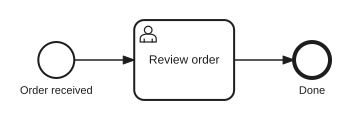

# Getting started

You need Node.js 22.12 or later and a reachable Camunda 7 REST API: Operaton, CIB seven or
Camunda 7. Without Node.js, take the standalone executable or the container image from
[installation](./installation.md).

## A first triage

pulse-cli uses `http://localhost:8080/engine-rest` by default, so a local engine needs no
configuration. Give it a few seconds to start before the first command.

```sh
npm install -g @miragon/pulse-cli
docker run -d --name engine -p 8080:8080 operaton/operaton:2.1.5
# or camunda/camunda-bpm-platform:run-7.24.0, or cibseven/cibseven:run-2.2.0
pulse-cli ping
pulse-cli status
```

`pulse-cli ping` checks the connection. `pulse-cli status` triages the whole engine in one read-only
call: incidents grouped by root cause, overdue jobs, external task workers and failed batches,
each finding with the next command to run. The Operaton image ships the invoice example, so a
fresh container already has instances, and no findings:

```text
Engine  http://localhost:8080/engine-rest (version 2.1.5, 13ms)
Status  ok

Definitions:
KEY            VERSIONS  INSTANCES  INCIDENTS  FAILED JOBS
invoice        2         6          0          0
ReviewInvoice  1         2          0          0

Jobs       0 executable
Tasks      6 open
Batches    0 running, 0 with failures
Incidents  0 open, 0 propagated
```

## Your first process

Create a small process with one user task:

```sh
cat > order.bpmn <<'EOF'
<?xml version="1.0" encoding="UTF-8"?>
<bpmn:definitions xmlns:bpmn="http://www.omg.org/spec/BPMN/20100524/MODEL"
    xmlns:camunda="http://camunda.org/schema/1.0/bpmn" targetNamespace="https://example.com/order">
  <bpmn:process id="order" name="Order" isExecutable="true" camunda:historyTimeToLive="30">
    <bpmn:startEvent id="received" />
    <bpmn:sequenceFlow id="f1" sourceRef="received" targetRef="review" />
    <bpmn:userTask id="review" name="Review order" camunda:candidateGroups="sales" />
    <bpmn:sequenceFlow id="f2" sourceRef="review" targetRef="done" />
    <bpmn:endEvent id="done" />
  </bpmn:process>
</bpmn:definitions>
EOF
```

<figure class="diagram">
  
  <figcaption>order.bpmn as a diagram</figcaption>
</figure>

Deploy it with an instance, see where it waits, then complete the task. No id is passed
around: the workflow commands find the instance by its business key.

```sh
pulse-cli deploy order.bpmn --start --business-key ORD-1001 --var amount=250
pulse-cli inspect --business-key ORD-1001
pulse-cli advance --business-key ORD-1001 --var approved=true
```

The same steps as raw REST operations, one command per request:

```sh
pulse-cli deployment create order.bpmn --deployment-name order
pulse-cli process-definition start order --business-key ORD-1002 --var amount=250
TASK_ID=$(pulse-cli task list --process-definition-key order --fields id | jq -r '.[0].id')
pulse-cli task complete "$TASK_ID" --var approved=true
pulse-cli historic-process-instance list --process-definition-key order --finished --fields id,businessKey,state -o table
```

## Your engine, Claude Code or CI

Point pulse-cli at your own engine with a read-only profile, or hand it to Claude Code or your CI
pipeline. A profile also holds the engine's Basic auth, OAuth or bearer token settings, see
[authentication](./authentication.md).

::: code-group

```sh [Your engine]
pulse-cli config set prod --url https://engine.example.com/engine-rest --read-only
pulse-cli status --profile prod
```

```text [Claude Code]
/plugin marketplace add Miragon/pulse
/plugin install pulse-cli@pulse
/pulse-cli:status
```

```sh [CI]
export PULSE_CLI_URL=https://engine.example.com/engine-rest
pulse-cli status --read-only --fail-on warning
```

:::

The [Claude Code plugin](./agents.md#claude-code-plugin) calls the CLI you installed, or
`npx -y @miragon/pulse-cli` if there is none. Other agents need one line in `AGENTS.md` or
`CLAUDE.md`: "Run `pulse-cli guide` before using `pulse-cli`."

In CI, `--fail-on warning` fails on any finding, an open incident included. `--fail-on critical`
fails only when executable jobs are overdue, and that finding asks whether the job executor is
running. Either way the command exits with code 9 (`CHECK_FAILED`).

## Where next

- [Workflow commands](./workflow-commands.md): `inspect`, `wait`, `advance`, `retry`, `deploy` and
  `status`, the six commands that combine several requests.
- [Recipes](./recipes.md): command lines for everyday tasks.
- [Safety](./safety.md): previews, confirmation and read-only mode.
- In the CLI: `pulse-cli commands` lists the API groups, `pulse-cli describe <group> <command>`
  explains a command and `pulse-cli guide` prints the usage guide.
