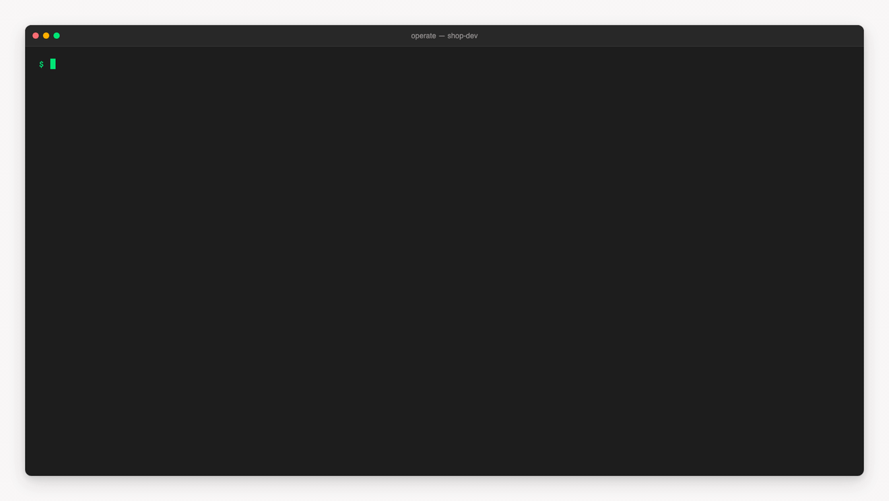

# Pulse CLI

The Pulse CLI lets an AI agent, or you at a shell, operate a Camunda 7 process engine: Operaton,
CIB seven or Camunda 7. The agent names what should happen in one short command, and the CLI
sends the requests to the engine's REST API.

```sh
npx @miragon/pulse-cli guide
```



| Page                                        | What it covers                                                          |
| ------------------------------------------- | ----------------------------------------------------------------------- |
| [Getting started](./getting-started.md)     | A first triage, then your own engine, Claude Code or CI                 |
| [Installation](./installation.md)           | npm, Homebrew, standalone executable, container image, shell completion |
| [Quick start](./quick-start.md)             | One process from an empty engine to a finished instance                 |
| [Workflow commands](./workflow-commands.md) | Inspect, wait, advance, retry, deploy, status                           |
| [Command structure](./commands.md)          | Names, arguments, variables, request bodies, files, dates               |
| [Output and errors](./output-and-errors.md) | Formats, previews, error fields, exit codes                             |
| [Configuration](./configuration.md)         | Options, environment variables, config and project files, profiles      |
| [Authentication](./authentication.md)       | Basic auth, OAuth logins, bearer tokens, token commands, other headers  |
| [Safety](./safety.md)                       | Previews, confirmation, read-only mode                                  |
| [Recipes](./recipes.md)                     | Command lines for everyday tasks                                        |
| [AI agents](./agents.md)                    | The guide, the Claude Code plugin and its skill                         |
| [Engines](./engines.md)                     | Compatibility, choosing the engine, adding a difference or an engine    |
| [Architecture](./architecture.md)           | Engine port, adapters, catalog generation                               |
| [Architecture decisions](./adr/index.md)    | Why the CLI is built the way it is                                      |
| [Development](./development.md)             | Building and testing the CLI in the Pulse repository                    |
