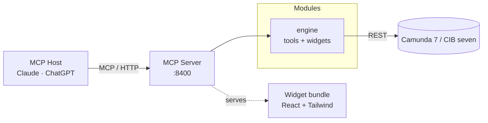

# Pulse architecture

Pulse is a single Node.js MCP server that exposes Camunda 7 / CIB seven
operations to any MCP host (Claude, ChatGPT, …). Everything it shows, the figures of its views
included, it reads from the engine's REST API.

## At a glance

## Modules

| Module                                                      | Role                                                                                                                                                                                                                           |
| ----------------------------------------------------------- | ------------------------------------------------------------------------------------------------------------------------------------------------------------------------------------------------------------------------------ |
| **MCP Server** (`apps/mcp-server/`)                         | Hosts the HTTP transport on port `8400` on the official MCP TypeScript SDK, loads modules from `MCP_ACTIVE_MODULES`, and serves the Vite-built React widget bundle (see **widgets**).                                          |
| **CLI** (`apps/cli/`)                                       | Every engine REST operation as a command, generated from the OpenAPI spec, plus the workflow commands; on npm, Homebrew, GHCR and the GitHub release. See the [CLI docs](../cli/index.md); rules in `apps/cli/CLAUDE.md`.      |
| **Pulse for VS Code** (`apps/vscode/`)                      | Shows what an engine runs next to the BPMN models in VS Code: the runtime view (`packages/core/runtime-view`, a Preact webview over the engine contract) and the C7 adapter. A .vsix; rules in `apps/vscode/CLAUDE.md`.        |
| **Pulse for Orca** (`apps/orca/`)                           | The same runtime view and C7 adapter in Orca's editor tabs and a Pulse panel; an Orca plugin, rules in `apps/orca/CLAUDE.md`.                                                                                                  |
| **engine** (`packages/connectors/engine/engine-connector/`) | Wraps the Camunda 7 / CIB seven REST API via an OpenAPI-generated client. Exposes process, task, incident, deployment, and history tools plus widgets.                                                                         |
| **widgets** (`apps/mcp-server/dist/mcp-app.js` + `.css`)    | One Vite-built ES module + stylesheet containing React, Tailwind, and every widget. The server serves it behind one `ui://views/<tool>.html` resource per widget tool, which declares that view on itself (`showToolBinding`). |

## Composition rules

A few layering rules keep modules independently usable and a second engine dialect cheap:

- Three axes keep a second engine dialect and a second interface cheap. Engine
  _vendors_ (CIB seven, Operaton, Camunda 7) are per-engine runtime configuration
  (`flavor` on the engine entry, resolved to an `EngineProvider` carrying only the
  real differences: cockpit routes, branding, client hook), never packages or apps.
  A _dialect_ (an engine API family: Camunda 7 today, Camunda 8 later) is one package
  family under `packages/connectors/<dialect>/` (`c7` today). A family is one source the
  server reads, a dialect or another source (a metrics store, say): its client, its core when
  its interfaces share a pure domain and, for a source that is no dialect, its connector (the
  MCP module). A package two interfaces share is extracted on its second consumer into the
  family's core, like `@miragon/pulse-c7-core`, the core of the Camunda 7 REST dialect family
  that the CLI bundles, the C7 adapter runs and the engine connector runs over
  its client (one port per API family; it names no command, flag or tool). `packages/core/`
  holds what every family builds on, never one family's code. The family `engine` is the neutral
  layer: one MCP server app, the thin composition root `apps/mcp-server`, and one module
  (`packages/connectors/engine/engine-connector`) serve every dialect, and its core
  (`packages/connectors/engine/engine-core`) is the contract each dialect implements. An
  _interface_ is an app: the MCP server, the CLI, Pulse for VS Code and Pulse for Orca.
- Modules are peers. Connector packages (`*-connector`) never import each other. What one
  module needs of another the app injects through `shared` (`SharedResources` in
  `apps/mcp-server/src/setup.ts`), the port for what the modules of a composition share; today
  the app hands nothing through.
- Modules are self-contained. Each exports a module definition: config schema, env mapping,
  known env vars, toolset vocabulary, boot warnings, plugin factory
  (`packages/connectors/<family>/<family>-connector/src/module.ts`). A plugin is a name plus a
  `register(server)` that puts the module's tools, prompts and resources on the one server the
  shared boot builds; the boot refuses a name or resource URI two modules register. The app only lists its modules and wires
  what they share (`apps/mcp-server/src/setup.ts`); the shared boot selects the
  modules (`MCP_ACTIVE_MODULES`), installs OAuth from the env and resolves one fail-closed
  toolset per module per boot (a module with toolsets: read-only unless widened) and logs it.
  The module packages are published to npm, so external composition roots can mount them next
  to their own modules. The reference is `templates/composed-server/`.
- A view comes from the bundle or from its module. The engine module's views are bundle views
  (an ESLint gate blocks a resource in `packages/connectors/`). A module of yours, on npm say, may
  bring a finished HTML document as its own resource instead: nothing of it enters the bundle, so
  it shares no code with it, gets none of widget-shell's host contexts and states its own CSP. The
  boot keeps `ui://views/` for the bundle and fails on a tool that binds a resource nobody serves.
- The MCP server app owns no domain UI. Widgets live in packages: `pulse-ui` carries the design kit,
  `widget-shell` the view runtime; each module carries its own and renders no other module's widget.
  A view that composes modules goes in a dedicated package, created with the first real one.
- One profile format. `@miragon/pulse-profile` (`packages/core/profile`) is the one format of the
  engine profiles of the CLI, Pulse for VS Code, Pulse for Orca and the server: it takes a file's
  text, returns a verdict per profile as data, reads no file or environment, imports nothing, and
  lets an interface state what it serves (`refusalsOn`), so a key is applied or refuses a profile.
- One transport. `@miragon/pulse-http` (`packages/core/http`) is the one HTTP client of the engine
  connector (its SDK client's `fetch`), of the CLI and of the C7 adapter of Pulse for VS Code and
  Pulse for Orca: a deadline to the last byte, no redirect, a 64 MiB cap (none in the CLI), one
  retry after a 401, failure reasons as data, masked secrets; every wiring passes `TRANSPORT_CASES`.
- One engine contract: `@miragon/pulse-engine-core` holds the ports, read models, laws and shared
  rules (`RootCauses`) of every dialect; the runtime view and its two editor hosts, c7-core and the
  C7 adapter (`packages/connectors/c7/c7-adapter`) use it, the engine connector and the CLI through
  c7-core.
- Extract on the second consumer, never speculatively. A composed-views package appears with
  the first cross-module view. A second dialect joins the engine module (`ENGINE_DIALECTS`),
  never with a widget package or an MCP server app of its own.

## Views and hosts

A widget never talks to its host. It reads host-agnostic contexts from widget-shell's view
runtime (`useViewHost` for tool calls and hand-offs, the theme, locale, display mode and height
budget), and one adapter fills them: today the MCP Apps adapter over the official `App` of
`@modelcontextprotocol/ext-apps`, the only code that imports its view runtime (an ESLint gate
keeps it so). `TestViewHost` fills the same contexts in tests and publishes the formatters'
locale as the view root does, so a widget test reads the same on every machine.

The MCP Apps host is therefore one host among several possible ones. A web app that shows the
same React components brings an adapter of its own and leaves the widgets as they are. The engine
module's widgets still read the Camunda 7 REST family's data. Components for Camunda 8 would read
engine-core's contract, as the runtime view does: a design question of its own.

## What the UIs share

Pulse's UIs run on two runtimes. React on `@miragon/pulse-ui` and widget-shell: the MCP widgets, a
starter's and the web apps of [#573](https://github.com/Miragon/pulse/issues/573). Preact with its
own components and stylesheets: the runtime view's webview (Pulse for VS Code and Pulse for Orca),
which has no host adapter and never renders a widget. They share a core up to building blocks: the
formats (the board file first), pulse-ui's framework-free `@miragon/pulse-ui/tones` (one tone per
situation, `SITUATION_TONES`) and `@miragon/pulse-ui/format` (dates, durations, counts, short ids),
from `@miragon/pulse-ui/testing` the product glossary, the count words and the brand gates, the
engine rules of c7-core, the numbers of a feature several show (boards first: one builder over one
read) and building blocks written against React's API with props and callbacks only, which the
webview renders through `preact/compat`. Each keeps its own screens and host wiring: six cockpit
views have a counterpart in the editors, and [Parity with the MCP cockpit](../vscode/parity.md)
lists what still differs. The decision, of 2026-11-12, is `apps/vscode/docs/adr/ui-foundation.md`.

## External systems

| System                | Purpose                                                                  | Default endpoint                    |
| --------------------- | ------------------------------------------------------------------------ | ----------------------------------- |
| Camunda 7 / CIB seven | The BPM engine itself: process definitions, instances, tasks, incidents. | `http://localhost:8410/engine-rest` |

## Data flow

1. The MCP host calls a tool on the server (e.g. `engine_status`).
2. The server delegates to the matching module's plugin.
3. The plugin calls the engine's REST API and returns JSON for the model.
4. A view tool (the engine module's `open_cockpit`) returns the view's data as `structuredContent`
   and its model-facing result (the facts as compact JSON) as `content`; the host renders it in
   the tool's view, which the shared bundle picks by the tool's name (re-running the tool once
   where a host drops `structuredContent`). Inside the view, app-only `*_data` feeds refresh and
   page it without a model turn.

## Repository layout

| Path                   | Description                                                                         |
| ---------------------- | ----------------------------------------------------------------------------------- |
| `apps/mcp-server/`     | The MCP server entry point and the widget bundle.                                   |
| `packages/core/`       | What every family builds on: widget-shell, pulse-ui, profile, transport.            |
| `packages/connectors/` | One folder per family: the neutral `engine` (module, core), one per dialect (`c7`). |
| `playground/`          | Demo env: showcases, Compose stack, Fly.io deployment.                              |

For deeper detail, [Reference](reference.md) lists every tool and toolset.
