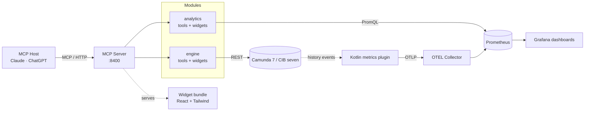

# Pulse architecture

Pulse is a single Node.js MCP server that exposes Camunda 7 / CIB seven
operations and Prometheus-backed analytics to any MCP host (Claude, ChatGPT, …). A Kotlin plugin
in the engine emits process metrics via Micrometer, pushed over OTLP; the OTEL Collector exports
them to Prometheus so the analytics module can query them.

## At a glance

## Modules

| Module                                                               | Role                                                                                                                                                                                                                           |
| -------------------------------------------------------------------- | ------------------------------------------------------------------------------------------------------------------------------------------------------------------------------------------------------------------------------ |
| **MCP Server** (`apps/mcp-server/`)                                  | Hosts the HTTP transport on port `8400` on the official MCP TypeScript SDK, loads modules from `MCP_ACTIVE_MODULES`, and serves the Vite-built React widget bundle (see **widgets**).                                          |
| **CLI** (`apps/cli/`)                                                | Every engine REST operation as a command, generated from the OpenAPI spec, plus the workflow commands; on npm, Homebrew, GHCR and the GitHub release. See the [CLI docs](../cli/index.md); rules in `apps/cli/CLAUDE.md`.      |
| **VS Code extension** (`apps/vscode/`)                               | Shows what an engine runs next to the BPMN models in VS Code: a Preact webview over an engine-neutral contract and the C7 adapter. Ships as a .vsix on the Marketplace and Open VSX; rules in `apps/vscode/CLAUDE.md`.         |
| **engine** (`packages/connectors/engine/engine-connector/`)          | Wraps the Camunda 7 / CIB seven REST API via an OpenAPI-generated client. Exposes process, task, incident, deployment, and history tools plus widgets.                                                                         |
| **analytics** (`packages/connectors/analytics/analytics-connector/`) | Queries Prometheus via PromQL for the process dashboard (per process and per activity), period, version and engine comparisons, the cross-engine landscape and engine health. Tools + widgets.                                 |
| **engine-plugins** (`engine-plugins/`)                               | Kotlin Micrometer plugins for CIB seven: a process-metrics emitter. Independent build (Java 21, Gradle). No engine-side database.                                                                                              |
| **widgets** (`apps/mcp-server/dist/mcp-app.js` + `.css`)             | One Vite-built ES module + stylesheet containing React, Tailwind, and every widget. The server serves it behind one `ui://views/<tool>.html` resource per widget tool, which declares that view on itself (`showToolBinding`). |

## Composition rules

A small set of layering rules keeps modules independently usable and a future
second engine dialect cheap:

- Three axes keep a second engine dialect and a second interface cheap. Engine
  _vendors_ (CIB seven, Operaton, Camunda 7) are per-engine runtime configuration
  (`flavor` on the engine entry, resolved to an `EngineProvider` carrying only the
  real differences: cockpit routes, branding, client hook), never packages or apps.
  A _dialect_ (an engine API family: Camunda 7 today, Flowable would be another) is
  one package family under `packages/connectors/<family>/`. A family is one source the
  server reads, a dialect or another source such as `analytics` (Prometheus): its client,
  its connector (the MCP module) and, when its interfaces share a pure domain, its core.
  A package two interfaces share is extracted on its second consumer into the family's core,
  like `@miragon/pulse-engine-core`, the Camunda 7 family's workflow domain that the CLI and
  the VS Code extension's C7 adapter bundle and the engine connector runs over its client
  (one port per API family; it names
  no command, flag or tool). `packages/core/` holds what every family builds on, never one
  family's code. An
  _interface_ is an app:
  `apps/mcp-server` is the thin composition root of the Camunda-7-dialect
  MCP server (engine + analytics); a different dialect gets a family and an MCP server app
  named after it.
  The CLI (`apps/cli`) and the VS Code extension (`apps/vscode`) are interfaces of their own.
- Modules are peers. Connector packages (`*-connector`) never import each other. Cross-module
  capabilities are injected by the app, e.g. the engine module's BPMN-XML lookup feeding the
  analytics heatmap and the names in its views (`SharedResources.fetchBpmnXml`) and its
  configured engine ids, the only engines analytics reads (`engineIds`).
- Modules are self-contained. Each exports a module definition: config schema, env mapping,
  known env vars, toolset vocabulary, boot warnings, plugin factory
  (`packages/connectors/<family>/<family>-connector/src/module.ts`). A plugin is a name plus a
  `register(server)` that puts the module's tools, prompts and resources on the one server the
  shared boot builds; the boot refuses a name or resource URI two modules register. The app only lists its modules and wires
  their shared resources (`apps/mcp-server/src/setup.ts`); the shared boot selects the
  modules (`MCP_ACTIVE_MODULES`), installs OAuth from the env and resolves one fail-closed
  toolset per module per boot (a module with toolsets: read-only unless widened) and logs it.
  The module packages are published to npm, so external composition roots can mount them next
  to their own modules. The reference is `templates/composed-server/`.
- A view comes from the bundle or from its module. Engine and analytics views are bundle views
  (an ESLint gate blocks a resource in `packages/connectors/`). A module of yours, on npm say, may
  bring a finished HTML document as its own resource instead: nothing of it enters the bundle, so
  it shares no code with it, gets none of widget-shell's host contexts and states its own CSP. The
  boot keeps `ui://views/` for the bundle and fails on a tool that binds a resource nobody serves.
- The MCP server app owns no domain UI. Widgets live in packages: `pulse-ui`
  carries the design kit, `widget-shell` the view runtime;
  each module carries its own. Cross-module UI goes through another module's widget by its raw
  host-widget id (`analytics:engine-landscape`, `analytics:process-heatmap`), a probe feed by tool name
  with graceful degradation, or hard-composed views in a dedicated package (created with the first real view).
- Extract on the second consumer, never speculatively. A composed-views
  package appears with the first cross-module view, a shared domain-widget
  package with a second dialect, a host-kit with a second MCP server app.

## Views and hosts

A widget never talks to its host. It reads host-agnostic contexts from widget-shell's view
runtime (`useViewHost` for tool calls and hand-offs, the theme, locale, display mode and height
budget), and one adapter fills them: today the MCP Apps adapter over the official `App` of
`@modelcontextprotocol/ext-apps`, the only code that imports its view runtime (an ESLint gate
keeps it so). `TestViewHost` fills the same contexts in tests.

The MCP Apps host is therefore one host among several possible ones. A web app or a VS Code
webview that shows the same React components brings an adapter of its own and leaves the
widgets as they are. The engine module's widgets still read the Camunda 7 REST family's data,
though: components that serve another engine such as Camunda 8 need an engine-neutral contract first,
as the VS Code extension keeps one for its webview (`apps/vscode`), and that is a design
question of its own.

## External systems

| System                  | Purpose                                                                        | Default endpoint                    |
| ----------------------- | ------------------------------------------------------------------------------ | ----------------------------------- |
| Camunda 7 / CIB seven   | The BPM engine itself: process definitions, instances, tasks, incidents.       | `http://localhost:8410/engine-rest` |
| OpenTelemetry collector | Receives OTLP from the engine; exports metrics to Prometheus.                  | `:8431` (OTLP HTTP)                 |
| Prometheus              | Time-series store for the process metrics; the analytics module's data source. | `http://localhost:8460`             |
| Grafana                 | Provisioned process-analytics dashboards over Prometheus.                      | `http://localhost:8470`             |

## Data flow

1. The MCP host calls a tool on the server (e.g. `analytics_engine_health`).
2. The server delegates to the matching module's plugin.
3. The plugin calls the relevant system (REST for the engine, PromQL for
   Prometheus) and returns JSON for the model.
4. A view tool (the engine module's `open_cockpit`, analytics' `show_*`) returns the
   view's data as `structuredContent` and its model-facing result (the facts or
   figures as compact JSON; the heatmap: a short summary) as `content`; the host
   renders it in the tool's view, which the shared bundle picks by the tool's
   name (re-running the tool once where a host drops `structuredContent`).
   Inside the view, app-only `*_data` feeds refresh and page it without a model
   turn.

Process metrics originate in the engine: the Kotlin plugin maps history events
to Micrometer counters/histograms (100 % coverage, model-bounded labels), the
Collector receives them over OTLP, and Prometheus stores them. Per-instance drill-down (search) is
served by the engine REST history API, not the metrics.

## Repository layout

| Path                   | Description                                                           |
| ---------------------- | --------------------------------------------------------------------- |
| `apps/mcp-server/`     | The MCP server entry point and the widget bundle.                     |
| `packages/core/`       | What every family builds on: widget-shell, pulse-ui.                  |
| `packages/connectors/` | One folder per family: client, connector (MCP plugin), optional core. |
| `engine-plugins/`      | Kotlin Micrometer plugins (process metrics).                          |
| `playground/`          | Demo env: showcases, Compose stack, Fly.io deployment.                |

For deeper detail, [Reference](reference.md) lists every tool and toolset.
