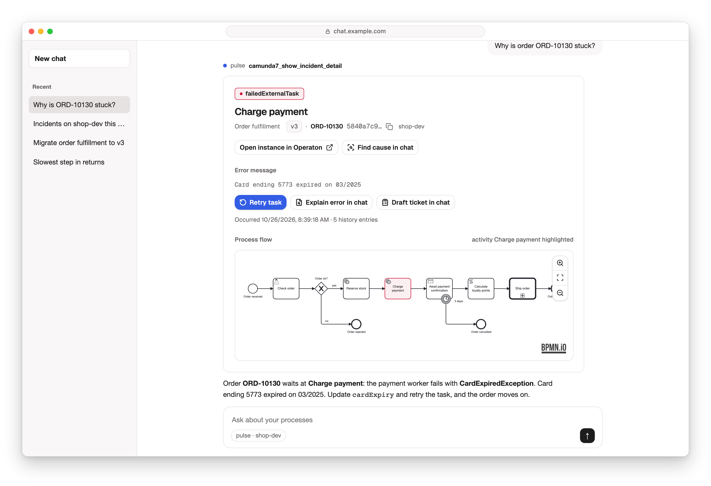

# Pulse MCP server

The Pulse MCP server lets Claude, ChatGPT or any other MCP client read and operate your
Camunda 7, CIB seven and Operaton engines, and answers with widgets in the chat. It starts
read-only; writes need a toolset you name. Commands and configs call the server `pulse`.

| Page                                         | What it covers                                                                       |
| -------------------------------------------- | ------------------------------------------------------------------------------------ |
| [Getting started](./getting-started.md)      | Connect your Claude to the public playground, then run the server on your own engine |
| [Usage](./usage.md)                          | Connect an assistant, what to ask, language and theme                                |
| [Reference](./reference.md)                  | Every tool, the toolsets and the common settings                                     |
| [Operations](./operations.md)                | The Docker image, security, environment variables, toolsets, health routes           |
| [Architecture](./architecture.md)            | The server, its engine module and the systems it talks to                            |
| [Build your own server](./build-your-own.md) | Start a server of your own from the starter, with modules for your own systems       |
| [Developer guide](./developer.md)            | Run the stack from source and contribute to Pulse                                    |
