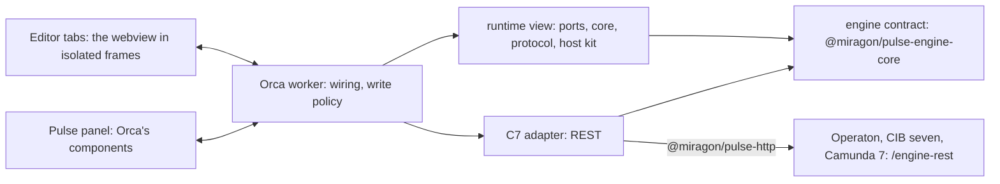

# Architecture

Pulse for Orca and Pulse for VS Code are two hosts of one runtime view. What both show and
decide lives in two packages they bundle; each host only wires it into its editor:

| Part                      | Holds                                                                                        |
| ------------------------- | -------------------------------------------------------------------------------------------- |
| Worker (`trusted-worker`) | the engines, the write policy, the settings and the secrets; the only part with network      |
| Pulse panel               | the engines tree, local models, boards, the login form and every write confirmation          |
| Editor tabs               | the webview of the extension in isolated frames, without network, from what the worker posts |

A frame holds no authority: it posts what you click, and the worker answers with the action to
take within your click (open the engine's web app, copy). Only the panel confirms a write
(Orca names the caller of every request), a tab's attempt is refused and logged.

## What Orca does not offer yet

Pulse for Orca works around these, and moves on when Orca offers them:

- Editor tabs need a file, so each view is a handle file in `.pulse/views/`, and a tab shows its
  file name as its title.
- A plugin cannot open or focus its panel, so a waiting write points at the panel from the
  status bar and a desktop notification.
- Orca has no close event for tabs and panels; a request Orca aborts on close stands in.
- The worker does not know the active editor, so "Show runtime data for this model" is the
  list of local models in the panel.
- `editor.open` takes no line, so incident details, models and code open at the top.
- Tree items have no badge, colour or row action.
- Orca grants a plugin's secrets to all its parts; Pulse reads them in the worker only.

More in the repository: `apps/orca/CLAUDE.md` (commands and rules), the decisions of the runtime
view in `apps/vscode/docs/adr/`.
