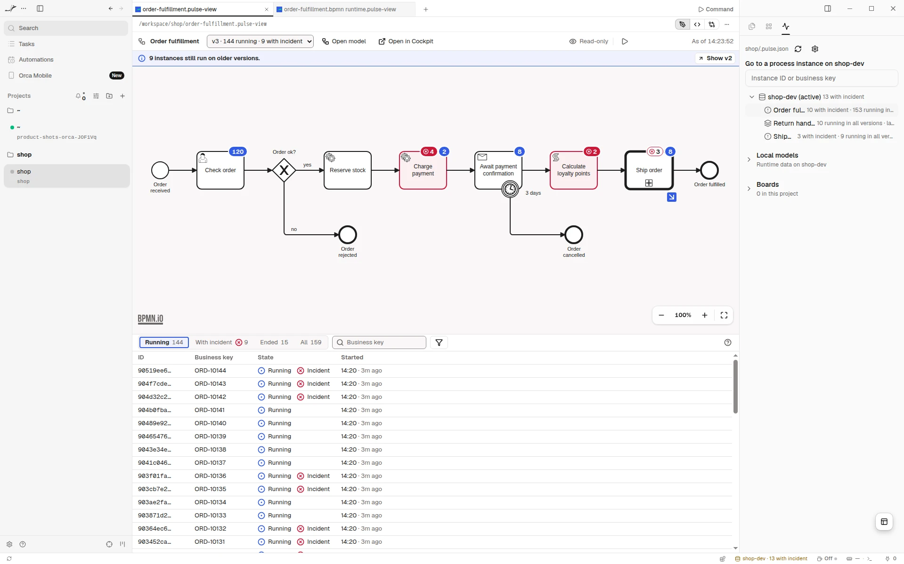

# Pulse for Orca

::: warning Early version
Pulse for Orca is an early version, built from the same runtime view as
[Pulse for VS Code](../vscode/index.md): expect rough edges and changes between releases. It is
not in [Miragon's Orca catalog](https://github.com/Miragon/orca-plugins) yet, so for now you
[load it from the source](./installation.md#from-the-source). Writes are off for every engine but a local one unless you
turn them on.
:::

Pulse for Orca shows what your process engine is running inside [Orca](https://github.com/stablyai/orca):
definitions, instances, incidents and variables, with badges on the deployed diagram, in Orca's
editor tabs, and the engines in a Pulse panel in the right sidebar. It works with Operaton,
CIB seven and Camunda 7 and reads the same engine profiles as the [Pulse CLI](../cli/index.md).

It does what Pulse for VS Code does, with Orca's surfaces:

| Pulse for VS Code                                  | Pulse for Orca                                                                  |
| -------------------------------------------------- | ------------------------------------------------------------------------------- |
| Engines and Boards views in the activity bar       | The Pulse panel: engines, local models, boards, go to an instance               |
| Panels for engine, definition, instance, migration | Editor tabs for the same views, live and with a link back                       |
| _Show Runtime Data for This Model_                 | "Local models" in the panel: each `.bpmn` against its deployment                |
| Write and bulk dialogs                             | The confirmation waits in the Pulse panel and in the status bar                 |
| Settings `pulse.*`                                 | The plugin's settings in Orca: project file, writes, environments, live updates |

| Page                                | What it covers                                             |
| ----------------------------------- | ---------------------------------------------------------- |
| [Installation](./installation.md)   | Load it from the source, later install it from the catalog |
| [Configuration](./configuration.md) | Engine profiles, credentials and the plugin's settings     |
| [Usage](./usage.md)                 | The panel, the tabs, writes and their confirmation         |
| [Architecture](./architecture.md)   | Worker, panel and tabs, and what Orca does not offer yet   |
