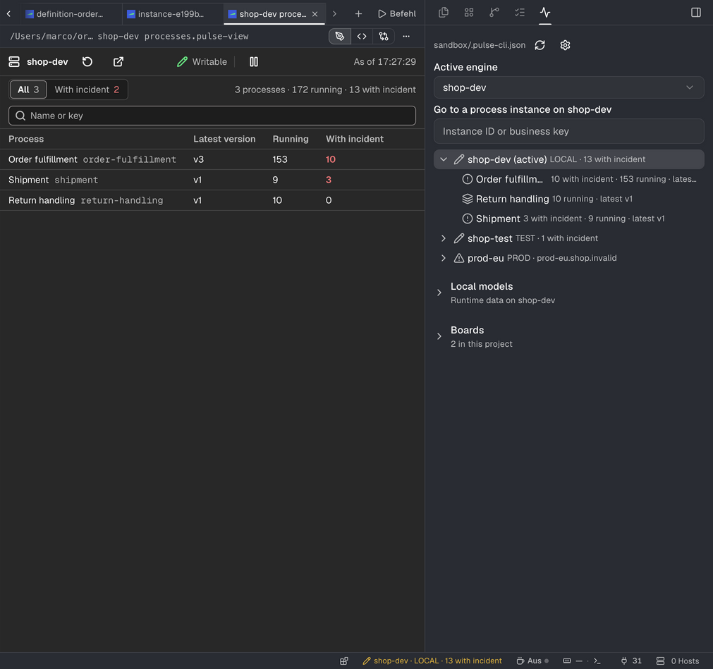
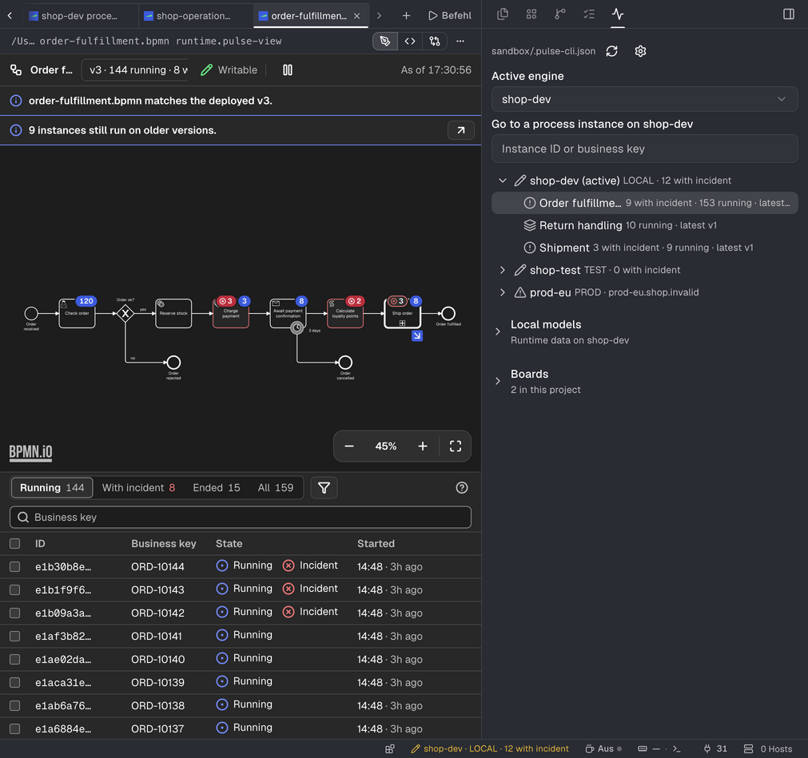
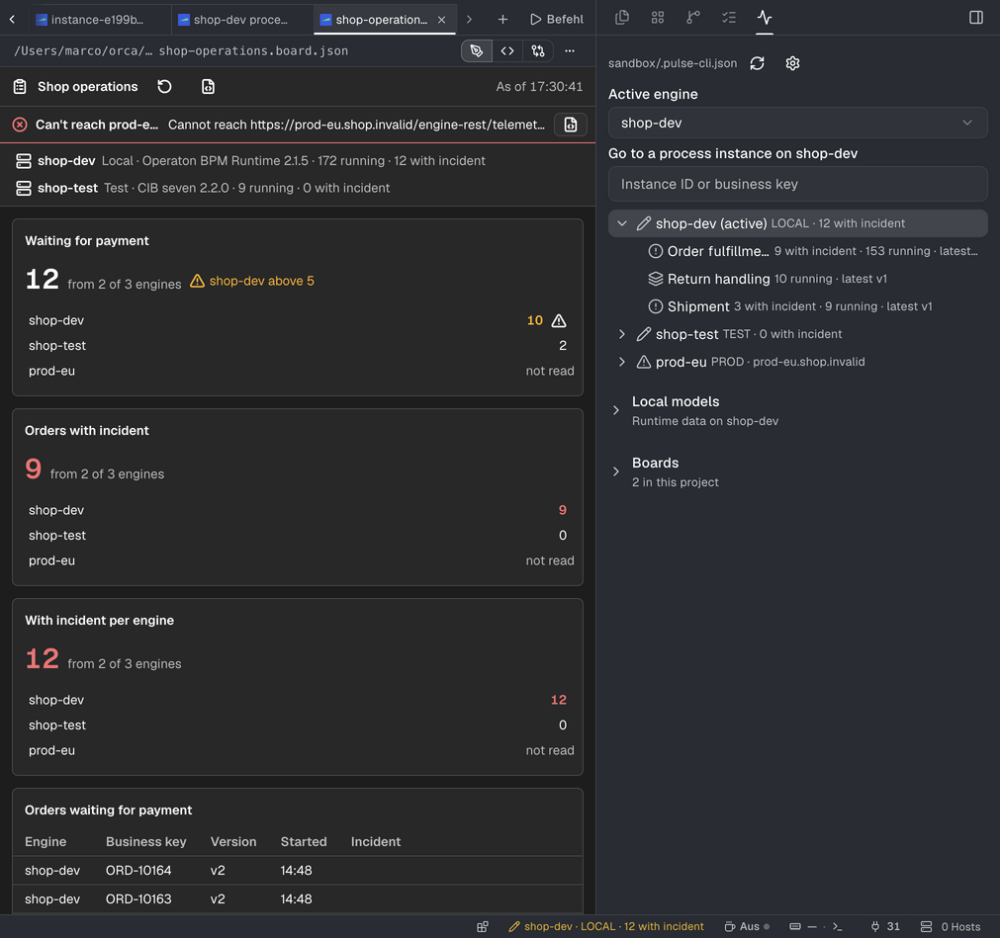
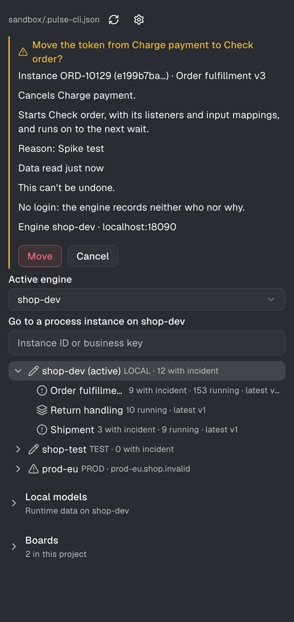

# Usage

## The panel

The Pulse panel in Orca's right sidebar lists the engines of the project file with their process
definitions and incident counts. Enter on an engine opens its overview, on a process its
definition, each in an editor tab. The panel also holds:

- **Active engine**: the engine the status bar shows with its incidents.
- **Go to instance**: an instance id or a business key opens the instance, a list when several
  share the key.
- **Local models**: every `.bpmn` of the project, opened against the definition it deploys, with
  whether the file matches the deployed version.
- **Boards**: the boards of `.pulse/boards/`, and a form for a new one.

## The tabs

A tab shows the engine overview, a definition, an instance or a migration exactly as Pulse for
VS Code does: badges on the diagram, the incident's root cause, variables, the history. Tabs
refresh on their own while you see them and pause after 15 minutes without activity. A link
leads back to the tab that opened one. A tab is a handle file in `.pulse/views/` next to the
project file, which Git ignores. Incident details open as a `.log` file. _Open in web app_ opens
the engine's cockpit, and a copy lands on your clipboard.

A board (`.board.json`) opens in its own editor, from the panel or from the file.

## Writes

Retrying incidents, changing variables, moving tokens, cancelling and migrating instances follow
the rules of Pulse for VS Code ([Configuration](./configuration.md)). When a write needs your
confirmation, it waits in the Pulse panel, with the engine, the instances and what changes, and
the status bar says so. Only the panel can confirm it, never a tab; an unanswered confirmation
lapses after ten minutes. Every write and every answer goes into the plugin's log
(`orca plugin logs`).

