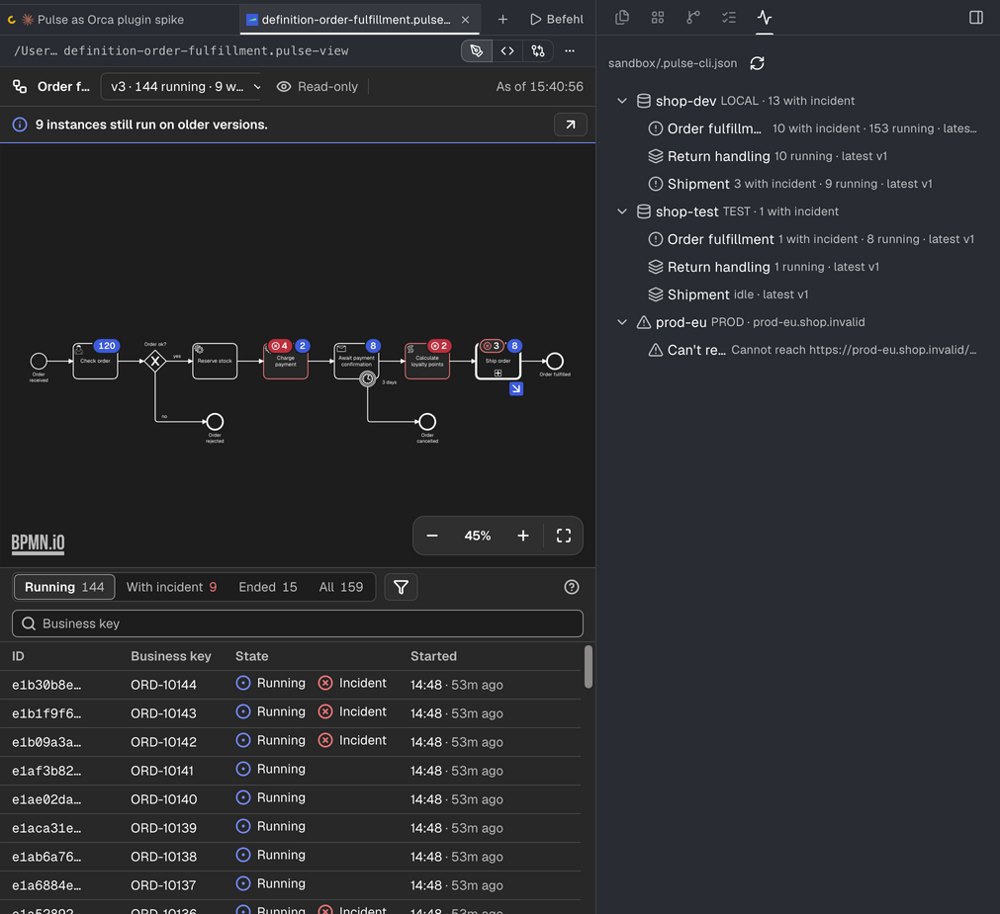

# Spike: Pulse as an Orca plugin

**Result:** Pulse for VS Code carries over to Orca with almost no new logic. The plugin shows real
engine data from the sandbox: the Engines tree with "with incident" counts in Orca's right sidebar,
a definition and an instance view in an editor tab with the bpmn-js diagram, its badges and the
incident's root cause, and a login kept in Orca's encrypted secrets. The webview, the core and the
C7 adapter run unchanged; the spike adds about 1,050 lines of glue in `apps/vscode/dev/orca/`.

**Recommendation: go on, read-first.** Build a real version that shows what the spike shows plus
live refresh and the incident hand-off to an agent, and leave writes until Orca has a trusted
confirmation surface or the panel flow below is proven. Before that, an owner decides where an Orca
host lives in this repository (section 5).

How it came about: [inventory](inventory.md), [prior art](prior-art.md), proposals
[1](proposal-1.md), [2](proposal-2.md), [3](proposal-3.md), the reviewed [plan](plan.md).

## 1. What works

Against the sandbox engines (`pnpm --filter pulse-cockpit run sandbox:up`), in Orca 1.4.252, dark
theme:

| Screenshot                                                             | Shows                                                                                                                                                                                                                                                    |
| ---------------------------------------------------------------------- | -------------------------------------------------------------------------------------------------------------------------------------------------------------------------------------------------------------------------------------------------------- |
| [engines-panel.png](screenshots/engines-panel.png)                     | The Pulse panel: shop-dev LOCAL with 13 instances with incident and its three processes, shop-test TEST refusing without a login (HTTP 401), prod-eu PROD unreachable                                                                                    |
| [engines-panel-signed-in.png](screenshots/engines-panel-signed-in.png) | The same after the shop-test login was stored in `secrets:own`: shop-test lists its processes                                                                                                                                                            |
| [definition-dark.png](screenshots/definition-dark.png)                 | Order fulfillment v3 in an editor tab next to the panel: the diagram with badges (Check order 120, Charge payment 4 incidents and 2 running, Calculate loyalty points 2, Ship order 3 in called instances), the older-versions notice, the instance list |
| [instance-dark.png](screenshots/instance-dark.png)                     | ORD-10129: the path in the diagram, Charge payment failed, the Incidents tab with the root cause `CardExpiredException`                                                                                                                                  |



Checked on the way (plan section 4): `orca plugin validate` and `orca plugin check` pass;
`orca plugin dev request` answers `engines.list` with real data and `views.open` writes the handle
and opens the tab; the worker bundle carries no `vscode`; the extension's typecheck, ESLint,
1,420 tests with their coverage floors, dependency-cruiser, knip and prettier stay green.

Not captured: light theme and the filled login form. `--theme` and `--act` work only while Orca's
window is hidden or minimized, and this session may not send Apple Events to hide it. Section 6
has the commands.

## 2. Feature mapping as built

| VS Code                                              | Orca, as built                                                                                                                                                    | File                                              |
| ---------------------------------------------------- | ----------------------------------------------------------------------------------------------------------------------------------------------------------------- | ------------------------------------------------- |
| Activity bar and Engines tree view                   | Components panel with Orca's `Tree`, in the right sidebar                                                                                                         | `apps/vscode/dev/orca/panel/engines.tsx`          |
| Incident badge on a definition                       | `error` icon and "N with incident" in the row description; the engine row sums it, as the engine overview does                                                    | `apps/vscode/dev/orca/worker/engine-rows.ts`      |
| Problem rows                                         | `warning` rows with the words of `Problems`                                                                                                                       | same                                              |
| Set credentials (input boxes)                        | A form under the tree on selecting an engine with basic auth; the worker writes through `CredentialStore` into `secrets:own` after checking `secrets.protection`  | `apps/vscode/dev/orca/worker/engine-directory.ts` |
| `.pulse-cli.json` discovery and `pulse.environments` | The plugin setting "Project file"; environments from `.vscode/settings.json` next to it, as workspace scope                                                       | same                                              |
| Webview panel in an editor tab                       | Custom editor on `.pulse-view` handle files the worker writes to `<workspace>/.pulse/views/` (a `.gitignore` of `*` keeps Git clean) and opens with `editor.open` | `apps/vscode/dev/orca/worker/view-handles.ts`     |
| `acquireVsCodeApi` and `postMessage`                 | A shim that maps intents to `plugin.request("cockpit.intent")` and state posts to window `message` events; theme from Orca's `light`/`dark` class                 | `apps/vscode/dev/orca/editor/bridge.ts`           |
| Extension host wiring of the panels                  | Sessions per editor, keyed by `PanelCaller.id`; `PanelEffects` open further tabs                                                                                  | `apps/vscode/dev/orca/worker/cockpit-sessions.ts` |

Missing for a real version, by priority:

1. **Live refresh and closed tabs.** Orca tells the worker nothing when a tab closes. Give each
   frame a lease it renews while visible; feed visibility into the core's `LiveContext`; refresh
   the tree on a timer while the panel is visible.
2. **Navigation details.** Back links (`PanelOrigins`), readable tab names for instances (the
   business key, not the UUID), a picker for several called instances, go-to-instance.
3. **Copy, open in Cockpit, stack traces.** Copy can run in the shim inside the click; open in
   Cockpit and copy handover need a URL or text from the worker within the gesture window, best as
   the answer to the intent rather than a post. Stack traces as a read-only view, links into code
   through `editor.open`.
4. **Agent hand-off (Orca only).** "Ask an agent about this incident" through `agent.launch` with a
   fixed task line, typed ids and engine text fenced and capped, as invariant 6 asks of the MCP
   widgets ([proposal 2](proposal-2.md)). "Inspect in a terminal" with `pulse inspect`.
5. **Status bar.** One item with the incident total; it keeps the worker running, which also
   carries the live refresh.
6. **Writes.** The core asks `confirmWrite`; the worker keeps the write pending and accepts the
   answer only from the Pulse panel (`PanelCaller` `{ surface: "panel", contributionId: "engines" }`,
   bound by Orca to the frame's session), drawn with Orca's own controls, with the typed host for
   production. Then audit through `WriteAudit` into `orca plugin logs`.
7. **Model drift and boards**, last, since they need workspace files.

## 3. What Orca made easy

- **The split fits.** Pulse already keeps the engine in a Node host and the UI in a sandboxed
  webview; Orca's `trusted-worker` plus isolated frames is the same shape. Node 24 in the worker
  has `JSON.rawJSON`, so `LosslessJson` and `EngineHttp` run as they are.
- **The webview bundle runs unchanged.** Isolated frames load an IIFE, CSS and fonts by relative
  URL, allow inline styles, and keep `localStorage`; the frame needs no network because the state
  carries the BPMN XML (24 KB for Order fulfillment, far under the 256 KiB post limit).
- **The Tree component** gives a native-looking engines list in about 190 lines, keeps engine text
  as text, and offers a password input for the login.
- **Secrets, settings and the dev loop.** `secrets:own` sits on the OS key store;
  `contributes.settings` draws the setting in Orca's Settings; `orca plugin dev request`,
  `plugin shot`, `plugin check` and `plugin validate` made each step checkable without clicking.

## 4. What Orca made hard, and where it lacks a surface

Candidates for an issue or a request to the Orca team:

- **No editor tab without a file.** A cockpit view needs a handle file in the workspace and
  `workspace:write` (as git-log and git-control do). A `views` contribution or `editor.openView`
  that opens a custom editor on a virtual document would remove the files.
- **No way to open or focus a panel from code** (`orca plugin open` exists only on the CLI), so a
  pending confirmation can only point at the panel.
- **No close event for editors and panels** in the worker; sessions need leases.
- **No title for a custom editor tab** from the frame: the tab shows the handle's file name.
- **Tree items have no badge, colour or row action**, so counts become text and "set credentials"
  becomes select plus form.
- **Every surface of a plugin may read its secrets**, the frame that renders engine text
  included. Frames have no network and `openExternal` needs a click plus a consent prompt, which
  contains it, but a per-surface grant would make the worker the only reader.
- **`orca plugin shot --editor` captures once the editor asked for its document**, before the state
  a worker sends afterwards; the diagram is still empty then. The spike used `--window` instead. An
  editor-side "ready" signal, or waiting for pending `plugin.request` calls as panel shots do, would
  fix it.
- **`--theme` and `--act` need the window hidden or minimized**, which an agent running inside Orca
  cannot always do.
- **Docs and behaviour differ in small places:** `workspace.list` reports local workspaces with
  `hostId: "local"`, not `null`; a rebuilt worker keeps running the old code until
  `orca plugin restart` (panels hot reload); the first panel shot after a cold worker start shows
  the loading state.
- **Reserved, not yet usable:** `mcpServers` would let the plugin offer Pulse's MCP server to the
  agents Orca launches; `connections` a host-run sign-in.

## 5. Effort and recommendation

**Placement first (owner decision).** The spike lives in `apps/vscode/dev/` because the root rule
says apps never import each other. A real version is a shipped interface and needs one of:

- a host layer at apps/vscode/src/orca with its own dependency-cruiser rules, tsconfig and tests
  (fast, but a second interface inside the VS Code app), or
- an app at apps/orca over packages extracted from `apps/vscode/src` (contract, core, protocol,
  webview, C7 adapter, the pure connection files): the clean path, a larger move.

| Work                                                                                                                                                                        | Estimate    |
| --------------------------------------------------------------------------------------------------------------------------------------------------------------------------- | ----------- |
| Placement: `src/orca` layer with rules, tsconfig, tests and CI (or the package extraction: plus 5 to 8 days)                                                                | 2 to 3 days |
| Live refresh, leases, worker restarts, tree refresh                                                                                                                         | 2 days      |
| Navigation details, copy, open in Cockpit, stack traces                                                                                                                     | 3 days      |
| Agent hand-off and status bar                                                                                                                                               | 2 days      |
| Tests: fake `orca` API for worker and shim, a smoke test in a real Orca as modeler-suite's `orca-electron` harness does                                                     | 3 days      |
| Packaging and publishing: a release job that builds the plugin and commits it where a catalog can pin it (Miragon/orca-modelers or a repository of its own), listing images | 2 days      |
| Writes with the panel confirmation, audit, conformance                                                                                                                      | 4 to 5 days |

Read-first version: about three weeks; with writes about four.

**Go on**, read-first, for three reasons: the reuse is real (no change to webview, core or adapter),
Orca's surfaces cover the must-haves, and Orca adds what VS Code lacks (agents next to the cockpit).
Wait for Orca only on writes and on the gaps above; drop it only if Orca's worker model, which its
docs still call experimental, changes in a way that breaks the split.

## 6. Run it locally

```sh
pnpm install && pnpm build                      # engine-core is bundled from its build
pnpm --filter pulse-cockpit run sandbox:up      # shop-dev, shop-test (demo/demo), about two minutes
pnpm --filter pulse-cockpit run orca:build      # builds the plugin into apps/vscode/dist-orca
O=/Applications/Orca.app/Contents/Resources/bin/orca
$O plugin dev load apps/vscode/dist-orca        # prints the approval command with its fingerprint
$O plugin dev load apps/vscode/dist-orca --approve <fingerprint>
$O plugin dev request apps/vscode/dist-orca engines.setProjectFile \
  --data "{\"path\":\"$PWD/apps/vscode/sandbox/.pulse-cli.json\"}"
$O plugin open local.pulse-cockpit              # the panel; Enter on a process opens its tab
$O plugin dev request apps/vscode/dist-orca views.open \
  --data '{"engine":"shop-dev","view":"definition","bpmnProcessId":"order-fulfillment"}'
```

The project file must lie inside a local Orca workspace, since the view handles go there. After a
rebuild, run `$O plugin restart local.pulse-cockpit` so the worker loads the new code.

The shots that need Orca's window hidden (light theme, the login form), with the window minimized:

```sh
$O plugin shot local.pulse-cockpit --theme light --width 420
$O plugin shot local.pulse-cockpit --width 420 --act \
  '[{"selectItem":{"label":"Engines"},"key":"engine|shop-test"},{"type":{"label":"Username"},"text":"demo"}]'
$O plugin shot local.pulse-cockpit --window --theme light   # with a Pulse tab open
```

`$O plugin dev unload apps/vscode/dist-orca` removes it again.
