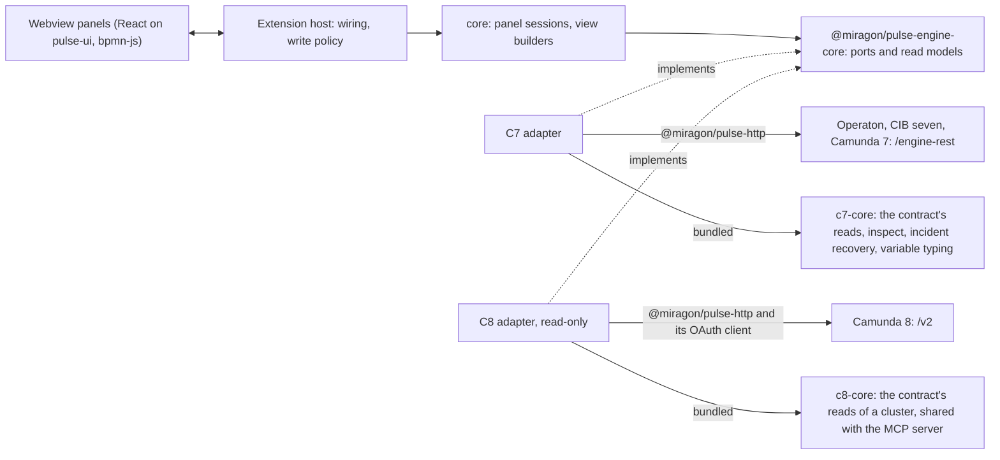

# Architecture

The core never knows which engine it talks to: it asks the ports of the engine contract
(`@miragon/pulse-engine-core`, the engine family's core: the shared language every engine dialect
implements, bundled into the extension), and one adapter per dialect family answers. The C7 adapter
serves Operaton, CIB seven and Camunda 7 over their REST API, with the c7 family's core and workflow
domain (`@miragon/pulse-c7-core`, shared with the CLI and the MCP server, bundled) for inspecting an
instance, an incident's retry target and cause and a variable's type, and with the contract's rule
for a failure's root cause (`RootCauses`, c7-core applies it too). The C8 adapter reads Camunda 8
over its Orchestration Cluster REST API, read-only, with client credentials from the transport's
OAuth client, and shares no code with the C7 adapter. A new dialect family is one more adapter
package with its BPMN vocabulary, proven by the conformance kit on a real engine (the C8 adapter's
run is local only until [#531](https://github.com/Miragon/pulse/issues/531),
[Camunda 8](./camunda8.md#what-is-tested)), and one entry per composition root.

The layers live in packages the extension shares with [Pulse for Orca](../orca/architecture.md),
each layer with its own globals and dependency rules; `apps/vscode/src/host` is the VS Code
wiring and the composition root:

| Package                                  | Layer      | Holds                                                                                  |
| ---------------------------------------- | ---------- | -------------------------------------------------------------------------------------- |
| `packages/connectors/engine/engine-core` |            | the engine contract: ports, read models, conformance laws                              |
| `packages/core/board`                    |            | the board file format and builder, shared with the MCP server (`@miragon/pulse-board`) |
| `packages/core/blocks`                   |            | a board's tiles, shared with the MCP cockpit (`@miragon/pulse-blocks`)                 |
| `packages/core/runtime-view`             | `ports`    | the ports of the editor hosts: engine plug, local model                                |
|                                          | `core`     | grouping, view models, panel behaviour                                                 |
|                                          | `protocol` | the messages between host and webview                                                  |
|                                          | `webview`  | what the panels draw                                                                   |
|                                          | `model`    | the local `.bpmn` model and the code that implements it                                |
|                                          | `host-kit` | the host-neutral rules: targets, writes, live updates, logins                          |
| `packages/connectors/c7/c7-adapter`      | adapter    | the C7 adapter of the contract                                                         |
| `packages/connectors/c8/c8-adapter`      | adapter    | the C8 adapter of the contract, read-only                                              |

By the owner's decision D9 of 2026-11-12 the webview renders with React on `@miragon/pulse-ui`,
composes its kit and shares one compact look with the MCP widgets. Its tones come
from `@miragon/pulse-ui/tones` and its times, durations, counts and short ids from
`@miragon/pulse-ui/format`, the parts of Pulse's design kit without React: a running, suspended or
failing instance shows in the same tone as in the MCP widgets, and a duration, a lower bound or a
long key reads the same. The core, ports, model reader and host kit stay framework-free.
[Parity with the MCP cockpit](./parity.md) lists what differs and why.

More in the repository:

- `apps/vscode/docs/architecture-overview.md`: who talks to whom, in pictures
- `apps/vscode/docs/adr/`: the decisions and their reasons (writes, migrations, live updates …),
  what the UIs share in `apps/vscode/docs/adr/ui-foundation.md`
- `apps/vscode/CLAUDE.md`: commands and rules for contributors and coding agents
