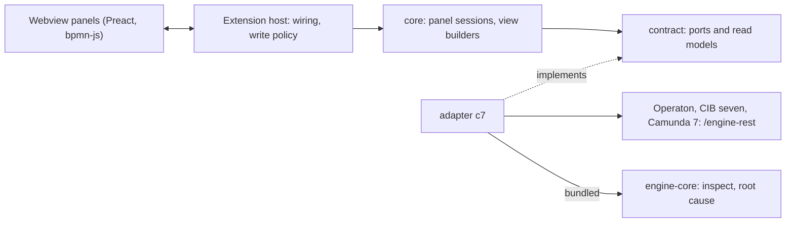

# Architecture

The core never knows which engine it talks to: it asks the ports of a contract, and one adapter
per engine family answers. The C7 adapter serves Operaton, CIB seven and Camunda 7 over their
REST API, with the Camunda 7 family's workflow domain (`@miragon/pulse-engine-core`, shared with
the CLI and the MCP server and bundled into the extension) for inspecting an instance and its
root causes; a new engine is one more adapter folder and one entry in the composition root.

The extension is one package with six layers under `apps/vscode/src`, each with its own globals
and dependency rules:

| Layer      | Holds                                                   |
| ---------- | ------------------------------------------------------- |
| `contract` | ports, read models, conformance laws                    |
| `core`     | grouping, view models, panel behaviour                  |
| `webview`  | what the panels draw                                    |
| `host`     | the VS Code wiring and the composition root             |
| `adapters` | one folder per engine family (`c7` today)               |
| `model`    | the local `.bpmn` model and the code that implements it |

The webview stays Preact with its own stylesheets. Its tones come from `@miragon/pulse-ui/tones`,
the part of Pulse's design kit without React, bundled as well: a running, suspended or failing
instance shows in the same tone as in the MCP widgets.

More in the repository:

- `apps/vscode/docs/architecture-overview.md`: who talks to whom, in pictures
- `apps/vscode/docs/adr/`: the decisions and their reasons (writes, migrations, live updates …)
- `apps/vscode/CLAUDE.md`: commands and rules for contributors and coding agents
