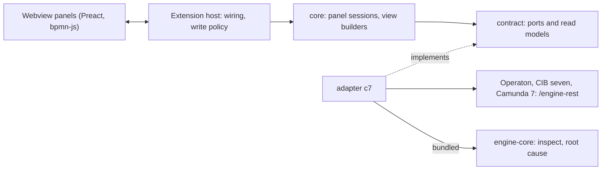

# Architecture

The core never knows which engine it talks to: it asks the ports of a contract, and one adapter
per engine family answers. The C7 adapter serves Operaton, CIB seven and Camunda 7 over their
REST API, with the Camunda 7 family's workflow domain (`@miragon/pulse-engine-core`, shared with
the CLI and the MCP server and bundled into the extension) for inspecting an instance and its
root causes; a new engine family is one more adapter package and one entry in each composition root.

The layers live in two packages the extension shares with [Pulse for Orca](../orca/architecture.md),
each layer with its own globals and dependency rules; `apps/vscode/src/host` is the VS Code
wiring and the composition root:

| Package                                     | Layer      | Holds                                                   |
| ------------------------------------------- | ---------- | ------------------------------------------------------- |
| `packages/core/runtime-view`                | `contract` | ports, read models, conformance laws                    |
|                                             | `core`     | grouping, view models, panel behaviour                  |
|                                             | `protocol` | the messages between host and webview                   |
|                                             | `webview`  | what the panels draw                                    |
|                                             | `model`    | the local `.bpmn` model and the code that implements it |
|                                             | `host-kit` | the host-neutral rules: writes, live updates, logins    |
| `packages/connectors/engine/engine-adapter` | adapter    | the C7 adapter of the contract                          |

More in the repository:

- `apps/vscode/docs/architecture-overview.md`: who talks to whom, in pictures
- `apps/vscode/docs/adr/`: the decisions and their reasons (writes, migrations, live updates …)
- `apps/vscode/CLAUDE.md`: commands and rules for contributors and coding agents
