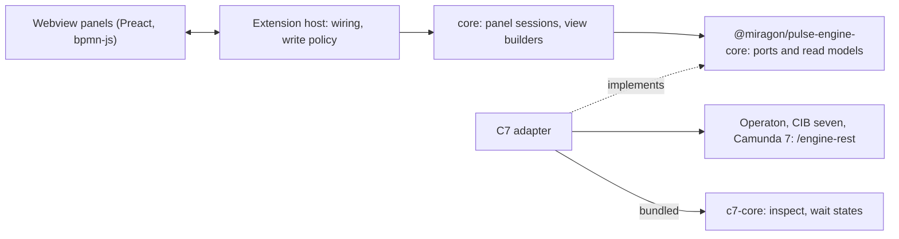

# Architecture

The core never knows which engine it talks to: it asks the ports of the engine contract
(`@miragon/pulse-engine-core`, the engine family's core: the shared language every engine dialect
implements, bundled into the extension), and one adapter per engine family answers. The C7 adapter
serves Operaton, CIB seven and Camunda 7 over their REST API, with the c7 family's core and workflow
domain (`@miragon/pulse-c7-core`, shared with the CLI and the MCP server and bundled into the
extension) for inspecting an instance, and with the contract's rule for the root cause of a failure
(`RootCauses`, which c7-core applies too); a new engine family is one more adapter package, proven
by the contract's conformance kit, and one entry in each composition root.

The layers live in two packages the extension shares with [Pulse for Orca](../orca/architecture.md),
each layer with its own globals and dependency rules; `apps/vscode/src/host` is the VS Code
wiring and the composition root:

| Package                                     | Layer      | Holds                                                         |
| ------------------------------------------- | ---------- | ------------------------------------------------------------- |
| `packages/connectors/engine/engine-core`    |            | the engine contract: ports, read models, conformance laws     |
| `packages/core/runtime-view`                | `ports`    | the ports of the editor hosts: engine plug, local model       |
|                                             | `core`     | grouping, view models, panel behaviour                        |
|                                             | `protocol` | the messages between host and webview                         |
|                                             | `webview`  | what the panels draw                                          |
|                                             | `model`    | the local `.bpmn` model and the code that implements it       |
|                                             | `host-kit` | the host-neutral rules: targets, writes, live updates, logins |
| `packages/connectors/engine/engine-adapter` | adapter    | the C7 adapter of the contract                                |

The webview stays Preact with its own stylesheets. Its tones come from `@miragon/pulse-ui/tones`
and its times, durations, counts and short ids from `@miragon/pulse-ui/format`, the parts of
Pulse's design kit without React, bundled as well: a running, suspended or failing instance shows
in the same tone as in the MCP widgets, and a duration, a lower bound or a long key reads the same.
The extension shares that foundation with the MCP widgets, the words of its counts and the brand
gates, never a component: [Parity with the MCP cockpit](./parity.md) lists what differs and why,
and [#586](https://github.com/Miragon/pulse/issues/586) holds when the two share building blocks.

More in the repository:

- `apps/vscode/docs/architecture-overview.md`: who talks to whom, in pictures
- `apps/vscode/docs/adr/`: the decisions and their reasons (writes, migrations, live updates …),
  the shared UI foundation in `apps/vscode/docs/adr/ui-foundation.md`
- `apps/vscode/CLAUDE.md`: commands and rules for contributors and coding agents
