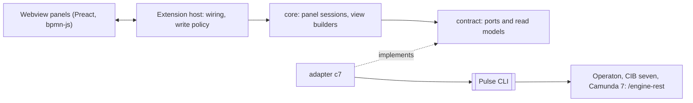

# Architecture

The core never knows which engine it talks to: it asks the ports of a contract, and one adapter
per engine family answers. The C7 adapter serves Operaton, CIB seven and Camunda 7 through the
Pulse CLI; a new engine is one more adapter folder and one entry in the composition root.

The extension is one package with six layers under `apps/vscode/src`, each with its own globals
and dependency rules:

| Layer      | Holds                                                   |
| ---------- | ------------------------------------------------------- |
| `contract` | ports, read models, conformance laws                    |
| `core`     | grouping, root cause, view models, panel behaviour      |
| `webview`  | what the panels draw                                    |
| `host`     | the VS Code wiring and the composition root             |
| `adapters` | one folder per engine family (`c7` today)               |
| `model`    | the local `.bpmn` model and the code that implements it |

More in the repository:

- `apps/vscode/docs/architecture-overview.md`: who talks to whom, in pictures
- `apps/vscode/docs/adr/`: the decisions and their reasons (writes, migrations, live updates …)
- `apps/vscode/CLAUDE.md`: commands and rules for contributors and coding agents
