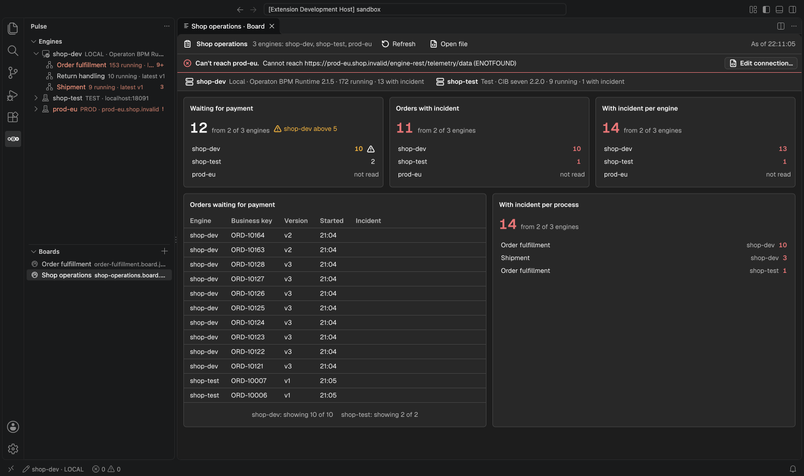

# Boards

A board keeps the operational questions your team asks again and again in one view: how many
orders wait for payment, which processes have incidents, which instances run at a step. A
board is a JSON file in your repository, so it is versioned and shared like the code. It only
reads; it never writes to an engine.



## A board file

Pulse reads every `.pulse/boards/*.board.json` in the workspace and lists it in the **Boards**
view. **Pulse: New Board…** writes a starter board with your engines. Editing the file gives
completion and checks from the board schema; Pulse reloads an open board when you save.

```json
{
  "schemaVersion": 1,
  "title": "Shop operations",
  "engines": ["shop-dev", "shop-test"],
  "rows": [
    {
      "row": [
        {
          "widget": "counter",
          "props": {
            "title": "Waiting for payment",
            "filter": { "process": "order-fulfillment", "activeElement": "Activity_AwaitPayment" },
            "warnAbove": 5
          }
        },
        { "widget": "incidentSummary", "props": { "groupBy": "process" } }
      ]
    },
    {
      "row": [
        { "widget": "instanceList", "props": { "filter": { "process": "order-fulfillment" } } }
      ]
    }
  ]
}
```

`engines` names profiles of `.pulse-cli.json`. A widget may narrow them with its own `engines`.

| Widget            | Shows                                                                                            |
| ----------------- | ------------------------------------------------------------------------------------------------ |
| `counter`         | How many instances match, per engine and in total; `warnAbove` warns per engine                  |
| `instanceList`    | The first 50 matching instances of each engine with the total of each, in one table              |
| `incidentSummary` | Instances with an open incident, `groupBy` engine or process                                     |
| `processDiagram`  | The deployed diagram of one engine (`process`, latest version) with its counts per element       |
| `incidentList`    | The first 50 open incidents of each engine with element and message, optionally of one `process` |

The `filter` takes `process` (BPMN process ID, every version), `activeElement` (needs
`process`), `state` (`running`, the default, or `ended`), `withIncident` and `businessKey`.
Columns are `engine`, `process`, `version`, `businessKey`, `state`, `startedAt`, `endedAt` and
`incident`.

## Several engines

Every row and every number keeps the engine it came from, and a click opens the instance or
the process on that engine. An engine that cannot be read, or that is not in your
`.pulse-cli.json`, gets one strip on top and "not read" in its cells; a total then says how
many engines it counts. A click on a count in a diagram opens the process filtered to that
element. A broken file lists each problem with its path and reason and keeps
showing the last valid version.
