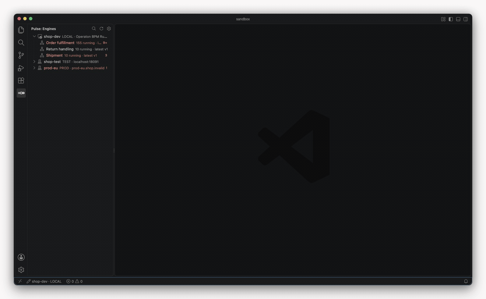

# Pulse for VS Code

::: warning Early version
Pulse for VS Code is an early version, published on the
[Visual Studio Marketplace](https://marketplace.visualstudio.com/items?itemName=miragon-gmbh.pulse-cockpit) and [Open VSX](https://open-vsx.org/extension/miragon-gmbh/pulse-cockpit): expect rough edges and changes between
releases ([Installation](./installation.md)). Writes are off for every engine but a local one
unless you turn them on.
:::

Pulse for VS Code shows what your process engine is running, right next to your BPMN models:
definitions, instances, incidents and variables, with badges on the deployed diagram. It works
with Operaton, CIB seven and Camunda 7 and reads the same engine profiles as the
[Pulse CLI](../cli/index.md).

## Why

When an instance gets stuck, you leave the editor: open the engine's web UI, search the
instance, read the stack trace, go back to the code and the model. Pulse brings that view to
where the models and the code already are.

- **The runtime on the model.** Running instances and incidents as badges on the deployed
  diagram, per version.
- **The root cause, not the noise.** The incident's root cause from the full stack trace, with
  links from its frames to your sources.
- **Model and engine side by side.** An open `.bpmn` file tells you whether it matches a
  deployed version.
- **Safe on real engines.** Writes run on local engines by default, elsewhere only when you
  allow them, always with a confirmation that names the engine.

| Page                                | What it covers                                           |
| ----------------------------------- | -------------------------------------------------------- |
| [Installation](./installation.md)   | Install it, try it on a seeded engine                    |
| [Configuration](./configuration.md) | Engine profiles, credentials, environments, live updates |
| [Usage](./usage.md)                 | The views and panels, model and code, writes and batches |
| [Architecture](./architecture.md)   | Contract, core, adapters and the decisions behind them   |
