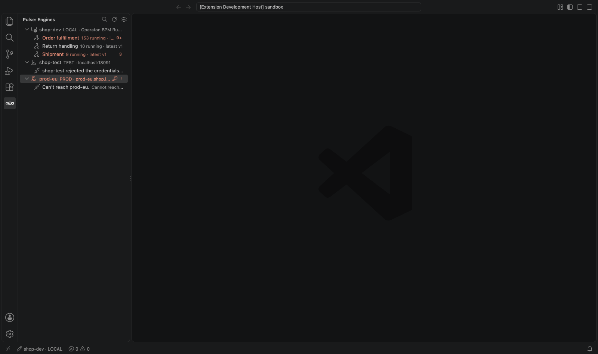
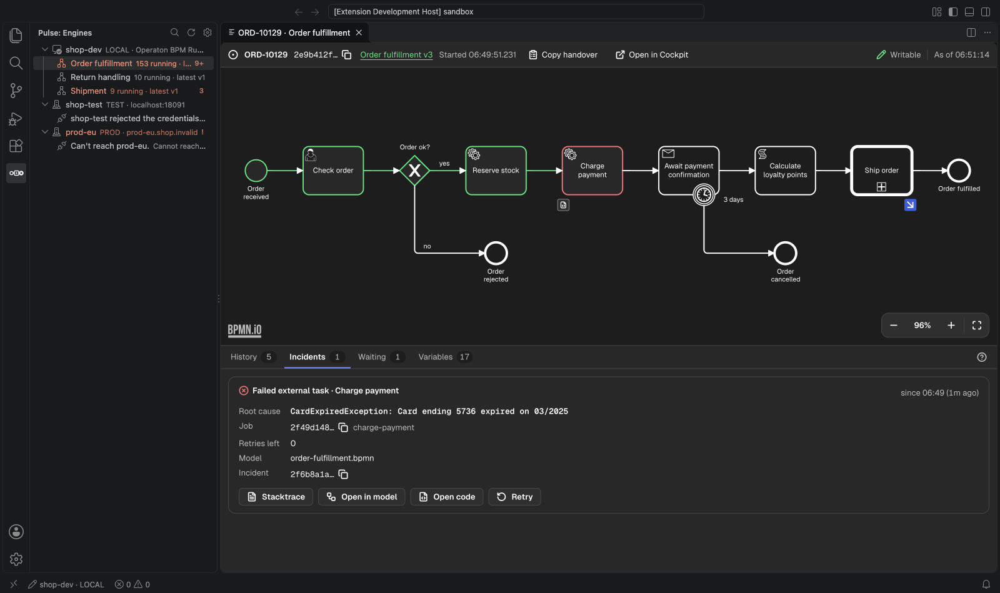
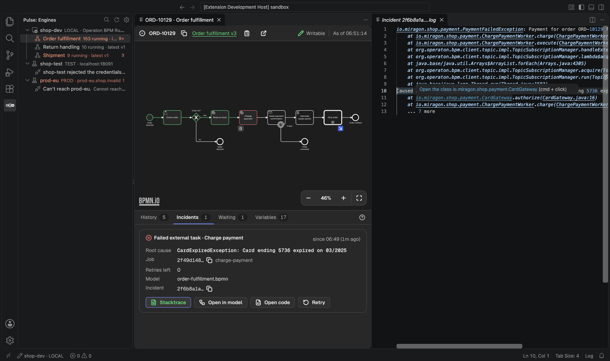
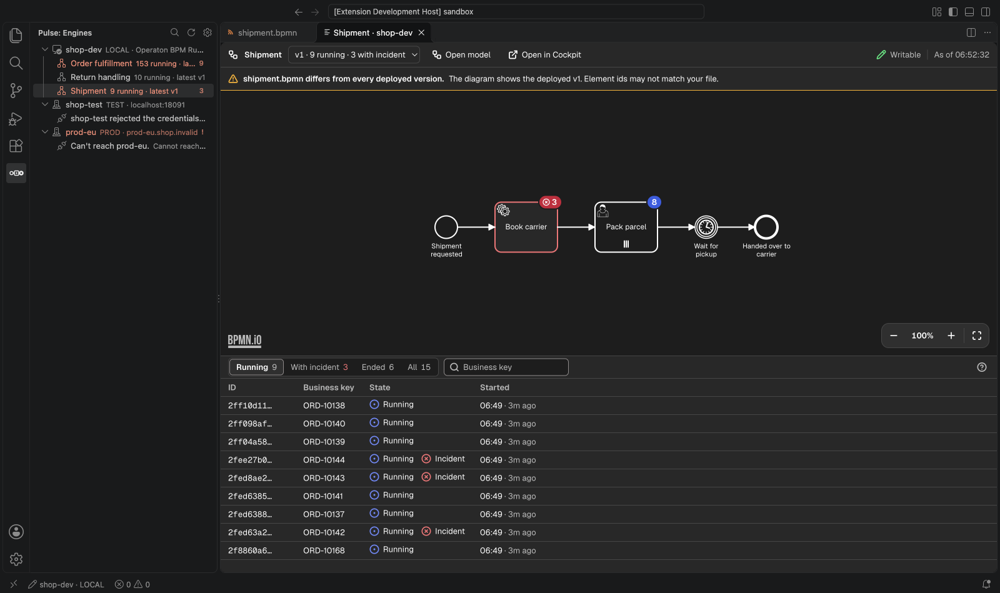
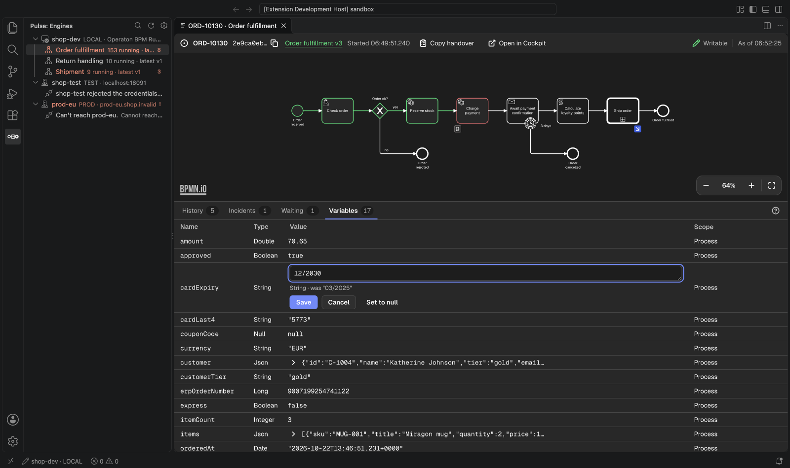
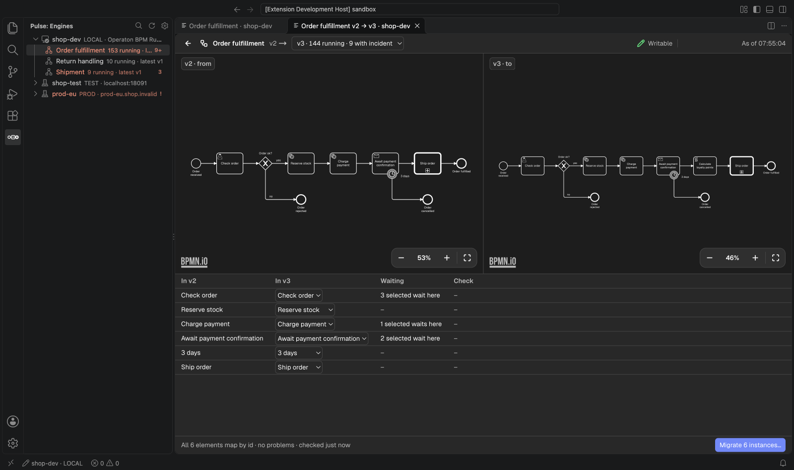

# Usage

## Engines and processes

The **Engines** view lists the profiles of `.pulse-cli.json` with their deployed processes,
running counts and incident markers. A click on an engine opens its overview: every process
with its latest version, running and with-incident counts, the ones in trouble first.

## A process definition

The **Definition** panel draws the deployed diagram of one version with badges per element, a
version picker with counts per version, and the instances (running, with incident, ended),
filtered by element or business key.

The funnel button in the filter bar finds instances by their process variables: a name (the
dialog suggests the names the newest instances of the version hold, any other name works
too), an operator
(is, is not, matches, greater or less than) and a value, `*` as the wildcard of _matches_.
_Compare as_ picks the type: text, number, true or false, date and time (is after, is
before) or null. JSON and object variables can't be searched.
Each condition becomes a chip, and an instance matches when all of them hold; counts and
selections follow. The search reads the engine's history, so CIB seven, Operaton and Camunda 7
need history level `audit` or higher.

## An instance and its incident

The **Instance** panel shows where the instance waits, its incidents with the root cause from
the full stack trace, incidents inside called instances, its variables, and a Markdown handover
to copy. Stack traces open as read-only documents with links from your frames to your sources.

## Model and code

From an incident or any element, open the local `.bpmn` at the element and the worker or
delegate that implements it. _Show Runtime Data for This Model_ on a `.bpmn` file tells you
whether the file matches a deployed version. _Go to Process Instance…_ finds one by id or
business key.

## Writes

Retry incidents, change variables and move tokens: on local engines by default, elsewhere only
when `pulse.writes` allows it ([Configuration](./configuration.md#settings)). Every write asks
first, names its exact target and leaves an audit line in the output channel "Pulse".

## Batches

Tick instances in the definition panel to cancel or migrate them as one batch, follow its
progress and stop it. A migration shows both versions with the mapping the engine proposes and
flags elements where instances would get stuck, before anything runs.

All 39 screenshots, one per use case, are in `apps/vscode/docs/screenshots/`.
