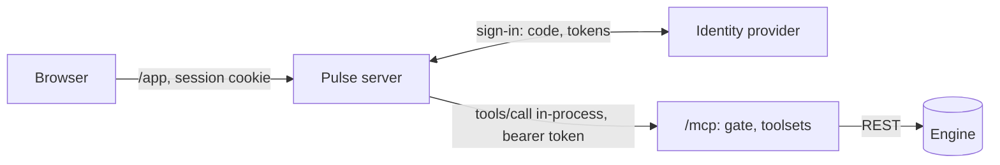

# How the web app works

The web app is a backend for frontend inside the MCP server, the pattern the IETF's _OAuth 2.0 for
Browser-Based Applications_ recommends: the server signs people in, keeps their tokens sealed in a
cookie and calls its own `/mcp` for each page. The browser never holds a token. The server half is
widget-shell's (`packages/core/widget-shell/src/web`), the page is `apps/web`.

## Two interfaces, one server

The server serves two interfaces from one app: `/mcp` to MCP clients with a bearer token, and
`/app` to browsers with the session cookie. No route takes both: `/mcp` answers a request that
carries the session cookie with the gate's 401, every route under `/app` answers 400 to one that
carries an `Authorization` header, and without an OAuth provider there is no `/app`.

| Route                                    | What it does                                                                                                                                                                    |
| ---------------------------------------- | ------------------------------------------------------------------------------------------------------------------------------------------------------------------------------- |
| `GET /app/auth/login`                    | Starts a sign-in: the code flow with PKCE S256, the provider's scopes and the gate's resource (RFC 8707) unless the provider names none (Entra ID), back to a page under `/app` |
| `GET /app/auth/callback`                 | Checks the state and the issuer (RFC 9207), exchanges the code, checks the access token as the gate does, starts a new session (a new id and CSRF secret)                       |
| `POST /app/auth/logout`                  | Ends the session, revokes the refresh token where the provider offers it and names where to go: the provider's end of the session, else `/app/signed-out`                       |
| `GET /app/api/session`                   | The signed-in name, the CSRF token and the session's end; 401 `signed_out` without a session                                                                                    |
| `POST /app/api/call`                     | A page's call of a tool, forwarded to `/mcp` ([below](#what-a-page-may-call))                                                                                                   |
| `GET /app` and each page of `pages.json` | The page, `no-store`; without a session a 302 to the sign-in, which comes back to the page with its query                                                                       |
| `GET /app/signed-out`                    | The page without a session                                                                                                                                                      |
| `GET /app/assets/*`                      | The build's assets, immutable, in brotli or gzip where the browser takes it                                                                                                     |

## The cookie

`__Host-pulse-session` (HttpOnly, Secure, SameSite=Lax, Path=/, at most three chunks) holds the
access and refresh token with their expiries, the name the page shows, the session's id and its
CSRF secret, never the ID token. It is a JWE (`dir`, `A256GCM`) under a key derived from
`MCP_WEB_SESSION_KEYS`: only the server reads it, and nobody alters it unseen. During a sign-in
`__Host-pulse-login` holds the state, the PKCE verifier and the page to return to, for ten minutes;
after a sign-out `__Host-pulse-ended` names the ended session until it would have expired, so the
cookie a call still under way sets opens no session, and its refresh token is revoked.

A page's call and the sign-out pass a CSRF check besides SameSite: a `Sec-Fetch-Site` other than
same-origin is refused, the `Origin` must be `MCP_URL`'s, and the `x-pulse-csrf` header must hold
the session's secret, which only a page of this origin reads from `/app/api/session`.

## Where the identity comes from

The session is no second source of identity. It holds a token the server's own sign-in got from the
same provider, which the gate checked before the session kept it, and `/mcp` verifies it again on
every forwarded call like any bearer token: the caller is its subject, and nothing the browser
chooses names one. Under passthrough an engine gets the user's own token, as from a chat; a
Camunda 8 cluster never does: the server reads it with its own client, so everyone signed in sees
what that client may read, on boards and on the screens: its instances, variables and incident
texts ([Camunda 8](../mcp/camunda8.md#one-client-per-server)). The per-caller caches key on the
token, so a renewed token starts afresh.

## What a page may call

`POST /app/api/call` takes `{ name, arguments }` as JSON of at most 64 KiB, with the CSRF token. It
admits a tool a view calls that only reads (`readOnlyHint`): the view tool `engine_open_cockpit`,
the app-only `*_data` feeds (the page's own screens read them too: `engine_screen_processes_data`,
`engine_screen_process_data`, `engine_screen_instances_data`, `engine_screen_variable_names_data`,
`engine_screen_instance_data`, `engine_screen_incident_text_data`, and the search's
`engine_screen_find_data`, one call per engine) and the model tools marked `forViews` because the widgets read them
(`engine_list_engines`, `engine_query_historic_activity_instances`, `engine_get_task_form`). Any
other tool gets 403 `WEB_NOT_FOR_PAGES`, a write 403 `WEB_READ_ONLY`, before it runs.

The server then sends one `tools/call` in-process to `/mcp` with the session's bearer token and an
MCP client's headers, so the edge guard, the OAuth gate, toolsets, engine routing, read-only
engines and passthrough decide as for a chat: a tool the toolset drops does not run for a page
either. A due access token, due by its expiry or by the session's check
(`MCP_WEB_SESSION_CHECK_MINUTES`, which the cookie's receipt time lets every replica read), is
renewed first, once per pair of tokens and replica within 10 s, and sealed back into the cookie.
The page gets `{ result }`, never a token; a JSON-RPC error answers 502, a provider that doesn't
answer once the token no longer goes out 503, a session that is gone 401 `signed_out`, the
provider's second refusal of a renewal at a replica too (the first may be a race with another
replica's). A page that leaves cancels the tool's call (499). The request log names the forwarded
call too (`tools/call engine_jobs_data /mcp 200 client=unknown via=/app/api/call 9ms`).

A page writes to no engine: its view host answers `useHostWrites()` with false, so no widget shows
a write control or asks the write gate (`engine_widget_actions_data`), and the forward refuses any
tool without `readOnlyHint`.

## The page

`apps/web` is a Vite build on React, `@miragon/pulse-ui` and widget-shell. It mounts an app of its
own with `mountApp` from `@miragon/pulse-widget-shell/widgets`: a frame (the side navigation, a
drawer under 64rem, the session's notices) around the engine module's view its address names, which
`PageView` calls with the page's chrome, so the cockpit leaves its head to the navigation, or a
screen of its own: an engine's processes, a process in one version, an instance and an incident
under it, the building blocks of `@miragon/pulse-blocks` over the screen feeds, whose places the
page claims, so the cockpit embedded elsewhere never shows them. A screen fills the window's height
from 64rem on and scrolls its regions in themselves; an incident's text is read only when it opens,
a version's variable names when the condition dialog does. The reads that load an engine's database
(a version's element statistics, an instance list's first page with its counts, the variable names, a
search, its engine's history gap apart for every text) stand on a floor of 30 s per signed-in user and
arguments at the server, so a Refresh within it shows the same read. Its router
gives each view its address and leads Back, Forward and its links to the view, which goes there
itself or starts anew there, never loading the page; it replaces an old `/app/cockpit?view=…` by
the view's own address. It reads its session with `readWebSession()` and calls tools through
`webToolCaller(session)`, which posts each call with the CSRF token and rejects a refusal as a
`WebApiError`. The build holds `index.html`, `pages.json` (the addresses' router patterns under
`/app`, such as `/app/engines/:engine/jobs`, never a route of the server's own) and `assets/`.

The server reads the build once at boot, so no request touches the file system, and compresses each
text asset over 1 KiB once, in brotli and gzip, keeping an encoding only where it is smaller. The
image builds the page beside the server into its `web/` and keeps the page's
`THIRD_PARTY_LICENSES.txt` in `/usr/share/doc/pulse-server/web/`; the browser gets no licence list.

`test:web` (`apps/mcp-server/test-host/web`) runs the built page in Chromium against the real server
with a fake identity provider: the sign-in and sign-out, renewals and refusals, the forward's rules,
every page state, with axe on each page.
