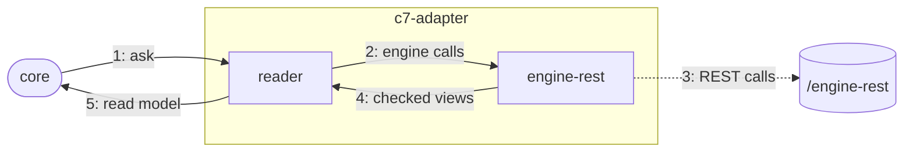

# The C7 adapter

The adapter that answers Pulse's questions and writes for Operaton, CIB seven and Camunda 7.

## Why

Operaton and CIB seven are forks of Camunda 7 and keep its REST API, so one adapter serves all
three. It calls that REST API itself with `fetch`
([c7-adapter.md](../../../../../apps/vscode/docs/adr/c7-adapter.md)), no child process, and runs
the core of the dialect family c7, `@miragon/pulse-c7-core` (the inspection of an instance, its
wait states, the target of an incident's retry, the request that holds its cause and the typing
of a written variable), which the CLI and the MCP server share; the editor hosts bundle it with
esbuild. It implements the engine contract of the engine family's core, `@miragon/pulse-engine-core`, and takes
the root cause of a failure text from its rule `RootCauses`, as c7-core does. The plug it provides,
`EngineAdapter`, is a port of the runtime view (`@miragon/pulse-runtime-view/ports`). The package
belongs to the c7 family, whose dialect it implements.

## How it works

1. The core asks a question through the `ProcessRuntime` port, e.g. "details of instance X".
2. A reader turns it into one or more engine calls and runs them in parallel where it can.
3. `engine-rest` sends them with the connection's credentials, never follows a redirect, stops after 60 s or 64 MiB; a connection for reads refuses every write.
4. It parses the JSON without losing digits and checks each field it reads.
5. The reader turns these views into the contract's read model; failures become a `RuntimeError`.

Writes (`ProcessCommands`) take the same road on a connection that may write.

## Where things are

- `packages/connectors/c7/c7-adapter/src`: `C7Adapter` builds a runtime and commands per engine connection
- `packages/connectors/c7/c7-adapter/src/reading`: one reader per question, e.g. `InstanceDetailReader`, with its own mapping
- `packages/connectors/c7/c7-adapter/src/mapping`: what several readers share: definition refs, states, timestamps, root incidents, the root cause of incident details (`RootCauses`)
- `packages/connectors/c7/c7-adapter/src/writing`, `packages/connectors/c7/c7-adapter/src/errors`: the bodies of a variable change and a move, the token a move cancels; failures to `RuntimeError`
- `packages/connectors/c7/c7-adapter/src/web-ui`: `CockpitWebUi`: links into Cockpit or the CIB seven webclient
- `packages/connectors/c7/c7-adapter/src/engine-rest`: the REST client: requests, paging, parsed and checked views
- `packages/connectors/c7/c7-adapter/src/engine-rest/inspect`: c7-core's port over `EngineHttp` (`HttpEngineTransport`); the adapter's `InspectView` is c7-core's instance view with its timeline, no mirror type

## Rules

- `packages/connectors/c7/c7-adapter/src` imports only the main entries of `@miragon/pulse-engine-core` (the contract) and `@miragon/pulse-c7-core`, the runtime view's ports and no Node built-in (dependency-cruiser); no other layer of the editor hosts imports c7-core
- Engine words are allowed here, not in contract, core or webview; classes, no comments (ESLint)

## Proven on

CI runs all conformance laws on real Operaton 2.1.5 and CIB seven 2.2.0; Camunda 7.24.0 ran
there until its image left Docker Hub in November 2026.

## More

[C7 adapter](../../../../../apps/vscode/docs/adr/c7-adapter.md) · [code structure](../../../../../apps/vscode/docs/adr/code-structure.md) · [runtime contract](../../../../../apps/vscode/docs/adr/runtime-contract.md) · [writes](../../../../../apps/vscode/docs/adr/writes.md)
