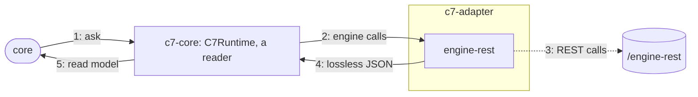

# The C7 adapter

The adapter that answers Pulse's questions and writes for Operaton, CIB seven and Camunda 7.

## Why

Operaton and CIB seven are forks of Camunda 7 and keep its REST API, so one adapter serves all
three. It calls that REST API itself through `@miragon/pulse-http`, the transport the CLI and
the MCP server send through, over the global `fetch` of its host's runtime
([c7-adapter.md](../../../../../apps/vscode/docs/adr/c7-adapter.md)), no child process, and runs
the core of the dialect family c7, `@miragon/pulse-c7-core` (the inspection of an instance, its
wait states, the target of an incident's retry, the request that holds its cause and the typing
of a written variable), which the CLI and the MCP server share; the editor hosts bundle it with
esbuild. It implements the engine contract of the engine family's core, `@miragon/pulse-engine-core`, and takes
the root cause of a failure text from its rule `RootCauses`, as c7-core does. The plug it provides,
`EngineAdapter`, is a port of the runtime view (`@miragon/pulse-runtime-view/ports`). The package
belongs to the c7 family, whose dialect it implements.

## How it works

1. The core asks a question through the `ProcessRuntime` port, e.g. "details of instance X".
2. c7-core's `C7Runtime`, which `C7Adapter` builds over the adapter's port, hands it to one of its readers, which turns it into one or more engine calls and runs them in parallel where it can.
3. `engine-rest` sends them through the transport with the connection's credentials: it never follows a redirect, stops after 60 s or 64 MiB, masks the credentials in the engine's error answers (a password of four characters or more); a connection for reads refuses every write before it leaves, as `unsupported` ("Read-only."), never as a missing resource.
4. It parses the JSON without losing digits; the reader checks each field it reads with c7-core's `JsonView`.
5. The reader turns these views into the contract's read model; a failure of the wire becomes a `RuntimeError` in the adapter's words (`ErrorTranslation.runtimeError`).

Writes (`ProcessCommands`) take the same road on a connection that may write. What a command checks
before it writes (a move's token, a migration's running instances, a refused Stop step's batch) it
reads through c7-core's reads of `./runtime` over the port of the read connection.

## Where things are

- `packages/connectors/c7/c7-adapter/src`: `C7Adapter` builds a runtime (c7-core's `C7Runtime` over the port of its wire) and commands per engine connection and names the local engine a host falls back to; `C7BpmnDialect`, the vocabulary of Camunda 7's BPMN files (the one file that imports `camunda-bpmn-moddle`'s descriptor)
- `packages/connectors/c7/c7-core/src/runtime`: c7-core's `C7Runtime`, every read of the engine contract over the adapter's port, and its readers of the engine, its processes, the counts on a diagram, the processes a version calls, the instances and their count, a version's variable names, an instance's detail (its inspection, the path from the history, its typed variables), the open incidents and an incident's details, a bulk operation and its failures, a migration's plan and its check; with them the incidents of an answer, the root incident, a version's reference, timestamps, states and the root cause of incident details (`RootCauses`); beside them the reads the commands check before a write (`findActivityTree`, `readHistoricInstances`, `readBatchStatistics`, `findHistoricBatch`)
- `packages/connectors/c7/c7-adapter/src/writing`, `packages/connectors/c7/c7-adapter/src/errors`: the bodies of a variable change and a move, the token a move cancels; failures to `RuntimeError`
- `packages/connectors/c7/c7-adapter/src/web-ui`: `CockpitWebUi`: links into Cockpit or the CIB seven webclient
- `packages/connectors/c7/c7-adapter/src/engine-rest`: the writes (`RestEngineWriter`: one method per write the commands send, a started batch's reference and an incident's root cause read by c7-core's `JsonView`, ids checked by c7-core's `isEngineId`); the wire's lossless JSON in `views`
- `packages/connectors/c7/c7-adapter/src/engine-rest/http`: the wire: `EngineHttp` over the transport, and how each of its failures reads
- `packages/connectors/c7/c7-adapter/src/engine-rest/inspect`: c7-core's port over `EngineHttp` (`HttpEngineTransport`, the routes of `CORE_ROUTES`, each sent by its method: a reading `GET`, or a reading `POST` with its body), which c7-core's readers and its inspection of an instance run on

## Rules

- `packages/connectors/c7/c7-adapter/src` imports only the main entry of `@miragon/pulse-engine-core` (the contract), the main entry and `./runtime` of `@miragon/pulse-c7-core`, the runtime view's ports, in its BPMN dialect the descriptor of `camunda-bpmn-moddle`, in its wire (`src/engine-rest/http`) the main entry of `@miragon/pulse-http`, and no Node built-in (dependency-cruiser); no other layer of the editor hosts imports c7-core or the transport
- Engine words are allowed here, not in contract, core or webview; classes, no comments (ESLint)

## Proven on

CI runs all conformance laws on real Operaton 2.1.5 and CIB seven 2.2.0, the read laws a second
time on each at history level AUDIT, where the history keeps no incident: "with incident" is the
runtime's open incidents, c7-core's rule, on every history level. Camunda 7.24.0 ran there until its
image left Docker Hub in November 2026. The reads are c7-core's `C7Runtime`, which the same read
laws also run over a second wire, the MCP server's generated SDK, on both images
(`packages/connectors/engine/engine-connector/src/lib/core-adapter/c7-runtime.engine.test.ts`):
one implementation, proven on both C7 wires.

## More

[C7 adapter](../../../../../apps/vscode/docs/adr/c7-adapter.md) · [code structure](../../../../../apps/vscode/docs/adr/code-structure.md) · [runtime contract](../../../../../apps/vscode/docs/adr/runtime-contract.md) · [writes](../../../../../apps/vscode/docs/adr/writes.md)
