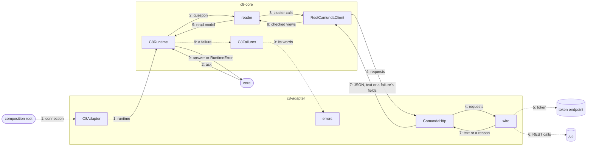

# The C8 adapter

The adapter that reads Camunda 8 for Pulse's questions, on SaaS and Self-Managed, from 8.9 on.

## Why

Camunda 8 has another API than the C7 family, so it gets an adapter of its own that shares no code
with the C7 one. Its reads are its family's core, `@miragon/pulse-c8-core` (the runtime, the kind
of each failure, the REST client, the readers, the mappings), over a transport port that carries
fields only. The adapter is a plug that brings the wire behind that port and the words of its
failures: it calls the Orchestration Cluster REST API itself through
`@miragon/pulse-http`, the transport the CLI and the MCP server send through, over the global
`fetch` of its host's runtime ([c8-adapter.md](../../../../../apps/vscode/docs/adr/c8-adapter.md)):
no client library and no child process. Its tokens come from the transport's OAuth client.

## How it works

1. A composition root hands `C8Adapter` a connection; `runtime(connection)` builds c8-core's `C8Runtime` over the connection's transport from its `CamundaTransports` and the adapter's words, so every runtime shares the adapter's token sources.
2. The core asks through the `ProcessRuntime` port; the runtime checks the version floor and hands the question to its reader.
3. The reader (c8-core) asks the REST client for what it needs, e.g. "the open incidents of instance X".
4. The REST client turns that into requests to the transport port, which `CamundaHttp` implements over the wire: a GET, a search as a reading POST, or a diagram's XML.
5. With client credentials the wire gets a token from the connection's token source, one per cluster and client.
6. It sends the request on a read-only connection, never follows a redirect, stops after the profile's `timeout` (60 s without one; a token request at most 30 s) or 64 MiB.
7. It answers with the text or with a reason, data that names no type of the transport; `CamundaHttp` reads JSON losslessly or throws a `CamundaRequestError`, whose fields (`CamundaFailure`) the port hands c8-core, which reads a missing resource from them.
8. The REST client checks each field it reads.
9. The reader maps the views onto engine-core's read models. A failure becomes a `RuntimeError`, which the runtime throws: `C8Failures` decides its kind from the port's fields and adds what holds on every surface (the `/v2` hint, no secondary storage), and the adapter's `errors` give its message and its way out.

## Where things are

- `packages/connectors/c8/c8-adapter/src`: `C8Adapter`, the plug of the ports, which builds c8-core's `C8Runtime`; `CamundaTransports`, which builds the transport of a connection and holds the token sources; `C8BpmnDialect`, the vocabulary of Camunda 8's BPMN files (the one file that imports `zeebe-bpmn-moddle`'s descriptor)
- `packages/connectors/c8/c8-adapter/src/web-ui`: `OperateWebUi`, the links into Operate
- `packages/connectors/c8/c8-adapter/src/wire`: `CamundaWire` over the transport, the token sources and the reasons of each failure
- `packages/connectors/c8/c8-adapter/src/rest`: `CamundaHttp`, c8-core's `CamundaTransport` over the wire, and `CamundaRequestError`, the wire's error with its words and the fields the port copies
- `packages/connectors/c8/c8-adapter/src/errors`: `ErrorTranslation` and `TokenTexts`, the words of a failure, its message and its way out
- `packages/connectors/c8/c8-core/src`: `C8Runtime`, which answers the contract with the readers after the version floor, and `C8Failures`, the kind of each failure; the REST client (`src/rest`: requests, paging, parsed and checked views), one reader per question (`src/reading`) and the mappings onto engine-core's read models (`src/mapping`)

## Rules

- `packages/connectors/c8/c8-adapter/src` imports only the main entries of engine-core and c8-core, the runtime view's ports, in its BPMN dialect the descriptor of `zeebe-bpmn-moddle` and, in its wire, the main entry and `./oauth` of `@miragon/pulse-http`; no Node built-in, no c7 package (dependency-cruiser)
- Engine words are allowed here, not in contract, core or webview; classes, no comments (ESLint)
- A secret never appears in an error, and a refused token request is not repeated within its hold
- A key that is no Java long names nothing and costs no call; a capped search says so where the contract has room for it (`truncated`, `atLeast`) or keeps the cluster's counts

## More

[C8 adapter](../../../../../apps/vscode/docs/adr/c8-adapter.md) · [code structure](../../../../../apps/vscode/docs/adr/code-structure.md) · [runtime contract](../../../../../apps/vscode/docs/adr/runtime-contract.md)
